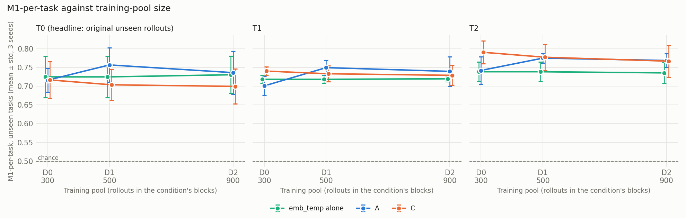
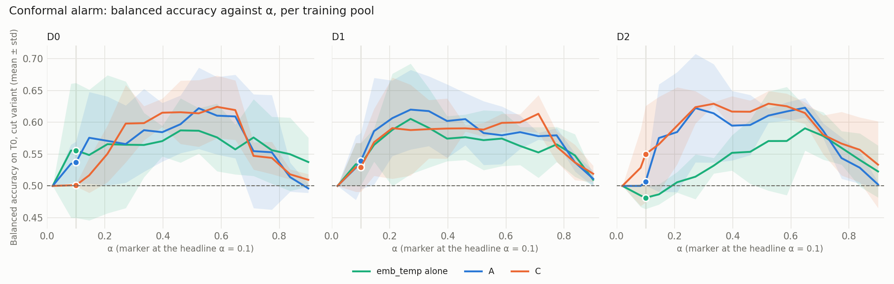
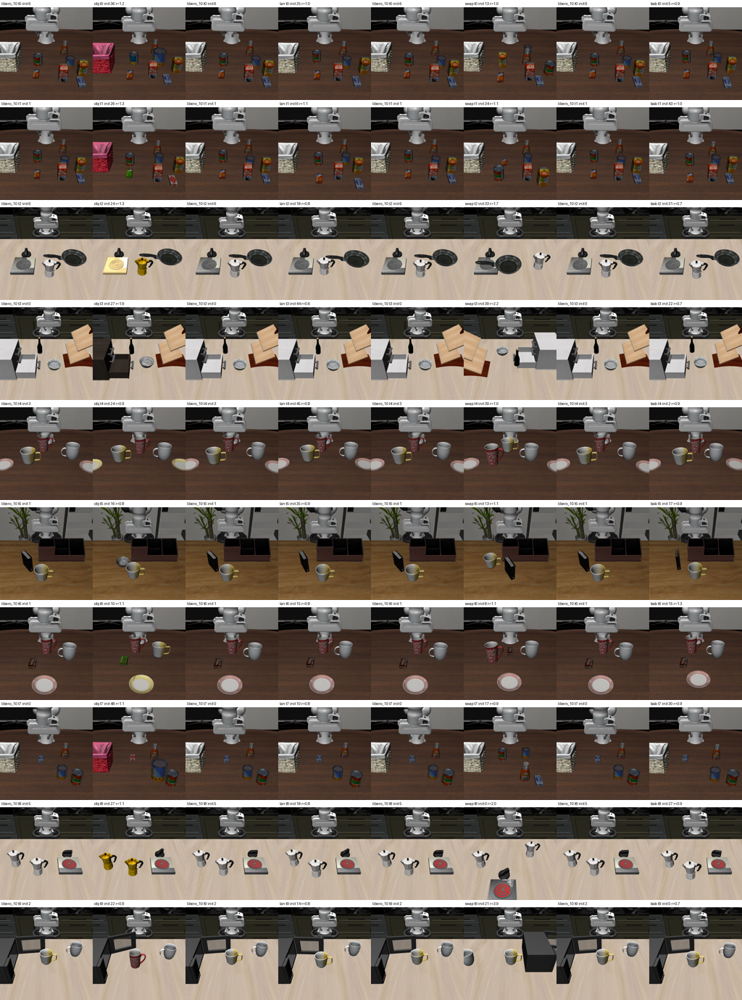

# More-data run: does more data improve the detectors?

*Generated 2026-10-12 11:24 UTC by `analysis/abc2/report2.py` from `results/abc2`. Spec: more_data_collection.md (handoff v1), section 5. Numbers to 3 d.p.; ± is the std over seeds.*

## 1. Headline

By Step 9's rule, 3 of 18 comparisons on T0 (training pools of D0 300, D1 500, D2 900 rollouts) are improvements (D1 - D0 C share of failures caught, D2 - D0 C balanced accuracy, D2 - D0 C share of failures caught) and 5 are significant worsenings; the rest show no significant change.

Ranking (M1-per-task on T0): D1 - D0 showed no significant change for any detector (point differences -0.013 to +0.041); D2 - D0 showed no significant change for any detector (point differences -0.017 to +0.020).

Alarm at α = 0.1 (cut variant): D1 - D0 balanced accuracy showed no significant change for any detector (point differences -0.022 to +0.028); D1 - D0 share of failures caught improved for C (+0.083 [+0.024, +0.120]); was significantly worse for emb_temp alone (-0.139 [-0.201, -0.060]); D2 - D0 balanced accuracy improved for C (+0.049 [+0.005, +0.081]); was significantly worse for A (-0.030 [-0.068, -0.004]), emb_temp alone (-0.074 [-0.114, -0.032]); D2 - D0 share of failures caught improved for C (+0.154 [+0.076, +0.204]); was significantly worse for A (-0.060 [-0.134, -0.016]), emb_temp alone (-0.199 [-0.247, -0.132]).

*Differences are x − y (positive = the larger pool is better); point difference on the original sample with the bootstrap 95% percentile interval.*

**Reading notes (lead, written after checking the numbers).**

- **Plain answer.** More data did **not** improve ranking on T0: all six M1-per-task differences (A, C, emb_temp alone; D1 − D0 and D2 − D0) have 95% intervals that include zero (A +0.041 / +0.020, C −0.013 / −0.017, emb_temp +0.000 / +0.006). For the alarm at α = 0.1 the result is mixed: C catches more failures with larger pools (D2 − D0 +0.154, higher in all three seeds), while A and emb_temp alone catch fewer.
- **Read the alarm verdicts as calibration-sensitive.** The bootstrap resamples test rollouts with each seed's conformal band held fixed, so it does not capture variability from the training and calibration sets. Seed-to-seed spread is large: emb_temp alone on D0 catches 0.00 / 0.68 / 0.00 of failures in seeds 0 / 1 / 2. Its scores are identical in D0 and D1 (no training, same layer 28), so its "significant worsening" comes entirely from the band changing as calibration successes are added (37 → 58 → 92 rollouts), and almost entirely from D0 seed 1. In seeds 0 and 2, D1 catches more (0.07, 0.19 vs 0.00). A's worsening is similar in kind (D0 seeds 0.10 / 0.16 / 0.00 vs D2 0.02 / 0.00 / 0.05).
- **The alarm stays weak in every condition.** At α = 0.1 (cut variant), no detector catches more than about one T0 failure in five before the cut, and balanced accuracy stays between 0.48 and 0.59.
- **T1 / T2.** These sets add new unseen rollouts. A's M1-per-task improves for D1 on T1 and T2, but not on T0 (the headline set). C's never improves on any set.
- **MLP (Step 10).** SAFE's training code is not on the box, so the handoff's fallback hyperparameters were used. The weight-decay grid is nearly inert under AdamW (lr × wd ≤ 1e-3 per step). Early stopping picked epochs 1–8. Eval-seen picks both the epoch and the weight decay, so eval-seen MLP numbers are optimistic; T0–T2 are clean.
- **B (Step 11)** passes its D0 check only with the joint H = 0/10/25 grid fit that abc used (only the H = 10 outputs are kept); see section 10.

## 2. Rollouts collected

Per block (block `ori` = the existing 300 rollouts). `failed`: raised twice and logged; `not run`: planned but never attempted. Table: `report_tables/corpus_block.csv`.

| Block | Role | Planned | Collected | Successes / total | Success rate | Failed | Not run | Cells skipped |
|---|---|---|---|---|---|---|---|---|
| ori | training | 300 | 300 | 137/300 | 0.457 | 0 | 0 | 0 |
| ori2 | training | 200 | 200 | 91/200 | 0.455 | 0 | 0 | 0 |
| obj | training | 200 | 200 | 47/200 | 0.235 | 0 | 0 | 0 |
| lan | training | 200 | 200 | 85/200 | 0.425 | 0 | 0 | 0 |
| swap | stress | 50 | 50 | 0/50 | 0.000 | 0 | 0 | 0 |
| task | stress | 50 | 50 | 4/50 | 0.080 | 0 | 0 | 0 |
| all_new |  | 700 | 700 | 227/700 | 0.324 | 0 | 0 | 0 |

Per (block, task): successes / collected, with the plan where it was not met. Table: `report_tables/corpus_block_task.csv`.

| Task | ori | ori2 | obj | lan | swap | task |
|---|---|---|---|---|---|---|
| 0 | 11/30 | 13/20 | 0/20 | 7/20 | 0/5 | 3/5 |
| 1 | 24/30 | 13/20 | 14/20 | 13/20 | 0/5 | 0/5 |
| 2 | 16/30 | 9/20 | 9/20 | 11/20 | 0/5 | 0/5 |
| 3 | 5/30 | 3/20 | 8/20 | 7/20 | 0/5 | 0/5 |
| 4 | 8/30 | 3/20 | 6/20 | 1/20 | 0/5 | 0/5 |
| 5 | 22/30 | 13/20 | 0/20 | 13/20 | 0/5 | 0/5 |
| 6 | 13/30 | 13/20 | 4/20 | 5/20 | 0/5 | 0/5 |
| 7 | 15/30 | 11/20 | 0/20 | 15/20 | 0/5 | 0/5 |
| 8 | 10/30 | 5/20 | 4/20 | 4/20 | 0/5 | 1/5 |
| 9 | 13/30 | 8/20 | 2/20 | 9/20 | 0/5 | 0/5 |

**Collection.** Started 2026-10-11T12:04:06+00:00, last rollout finished 2026-10-12T08:18:15.317564+00:00: **20.236 h** (696 rollouts in that window, 34.39/h; plus 4 smoke-test rollouts before the start). COLLECT_HOURS_MAX 36 h, reached: no. Disk-headroom stops: 0. Failures logged: 0.

**Skipped cells** (3 failures in a row): none.

**Demotions** (Step 5: `obj` or `lan` with overall success below 10% or above 90% becomes stress-test only): none (success rates: obj 0.235, lan 0.425).

**`lan` near-duplicate check.** 200 of 200 `lan` rollouts have an unperturbed partner (same base task and init-state index). Share of the 520 steps with all 7 action tokens identical: **mean 0.022, median 0.000** against the partner; mean 0.022 against the same task's unperturbed rollouts at other init states. **Reference value** (all pairs of unperturbed rollouts of one task at different init states, 12250 pairs): mean 0.021, median 0.000.

> **Caveat.** LIBERO-PRO's libero_10_lan init states are fresh draws, not the libero_10 states (RUNLOG Step 1.4: no row of any perturbed suite's init file matches a libero_10 state). A lan rollout and its 'partner' (same base task, same init_state_index) therefore do NOT share a scene; the handoff's near-duplicate premise does not hold. Read the pair figure against `reference` (unperturbed pairs of one task at different init states) and `lan_vs_nonpartner`: if they are about equal, the lan block is not a near-duplicate of the unperturbed rollouts.

## 3. Ranking (M1, mean ± std over seeds)

M1-per-task = within-cell ROC-AUC averaged over cells with ≥ 2 rollouts of each class (the number claims rest on). Pooled M1 and the timestep-only floor on T0. Cells averaged per seed for T0 / T1 / T2. Table: `report_tables/ranking.csv`.

| Detector | Pool | M1/task T0 | M1/task T1 | M1/task T2 | M1 pooled T0 | Floor T0 | Cells per seed (T0 / T1 / T2) |
|---|---|---|---|---|---|---|---|
| emb_temp alone (emb_temp[28]) | D0 | 0.725 ± 0.055 | 0.719 ± 0.010 | 0.739 ± 0.026 | 0.719 ± 0.036 | 0.547 | 3 3 3 / 3 3 3 / 8 7 9 |
| emb_temp alone (emb_temp[28]) | D1 | 0.725 ± 0.055 | 0.719 ± 0.010 | 0.739 ± 0.026 | 0.719 ± 0.036 | 0.547 | 3 3 3 / 3 3 3 / 8 7 9 |
| emb_temp alone (emb_temp[29]) | D2 | 0.731 ± 0.050 | 0.720 ± 0.007 | 0.736 ± 0.028 | 0.723 ± 0.030 | 0.547 | 3 3 3 / 3 3 3 / 8 7 9 |
| A | D0 | 0.716 ± 0.032 | 0.701 ± 0.025 | 0.742 ± 0.036 | 0.727 ± 0.014 | 0.547 | 3 3 3 / 3 3 3 / 8 7 9 |
| A | D1 | 0.757 ± 0.046 | 0.750 ± 0.020 | 0.775 ± 0.013 | 0.696 ± 0.090 | 0.547 | 3 3 3 / 3 3 3 / 8 7 9 |
| A | D2 | 0.736 ± 0.058 | 0.740 ± 0.040 | 0.769 ± 0.018 | 0.749 ± 0.043 | 0.547 | 3 3 3 / 3 3 3 / 8 7 9 |
| C | D0 | 0.717 ± 0.049 | 0.741 ± 0.011 | 0.791 ± 0.030 | 0.704 ± 0.070 | 0.547 | 3 3 3 / 3 3 3 / 8 7 9 |
| C | D1 | 0.704 ± 0.041 | 0.733 ± 0.021 | 0.778 ± 0.035 | 0.720 ± 0.043 | 0.547 | 3 3 3 / 3 3 3 / 8 7 9 |
| C | D2 | 0.700 ± 0.047 | 0.729 ± 0.026 | 0.767 ± 0.043 | 0.752 ± 0.014 | 0.547 | 3 3 3 / 3 3 3 / 8 7 9 |

## 4. Alarm at α = 0.1 (cut variant, mean ± std over seeds)

Balanced accuracy = (share of failures caught + share of successes not flagged) / 2; false-alarm rate on successes; detection time = first alarm ÷ cut, 1 if never (mean over failures); calibration rollouts = the condition's successful eval-seen rollouts. Table: `report_tables/alarm.csv`.

**T0**

| Detector | Pool | Balanced acc. | Failures caught | False alarms (succ.) | Detection time | Calib. rollouts | Test rollouts |
|---|---|---|---|---|---|---|---|
| emb_temp alone (emb_temp[28]) | D0 | 0.556 ± 0.106 | 0.226 ± 0.391 | 0.114 ± 0.180 | 0.851 ± 0.257 | 37.0 | 90 |
| emb_temp alone (emb_temp[28]) | D1 | 0.534 ± 0.033 | 0.087 ± 0.096 | 0.019 ± 0.033 | 0.960 ± 0.035 | 57.7 | 90 |
| emb_temp alone (emb_temp[29]) | D2 | 0.481 ± 0.018 | 0.027 ± 0.047 | 0.064 ± 0.078 | 0.977 ± 0.039 | 92.0 | 90 |
| A | D0 | 0.537 ± 0.033 | 0.086 ± 0.081 | 0.012 ± 0.021 | 0.963 ± 0.045 | 37.0 | 90 |
| A | D1 | 0.539 ± 0.044 | 0.111 ± 0.090 | 0.033 ± 0.029 | 0.943 ± 0.028 | 57.7 | 90 |
| A | D2 | 0.507 ± 0.006 | 0.026 ± 0.027 | 0.013 ± 0.022 | 0.985 ± 0.025 | 92.0 | 90 |
| C | D0 | 0.501 ± 0.002 | 0.027 ± 0.047 | 0.025 ± 0.044 | 0.979 ± 0.036 | 37.0 | 90 |
| C | D1 | 0.529 ± 0.038 | 0.110 ± 0.095 | 0.051 ± 0.071 | 0.940 ± 0.064 | 57.7 | 90 |
| C | D2 | 0.550 ± 0.076 | 0.181 ± 0.130 | 0.081 ± 0.111 | 0.910 ± 0.063 | 92.0 | 90 |

**T1**

| Detector | Pool | Balanced acc. | Failures caught | False alarms (succ.) | Detection time | Calib. rollouts | Test rollouts |
|---|---|---|---|---|---|---|---|
| emb_temp alone (emb_temp[28]) | D0 | 0.555 ± 0.099 | 0.237 ± 0.397 | 0.127 ± 0.199 | 0.847 ± 0.252 | 37.0 | 150 |
| emb_temp alone (emb_temp[28]) | D1 | 0.524 ± 0.023 | 0.072 ± 0.063 | 0.023 ± 0.030 | 0.944 ± 0.049 | 57.7 | 150 |
| emb_temp alone (emb_temp[29]) | D2 | 0.499 ± 0.009 | 0.059 ± 0.089 | 0.061 ± 0.077 | 0.952 ± 0.071 | 92.0 | 150 |
| A | D0 | 0.540 ± 0.038 | 0.098 ± 0.086 | 0.019 ± 0.023 | 0.948 ± 0.045 | 37.0 | 150 |
| A | D1 | 0.546 ± 0.054 | 0.143 ± 0.107 | 0.050 ± 0.006 | 0.915 ± 0.054 | 57.7 | 150 |
| A | D2 | 0.520 ± 0.020 | 0.052 ± 0.057 | 0.011 ± 0.020 | 0.966 ± 0.052 | 92.0 | 150 |
| C | D0 | 0.517 ± 0.015 | 0.057 ± 0.056 | 0.023 ± 0.039 | 0.956 ± 0.045 | 37.0 | 150 |
| C | D1 | 0.543 ± 0.046 | 0.144 ± 0.125 | 0.057 ± 0.079 | 0.909 ± 0.094 | 57.7 | 150 |
| C | D2 | 0.548 ± 0.032 | 0.185 ± 0.098 | 0.090 ± 0.091 | 0.896 ± 0.078 | 92.0 | 150 |

**T2**

| Detector | Pool | Balanced acc. | Failures caught | False alarms (succ.) | Detection time | Calib. rollouts | Test rollouts |
|---|---|---|---|---|---|---|---|
| emb_temp alone (emb_temp[28]) | D0 | 0.548 ± 0.081 | 0.250 ± 0.379 | 0.154 ± 0.217 | 0.826 ± 0.248 | 37.0 | 270 |
| emb_temp alone (emb_temp[28]) | D1 | 0.543 ± 0.013 | 0.129 ± 0.024 | 0.043 ± 0.038 | 0.922 ± 0.047 | 57.7 | 270 |
| emb_temp alone (emb_temp[29]) | D2 | 0.529 ± 0.022 | 0.122 ± 0.053 | 0.065 ± 0.063 | 0.917 ± 0.060 | 92.0 | 270 |
| A | D0 | 0.573 ± 0.082 | 0.162 ± 0.175 | 0.017 ± 0.015 | 0.935 ± 0.069 | 37.0 | 270 |
| A | D1 | 0.587 ± 0.075 | 0.224 ± 0.178 | 0.051 ± 0.032 | 0.871 ± 0.122 | 57.7 | 270 |
| A | D2 | 0.571 ± 0.049 | 0.151 ± 0.087 | 0.009 ± 0.016 | 0.946 ± 0.024 | 92.0 | 270 |
| C | D0 | 0.564 ± 0.043 | 0.149 ± 0.067 | 0.021 ± 0.030 | 0.940 ± 0.032 | 37.0 | 270 |
| C | D1 | 0.607 ± 0.071 | 0.274 ± 0.169 | 0.060 ± 0.056 | 0.870 ± 0.092 | 57.7 | 270 |
| C | D2 | 0.615 ± 0.032 | 0.324 ± 0.025 | 0.094 ± 0.067 | 0.836 ± 0.067 | 92.0 | 270 |

## 5. Paired differences (95% intervals)

Paired bootstrap (1000 resamples of rollouts within each cell within each seed, rng seed 20261011; both sides recomputed on the same resample, then averaged over seeds). Difference = x − y. Verdict by Step 9's rule: improvement only if the 95% interval lies above zero; an interval below zero is a significant worsening.
Correctness check: on the identity resample the recomputation reproduces the pipeline's per-seed and mean T0 numbers (max |diff| 5.9e-07, tolerance 1e-06).

**T0** (`report_tables/paired_T0.csv`)

| x − y | Detector | Metric | y | x | Point diff | Boot. mean diff | 95% interval | Verdict |
|---|---|---|---|---|---|---|---|---|
| D1 - D0 | A | M1-per-task | 0.716 | 0.757 | +0.041 | +0.042 | [-0.011, +0.101] | no significant change |
| D1 - D0 | A | balanced accuracy, α 0.1 (cut) | 0.537 | 0.539 | +0.002 | -0.004 | [-0.037, +0.029] | no significant change |
| D1 - D0 | A | share of failures caught, α 0.1 (cut) | 0.086 | 0.111 | +0.025 | +0.014 | [-0.047, +0.071] | no significant change |
| D1 - D0 | C | M1-per-task | 0.717 | 0.704 | -0.013 | -0.013 | [-0.041, +0.012] | no significant change |
| D1 - D0 | C | balanced accuracy, α 0.1 (cut) | 0.501 | 0.529 | +0.028 | +0.024 | [-0.003, +0.050] | no significant change |
| D1 - D0 | C | share of failures caught, α 0.1 (cut) | 0.027 | 0.110 | +0.083 | +0.073 | [+0.024, +0.120] | **improvement** |
| D1 - D0 | emb_temp alone | M1-per-task | 0.725 | 0.725 | +0.000 | +0.000 | [+0.000, +0.000] | no significant change |
| D1 - D0 | emb_temp alone | balanced accuracy, α 0.1 (cut) | 0.556 | 0.534 | -0.022 | -0.021 | [-0.063, +0.025] | no significant change |
| D1 - D0 | emb_temp alone | share of failures caught, α 0.1 (cut) | 0.226 | 0.087 | -0.139 | -0.136 | [-0.201, -0.060] | **significant worsening** |
| D2 - D0 | A | M1-per-task | 0.716 | 0.736 | +0.020 | +0.021 | [-0.036, +0.079] | no significant change |
| D2 - D0 | A | balanced accuracy, α 0.1 (cut) | 0.537 | 0.507 | -0.030 | -0.035 | [-0.068, -0.004] | **significant worsening** |
| D2 - D0 | A | share of failures caught, α 0.1 (cut) | 0.086 | 0.026 | -0.060 | -0.070 | [-0.134, -0.016] | **significant worsening** |
| D2 - D0 | C | M1-per-task | 0.717 | 0.700 | -0.017 | -0.016 | [-0.060, +0.027] | no significant change |
| D2 - D0 | C | balanced accuracy, α 0.1 (cut) | 0.501 | 0.550 | +0.049 | +0.044 | [+0.005, +0.081] | **improvement** |
| D2 - D0 | C | share of failures caught, α 0.1 (cut) | 0.027 | 0.181 | +0.154 | +0.144 | [+0.076, +0.204] | **improvement** |
| D2 - D0 | emb_temp alone | M1-per-task | 0.725 | 0.731 | +0.006 | +0.005 | [-0.008, +0.018] | no significant change |
| D2 - D0 | emb_temp alone | balanced accuracy, α 0.1 (cut) | 0.556 | 0.481 | -0.074 | -0.074 | [-0.114, -0.032] | **significant worsening** |
| D2 - D0 | emb_temp alone | share of failures caught, α 0.1 (cut) | 0.226 | 0.027 | -0.199 | -0.198 | [-0.247, -0.132] | **significant worsening** |

**T1** (`report_tables/paired_T1.csv`)

| x − y | Detector | Metric | y | x | Point diff | Boot. mean diff | 95% interval | Verdict |
|---|---|---|---|---|---|---|---|---|
| D1 - D0 | A | M1-per-task | 0.701 | 0.750 | +0.049 | +0.050 | [+0.005, +0.098] | **improvement** |
| D1 - D0 | A | balanced accuracy, α 0.1 (cut) | 0.540 | 0.546 | +0.007 | +0.003 | [-0.025, +0.028] | no significant change |
| D1 - D0 | A | share of failures caught, α 0.1 (cut) | 0.098 | 0.143 | +0.044 | +0.038 | [-0.006, +0.078] | no significant change |
| D1 - D0 | C | M1-per-task | 0.741 | 0.733 | -0.007 | -0.008 | [-0.025, +0.010] | no significant change |
| D1 - D0 | C | balanced accuracy, α 0.1 (cut) | 0.517 | 0.543 | +0.026 | +0.024 | [+0.001, +0.047] | **improvement** |
| D1 - D0 | C | share of failures caught, α 0.1 (cut) | 0.057 | 0.144 | +0.087 | +0.082 | [+0.042, +0.123] | **improvement** |
| D1 - D0 | emb_temp alone | M1-per-task | 0.719 | 0.719 | +0.000 | +0.000 | [+0.000, +0.000] | no significant change |
| D1 - D0 | emb_temp alone | balanced accuracy, α 0.1 (cut) | 0.555 | 0.524 | -0.031 | -0.028 | [-0.062, +0.010] | no significant change |
| D1 - D0 | emb_temp alone | share of failures caught, α 0.1 (cut) | 0.237 | 0.072 | -0.165 | -0.159 | [-0.208, -0.093] | **significant worsening** |
| D2 - D0 | A | M1-per-task | 0.701 | 0.740 | +0.039 | +0.040 | [-0.008, +0.091] | no significant change |
| D2 - D0 | A | balanced accuracy, α 0.1 (cut) | 0.540 | 0.520 | -0.019 | -0.023 | [-0.049, +0.003] | no significant change |
| D2 - D0 | A | share of failures caught, α 0.1 (cut) | 0.098 | 0.052 | -0.046 | -0.052 | [-0.099, -0.007] | **significant worsening** |
| D2 - D0 | C | M1-per-task | 0.741 | 0.729 | -0.011 | -0.011 | [-0.042, +0.019] | no significant change |
| D2 - D0 | C | balanced accuracy, α 0.1 (cut) | 0.517 | 0.548 | +0.030 | +0.033 | [-0.001, +0.062] | no significant change |
| D2 - D0 | C | share of failures caught, α 0.1 (cut) | 0.057 | 0.185 | +0.128 | +0.132 | [+0.080, +0.182] | **improvement** |
| D2 - D0 | emb_temp alone | M1-per-task | 0.719 | 0.720 | +0.001 | +0.000 | [-0.007, +0.007] | no significant change |
| D2 - D0 | emb_temp alone | balanced accuracy, α 0.1 (cut) | 0.555 | 0.499 | -0.056 | -0.057 | [-0.089, -0.020] | **significant worsening** |
| D2 - D0 | emb_temp alone | share of failures caught, α 0.1 (cut) | 0.237 | 0.059 | -0.178 | -0.179 | [-0.218, -0.132] | **significant worsening** |

**T2** (`report_tables/paired_T2.csv`)

| x − y | Detector | Metric | y | x | Point diff | Boot. mean diff | 95% interval | Verdict |
|---|---|---|---|---|---|---|---|---|
| D1 - D0 | A | M1-per-task | 0.742 | 0.775 | +0.033 | +0.037 | [+0.004, +0.073] | **improvement** |
| D1 - D0 | A | balanced accuracy, α 0.1 (cut) | 0.573 | 0.587 | +0.014 | +0.014 | [-0.008, +0.042] | no significant change |
| D1 - D0 | A | share of failures caught, α 0.1 (cut) | 0.162 | 0.224 | +0.062 | +0.062 | [+0.026, +0.120] | **improvement** |
| D1 - D0 | C | M1-per-task | 0.791 | 0.778 | -0.013 | -0.014 | [-0.031, +0.002] | no significant change |
| D1 - D0 | C | balanced accuracy, α 0.1 (cut) | 0.564 | 0.607 | +0.043 | +0.039 | [+0.019, +0.059] | **improvement** |
| D1 - D0 | C | share of failures caught, α 0.1 (cut) | 0.149 | 0.274 | +0.125 | +0.117 | [+0.078, +0.154] | **improvement** |
| D1 - D0 | emb_temp alone | M1-per-task | 0.739 | 0.739 | +0.000 | +0.000 | [+0.000, +0.000] | no significant change |
| D1 - D0 | emb_temp alone | balanced accuracy, α 0.1 (cut) | 0.548 | 0.543 | -0.005 | +0.004 | [-0.026, +0.034] | no significant change |
| D1 - D0 | emb_temp alone | share of failures caught, α 0.1 (cut) | 0.250 | 0.129 | -0.121 | -0.103 | [-0.147, -0.056] | **significant worsening** |
| D2 - D0 | A | M1-per-task | 0.742 | 0.769 | +0.027 | +0.032 | [-0.011, +0.080] | no significant change |
| D2 - D0 | A | balanced accuracy, α 0.1 (cut) | 0.573 | 0.571 | -0.002 | +0.002 | [-0.020, +0.028] | no significant change |
| D2 - D0 | A | share of failures caught, α 0.1 (cut) | 0.162 | 0.151 | -0.011 | -0.002 | [-0.045, +0.054] | no significant change |
| D2 - D0 | C | M1-per-task | 0.791 | 0.767 | -0.024 | -0.024 | [-0.051, +0.003] | no significant change |
| D2 - D0 | C | balanced accuracy, α 0.1 (cut) | 0.564 | 0.615 | +0.051 | +0.048 | [+0.024, +0.073] | **improvement** |
| D2 - D0 | C | share of failures caught, α 0.1 (cut) | 0.149 | 0.324 | +0.175 | +0.168 | [+0.126, +0.208] | **improvement** |
| D2 - D0 | emb_temp alone | M1-per-task | 0.739 | 0.736 | -0.003 | -0.003 | [-0.011, +0.003] | no significant change |
| D2 - D0 | emb_temp alone | balanced accuracy, α 0.1 (cut) | 0.548 | 0.529 | -0.019 | -0.017 | [-0.046, +0.012] | no significant change |
| D2 - D0 | emb_temp alone | share of failures caught, α 0.1 (cut) | 0.250 | 0.122 | -0.128 | -0.124 | [-0.160, -0.087] | **significant worsening** |

## 6. Stress test (share flagged before the cut, α = 0.1, mean ± std over seeds)

`seen` / `unseen`: stress rollouts whose base task is seen / unseen in that seed's split. A rollout's cut is its base task's unperturbed-cell cut (eval-seen for seen tasks, T1 for unseen). Nearly all stress rollouts fail, so this is the share of (mostly) failures flagged in time. Table: `report_tables/stress.csv`.

| Detector | Pool | seen all (n 70) | seen swap (n 35) | seen task (n 35) | unseen all (n 30) | unseen swap (n 15) | unseen task (n 15) |
|---|---|---|---|---|---|---|---|
| emb_temp alone (emb_temp[28]) | D0 | 0.271 ± 0.333 | 0.343 ± 0.375 | 0.200 ± 0.298 | 0.356 ± 0.386 | 0.489 ± 0.468 | 0.222 ± 0.329 |
| emb_temp alone (emb_temp[28]) | D1 | 0.262 ± 0.119 | 0.400 ± 0.223 | 0.124 ± 0.044 | 0.256 ± 0.236 | 0.467 ± 0.416 | 0.044 ± 0.077 |
| emb_temp alone (emb_temp[29]) | D2 | 0.224 ± 0.119 | 0.343 ± 0.216 | 0.105 ± 0.044 | 0.200 ± 0.173 | 0.378 ± 0.329 | 0.022 ± 0.038 |
| A | D0 | 0.238 ± 0.206 | 0.352 ± 0.306 | 0.124 ± 0.108 | 0.133 ± 0.153 | 0.200 ± 0.240 | 0.067 ± 0.067 |
| A | D1 | 0.329 ± 0.065 | 0.448 ± 0.044 | 0.210 ± 0.115 | 0.244 ± 0.204 | 0.400 ± 0.267 | 0.089 ± 0.154 |
| A | D2 | 0.219 ± 0.169 | 0.267 ± 0.216 | 0.171 ± 0.125 | 0.133 ± 0.120 | 0.244 ± 0.234 | 0.022 ± 0.038 |
| C | D0 | 0.233 ± 0.128 | 0.390 ± 0.240 | 0.076 ± 0.033 | 0.122 ± 0.135 | 0.222 ± 0.278 | 0.022 ± 0.038 |
| C | D1 | 0.314 ± 0.196 | 0.457 ± 0.325 | 0.171 ± 0.099 | 0.222 ± 0.192 | 0.356 ± 0.308 | 0.089 ± 0.077 |
| C | D2 | 0.319 ± 0.144 | 0.476 ± 0.115 | 0.162 ± 0.172 | 0.300 ± 0.186 | 0.422 ± 0.252 | 0.178 ± 0.139 |

## 7. MLP ablation and B (H = 10)

### MLP ablation (Step 10)

**MLP: ranking (M1)**

M1-per-task = within-cell ROC-AUC averaged over cells with ≥ 2 rollouts of each class (the number claims rest on). Pooled M1 and the timestep-only floor on T0. Cells averaged per seed for T0 / T1 / T2. Table: `report_tables/mlp_ranking.csv`.

| Detector | Pool | M1/task T0 | M1/task T1 | M1/task T2 | M1 pooled T0 | Floor T0 | Cells per seed (T0 / T1 / T2) |
|---|---|---|---|---|---|---|---|
| A-MLP | D0 | 0.686 ± 0.035 | 0.665 ± 0.007 | 0.669 ± 0.056 | 0.715 ± 0.032 | 0.547 | 3 3 3 / 3 3 3 / 8 7 9 |
| A-MLP | D2 | 0.642 ± 0.090 | 0.674 ± 0.066 | 0.709 ± 0.034 | 0.721 ± 0.069 | 0.547 | 3 3 3 / 3 3 3 / 8 7 9 |
| C-MLP | D0 | 0.717 ± 0.035 | 0.735 ± 0.019 | 0.761 ± 0.008 | 0.748 ± 0.044 | 0.547 | 3 3 3 / 3 3 3 / 8 7 9 |
| C-MLP | D2 | 0.732 ± 0.045 | 0.743 ± 0.017 | 0.784 ± 0.036 | 0.779 ± 0.031 | 0.547 | 3 3 3 / 3 3 3 / 8 7 9 |

**MLP: alarm at α = 0.1 (cut)**

Balanced accuracy = (share of failures caught + share of successes not flagged) / 2; false-alarm rate on successes; detection time = first alarm ÷ cut, 1 if never (mean over failures); calibration rollouts = the condition's successful eval-seen rollouts. Table: `report_tables/mlp_alarm.csv`.

**T0**

| Detector | Pool | Balanced acc. | Failures caught | False alarms (succ.) | Detection time | Calib. rollouts | Test rollouts |
|---|---|---|---|---|---|---|---|
| A-MLP | D0 | 0.516 ± 0.018 | 0.033 ± 0.036 | 0.000 ± 0.000 | 0.999 ± 0.001 | 37.0 | 90 |
| A-MLP | D2 | 0.546 ± 0.034 | 0.160 ± 0.102 | 0.067 ± 0.066 | 0.901 ± 0.067 | 92.0 | 90 |
| C-MLP | D0 | 0.591 ± 0.108 | 0.207 ± 0.226 | 0.025 ± 0.009 | 0.893 ± 0.124 | 37.0 | 90 |
| C-MLP | D2 | 0.575 ± 0.058 | 0.220 ± 0.117 | 0.070 ± 0.007 | 0.903 ± 0.039 | 92.0 | 90 |

**T1**

| Detector | Pool | Balanced acc. | Failures caught | False alarms (succ.) | Detection time | Calib. rollouts | Test rollouts |
|---|---|---|---|---|---|---|---|
| A-MLP | D0 | 0.515 ± 0.025 | 0.029 ± 0.051 | 0.000 ± 0.000 | 0.998 ± 0.004 | 37.0 | 150 |
| A-MLP | D2 | 0.550 ± 0.042 | 0.166 ± 0.089 | 0.067 ± 0.077 | 0.893 ± 0.045 | 92.0 | 150 |
| C-MLP | D0 | 0.595 ± 0.100 | 0.217 ± 0.216 | 0.026 ± 0.016 | 0.885 ± 0.105 | 37.0 | 150 |
| C-MLP | D2 | 0.564 ± 0.029 | 0.215 ± 0.081 | 0.087 ± 0.034 | 0.896 ± 0.042 | 92.0 | 150 |

**T2**

| Detector | Pool | Balanced acc. | Failures caught | False alarms (succ.) | Detection time | Calib. rollouts | Test rollouts |
|---|---|---|---|---|---|---|---|
| A-MLP | D0 | 0.547 ± 0.082 | 0.095 ± 0.164 | 0.000 ± 0.000 | 0.982 ± 0.031 | 37.0 | 270 |
| A-MLP | D2 | 0.584 ± 0.058 | 0.243 ± 0.135 | 0.075 ± 0.083 | 0.857 ± 0.071 | 92.0 | 270 |
| C-MLP | D0 | 0.624 ± 0.084 | 0.312 ± 0.208 | 0.064 ± 0.050 | 0.843 ± 0.105 | 37.0 | 270 |
| C-MLP | D2 | 0.624 ± 0.046 | 0.353 ± 0.086 | 0.106 ± 0.009 | 0.824 ± 0.025 | 92.0 | 270 |

**MLP: paired differences**

Paired bootstrap (1000 resamples of rollouts within each cell within each seed, rng seed 20261011; both sides recomputed on the same resample, then averaged over seeds). Difference = x − y. Verdict by Step 9's rule: improvement only if the 95% interval lies above zero; an interval below zero is a significant worsening.
Correctness check: on the identity resample the recomputation reproduces the pipeline's per-seed and mean T0 numbers (max |diff| 5.1e-07, tolerance 1e-06).

**T0** (`report_tables/mlp_paired_T0.csv`)

| x − y | Detector | Metric | y | x | Point diff | Boot. mean diff | 95% interval | Verdict |
|---|---|---|---|---|---|---|---|---|
| D0:A-MLP - D0:A | A-MLP vs A | M1-per-task | 0.716 | 0.686 | -0.031 | -0.028 | [-0.096, +0.036] | no significant change |
| D0:A-MLP - D0:A | A-MLP vs A | balanced accuracy, α 0.1 (cut) | 0.537 | 0.516 | -0.020 | -0.020 | [-0.048, +0.008] | no significant change |
| D0:A-MLP - D0:A | A-MLP vs A | share of failures caught, α 0.1 (cut) | 0.086 | 0.033 | -0.053 | -0.053 | [-0.111, +0.003] | no significant change |
| D0:C-MLP - D0:C | C-MLP vs C | M1-per-task | 0.717 | 0.717 | +0.001 | +0.001 | [-0.043, +0.039] | no significant change |
| D0:C-MLP - D0:C | C-MLP vs C | balanced accuracy, α 0.1 (cut) | 0.501 | 0.591 | +0.090 | +0.085 | [+0.048, +0.117] | **improvement** |
| D0:C-MLP - D0:C | C-MLP vs C | share of failures caught, α 0.1 (cut) | 0.027 | 0.207 | +0.180 | +0.174 | [+0.115, +0.227] | **improvement** |
| D2:A-MLP - D2:A | A-MLP vs A | M1-per-task | 0.736 | 0.642 | -0.095 | -0.096 | [-0.164, -0.030] | **significant worsening** |
| D2:A-MLP - D2:A | A-MLP vs A | balanced accuracy, α 0.1 (cut) | 0.507 | 0.546 | +0.040 | +0.040 | [-0.002, +0.078] | no significant change |
| D2:A-MLP - D2:A | A-MLP vs A | share of failures caught, α 0.1 (cut) | 0.026 | 0.160 | +0.134 | +0.134 | [+0.074, +0.195] | **improvement** |
| D2:C-MLP - D2:C | C-MLP vs C | M1-per-task | 0.700 | 0.732 | +0.032 | +0.029 | [-0.016, +0.076] | no significant change |
| D2:C-MLP - D2:C | C-MLP vs C | balanced accuracy, α 0.1 (cut) | 0.550 | 0.575 | +0.025 | +0.025 | [-0.016, +0.061] | no significant change |
| D2:C-MLP - D2:C | C-MLP vs C | share of failures caught, α 0.1 (cut) | 0.181 | 0.220 | +0.039 | +0.038 | [-0.023, +0.097] | no significant change |

### B at H = 10 (Step 11)

**B: ranking (M1)**

M1-per-task = within-cell ROC-AUC averaged over cells with ≥ 2 rollouts of each class (the number claims rest on). Pooled M1 and the timestep-only floor on T0. Cells averaged per seed for T0 / T1 / T2. Table: `report_tables/b_ranking.csv`.

| Detector | Pool | M1/task T0 | M1/task T1 | M1/task T2 | M1 pooled T0 | Floor T0 | Cells per seed (T0 / T1 / T2) |
|---|---|---|---|---|---|---|---|
| B H=10 | D0 | 0.709 ± 0.047 | 0.711 ± 0.021 | 0.751 ± 0.018 | 0.728 ± 0.045 | 0.547 | 3 3 3 / 3 3 3 / 8 7 9 |
| B H=10 | D2 | 0.706 ± 0.018 | 0.709 ± 0.021 | 0.728 ± 0.024 | 0.729 ± 0.040 | 0.547 | 3 3 3 / 3 3 3 / 8 7 9 |

**B: alarm at α = 0.1 (cut)**

Balanced accuracy = (share of failures caught + share of successes not flagged) / 2; false-alarm rate on successes; detection time = first alarm ÷ cut, 1 if never (mean over failures); calibration rollouts = the condition's successful eval-seen rollouts. Table: `report_tables/b_alarm.csv`.

**T0**

| Detector | Pool | Balanced acc. | Failures caught | False alarms (succ.) | Detection time | Calib. rollouts | Test rollouts |
|---|---|---|---|---|---|---|---|
| B H=10 | D0 | 0.517 ± 0.034 | 0.110 ± 0.108 | 0.075 ± 0.131 | 0.922 ± 0.098 | 37.0 | 90 |
| B H=10 | D2 | 0.525 ± 0.033 | 0.149 ± 0.058 | 0.099 ± 0.116 | 0.880 ± 0.047 | 92.0 | 90 |

**T1**

| Detector | Pool | Balanced acc. | Failures caught | False alarms (succ.) | Detection time | Calib. rollouts | Test rollouts |
|---|---|---|---|---|---|---|---|
| B H=10 | D0 | 0.541 ± 0.028 | 0.166 ± 0.139 | 0.083 ± 0.125 | 0.881 ± 0.157 | 37.0 | 150 |
| B H=10 | D2 | 0.527 ± 0.022 | 0.191 ± 0.142 | 0.136 ± 0.126 | 0.845 ± 0.119 | 92.0 | 150 |

**T2**

| Detector | Pool | Balanced acc. | Failures caught | False alarms (succ.) | Detection time | Calib. rollouts | Test rollouts |
|---|---|---|---|---|---|---|---|
| B H=10 | D0 | 0.591 ± 0.041 | 0.264 ± 0.046 | 0.082 ± 0.111 | 0.843 ± 0.120 | 37.0 | 270 |
| B H=10 | D2 | 0.572 ± 0.041 | 0.270 ± 0.110 | 0.125 ± 0.097 | 0.832 ± 0.105 | 92.0 | 270 |

## 8. Figures

**M1-per-task against training-pool size** (pool = rollouts in the condition's blocks: D0 300 (train ≈ 126), D1 500 (train ≈ 210), D2 900 (train ≈ 379); data: `report_tables/ranking.csv`, `report_tables/pool_sizes.csv`).



**Balanced accuracy against α**, per condition, T0, cut variant (data: `cp_curves.csv`).



**Perturbation check sheet** (Step 3.3): [perturbation_check/sheet.png](perturbation_check/sheet.png). Automatic criterion passed: obj 1/10, lan 10/10, swap 4/10, task 10/10 (how obj / swap were judged: RUNLOG's Step 3.3 entry in section 10).



## 9. Selections made (on each condition's eval-seen set)

β per family, the emb_temp layer and the c values are chosen once per condition over the seeds; A's probe per seed (values separated by / are per seed, in seed order). Table: `report_tables/selections.csv` (one row per seed).

| Pool | Seeds | beta_action | beta_emb_temp | beta_cross_layer | emb_layer | c_C_probes | c_C_final | c_A | A_probe |
|---|---|---|---|---|---|---|---|---|---|
| D0 | 0 1 2 | 0.96 | none | 0.91 | emb_temp[28] | 1 | 1e-05 | 1e-05 | layer01 / layer10 / layer02 |
| D1 | 0 1 2 | 0.83 | none | 0.96 | emb_temp[28] | 0.001 | 1e-05 | 1e-06 | layer06 / layer03 / layer04 |
| D2 | 0 1 2 | 0.83 | none | 0.96 | emb_temp[29] | 0.001 | 0.0001 | 1e-06 | layer10 / layer31 / layer11 |

Criteria: `beta_action`: best series' eval_seen M1-per-task, mean over seeds (4 d.p.); `beta_emb_temp`: best series' eval_seen M1-per-task, mean over seeds (4 d.p.); `beta_cross_layer`: best series' eval_seen M1-per-task, mean over seeds (4 d.p.); `emb_layer`: best eval_seen pooled M1, mean over seeds, at the chosen emb_temp beta; `c_C_probes`: mean over seeds of 33-probe mean eval_seen M1-per-task; `c_C_final`: mean over seeds of eval_seen M1-per-task; `c_A`: mean over seeds of 34-probe mean eval_seen M1-per-task; `A_probe`: best eval_seen M1-per-task at c_A (this seed).

## 10. Deviations and failures

**Regression gate (Step 8): PASSED** (D0 on T0 against results/abc; run 2026-10-12T08:28:09Z).

| Quantity (D0, T0, mean over seeds) | Reference | Got | Diff | Tolerance |  |
|---|---|---|---|---|---|
| emb_temp[28] alone, M1-per-task | 0.725 | 0.725 | +0.000 | ± 0.005 | pass |
| C final, M1-per-task | 0.717 | 0.717 | +0.000 | ± 0.005 | pass |
| A final, M1-per-task | 0.716 | 0.716 | +0.000 | ± 0.005 | pass |
| emb_temp[28], balanced accuracy, alpha 0.1, cut | 0.556 | 0.556 | -0.000 | ± 0.01 | pass |
| A, balanced accuracy, alpha 0.1, cut | 0.537 | 0.537 | +0.000 | ± 0.01 | pass |
| C, balanced accuracy, alpha 0.1, cut | 0.501 | 0.501 | +0.000 | ± 0.01 | pass |

**Bootstrap identity check:** passed (max |diff| 5.9e-07).

RUNLOG.md entries mentioning a deviation, decision, judgement, failure, skip or demotion (13, verbatim):

- **2026-10-11T11:48Z** — Step 1.4: HF dataset zhouxueyang/LIBERO-Pro (libero_10_* only) -> /data/tmp/libero_pro_hf; bddl + pruned_init for libero_10_{object,lan,swap,task} copied into the fork's bddl_files/ and init_files/. Each suite has 50 init states per task. FINDING: the perturbed suites' init states are NOT the libero_10 ones (fresh draws; no row matches any libero_10 state) — incl. libero_10_lan, whose bddl differs from libero_10 only in the :language line. So lan rollouts do not share a scene with the ori rollout at the same index; handoff Step 5's near-duplicate premise does not hold. Followed the handoff's explicit rule anyway (draw from that suite's own init states); the near-duplicate check is still computed as specified and reported with this caveat.
- **2026-10-11T11:54Z** — Step 2: collect_pro/ written (common.py job list/assignment, collect.py worker importing gen_rollouts_v2/capture_v2, check_parity.py, env_pro.sh, make_assignment_v3.py); configs/more_data.yaml; status.sh. init_state_assignment_v3.json written (700 jobs) at collect_pro/init_state_assignment_v3.json. Decisions: block_number = 0-based position in (ori2, obj, lan, swap, task) so rng seeds are 1000..1004; one rng per block drawn per task in task order (as v2); per-rollout sim seed 10000*(block_number+1)+100*task+trial; obs.npz (0.4 MB) also stored as in v2; frames = both views (agentview, wrist) as in v2.
- **2026-10-11T11:58Z** — Step 3.3 (perturbation applied), via render-only collect_pro/perturbation_check.py over all 40 perturbed (block, task) cells at each cell's first assigned init state; outputs results/abc2/perturbation_check/{<block>_taskTT.png, sheet.png, summary.csv}. lan and task: instruction differs from the original in 10/10 + 10/10 (PASS). obj and swap: the literal criterion (whole-frame mean |pixel diff| vs libero_10 frame 0, 'well above' taken as >= 1.5x the diff between two unperturbed init states) passes only 5/20 (ratios 0.83-3.88): the between-init-state jitter of small objects is as large in whole-frame pixel terms as recolouring or swapping a few objects. DEVIATION / judgement: the metric, not the perturbation, fails — I inspected every obj and swap side-by-side: obj shows the recoloured/replaced objects in all 10 tasks (red basket, yellow stove + moka pots, black cabinet, yellow plates, red mug, ...), swap shows exchanged object positions in all 10. Treated as applied; collection proceeds. Numbers stay in summary.csv for the report.
- **2026-10-11T12:05Z** — Step 3.4 resume: started a worker, killed it ~40 s into ori2_task00_trial00: only .tmp_ori2_task00_trial00_w0 (560 partial frames) remained, no final dir. On restart worker 0 reported '4 already complete (skipped), 346 pending', removed its stale tmp and restarted that rollout from scratch (completion verified below).
- **2026-10-11T12:05Z** — Step 3.6 disk rule, measured: stored ~0.144 GB/rollout (0.154 trial-0 all-frames, ~0.143 otherwise), cache 0.141 GB/rollout -> 0.285 GB. Free /data 237 GB. Need 0.285*696 + 42.2 (old-300 cache rebuild) + 30 = 271 GB > 237, but <= 237 + 42.2 (deleting /data/tmp/abc_features) = 279 GB. Decision: keep all knobs at full size (700); delete /data/tmp/abc_features only after the D0/T0 regression gate has used it and before building /data/tmp/abc2_features (planned free after cache build ~38 GB >= 30).
- **2026-10-11T13:36Z** — Decision (selection rule for the emb_temp layer): analysis/abc chose emb_temp[28] as the layer with the best mean eval_seen POOLED M1 (constraint_m1.summarise), although handoff v10 §2 says eval-seen selections use M1-per-task (that rule would give layer 26 on D0). Following the code that produced the reference (required for the regression gate); applied per condition on that condition's eval_seen. Logged in selections.csv.
- **2026-10-11T13:36Z** — Decision: split grouping by (base task, init_state_index) is applied across blocks literally (Step 7); since obj/lan indices point into their own suites' init files, an obj/lan rollout whose index equals a v2 rollout's index inherits that v2 rollout's side. Harmless (only adds constraints); noted for the report.
- **2026-10-12T09:27Z** — Step 4 done: 700/700 rollouts collected, 0 failed, 0 cells skipped; collection 2026-10-11 12:04 -> 2026-10-12 08:18 UTC (20.2 h, under COLLECT_HOURS_MAX 36). Successes: ori2 91/200, obj 47/200, lan 85/200, swap 0/50, task 4/50.
- **2026-10-12T09:27Z** — Step 5 done: corpus_v3_index.json (1000 rollouts, v2 first). Demotion: none (obj 23.5%, lan 42.5% within 10-90%). lan near-duplicate: 200/200 lan rollouts have a same-(task, init index) unperturbed partner; mean share of identical-token steps 0.022 (median 0.000) vs reference unperturbed pairs at different init states 0.021 (median 0.000) and lan vs non-partners 0.022 -> as expected from the init-state finding, lan pairs are NOT near-duplicates; the lan block holds as much new scene information as ori2.
- **2026-10-12T11:23Z** — Step 11 FAIL then fixed (Decision): first B run (stage5_b.py fitting only the H=10 targets per layer) failed the D0 check: T0 M1-per-task 0.6968 vs reference 0.7086 (tol 0.005); final-detector c chose 1e-6 vs abc's 1e-3. Cause (dev_notes/bsetup.md): abc's setup_b fitted H=0,10,25 targets jointly per layer with LBFGS stopped at max_iter; fitting H=10 alone stops at a different point (per-probe AUROC drift up to 1.3e-2 at c=1), enough to flip the c selection. One fix attempt: stage5_b.py --joint-h (default) fits the 12 targets jointly exactly as setup_b and keeps only the H=10 outputs (H=0/25 outputs are a numerical device, never saved or reported). Grid then matches abc's b_grid.csv to <= 1.9e-4; D0 check PASSED: 0.708642 vs 0.7086, c_final 1e-3 as abc, pooled 0.7278 as abc. D2 re-run with the same fit (T0 M1-per-task 0.706 +- 0.018). 49 min.
- **2026-10-12T11:23Z** — Decision (Step 6 cache check): /data/tmp/abc_features was deleted under the disk rule before the new cache was built, so the 'first 300 rows of layer 15 equal the old cache' check used the handoff's fallback (pooled_and_hN) on 5 v2 rollouts incl. a P=7 one, not on all 300; the D0 pipeline on the new cache then reproduced every D0/T0 gate number exactly (final_table D0 rows), which checks the 300 rows indirectly.
- **2026-10-12T11:23Z** — judgement (interpretation, see lead_notes.md in the report): alarm verdicts are dominated by seed-level conformal-band variability that the Step 9 bootstrap (test resampling, band fixed) does not capture; e.g. emb_temp alone has identical scores in D0/D1 and its 'significant worsening' comes from D0 seed 1's band alone.
- **2026-10-12T11:24Z** — FINDING (data quirk, kept): MuJoCo logged 5 'Nan, Inf or huge value in QACC ... simulation is unstable' warnings during collection (MUJOCO_LOG.TXT, sim time 0.528 s each, i.e. during the 10 settle steps). Two workers ran concurrently, so each maps to one of two rollouts; every pair contains a base-task-5 rollout (swap_task05_trial01, lan_task05_trial05, lan_task05_trial11, lan_task05_trial12, lan_task05_trial15; the alternatives are task/ori2 task02 rollouts), matching v2's known task05_trial27 instability. All rollouts completed and passed their checks; kept, as task05_trial27 was. Note: the simulator appended these lines to the tracked file MUJOCO_LOG.TXT (git shows it modified); left as is.

## 11. Proposed commit message

```
More-data run: 700 new LIBERO-10 / LIBERO-PRO rollouts, A/C/CP on D0-D2

Collected new unperturbed and LIBERO-PRO-perturbed rollouts and re-ran the frozen
A / C / constraint / conformal pipeline on nested training pools (D0 300, D1 500, D2 900).
Regression gate passed; result: T0: 3 of 18 paired comparisons improve, 5 worsen.

New:
- collect_pro/: LIBERO-PRO capture code (suite and init state as arguments)
- analysis/abc2/: index, constraints, feature cache, pipeline port, bootstrap, report
- configs/: more_data.yaml (run knobs)
- results/abc2/: RUNLOG, audit, tables, scores, figures, REPORT.md
- corpus_v3_index.json: combined v2 + v3 rollout index
- run_all.sh: resumable entrypoint
- status.sh: collection status poller

Co-Authored-By: Claude Opus 5.5 <noreply@anthropic.com>
```
