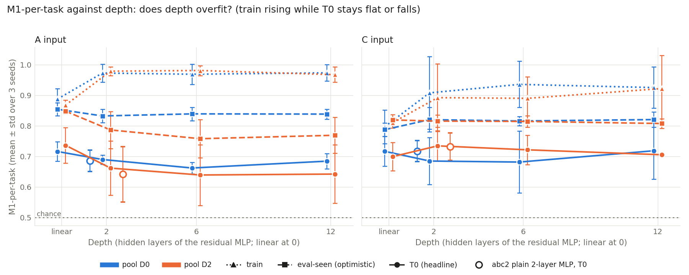
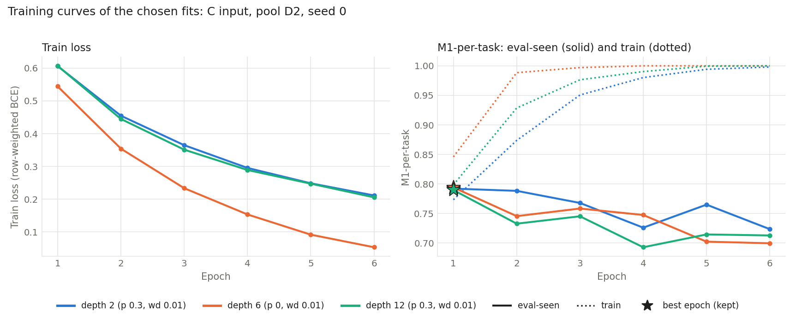

# Deep-MLP run: does depth help A and C?

Residual MLPs with 2, 6 and 12 hidden layers (width 256) trained as A's and C's detectors on pools D0 and D2, three seeds, compared on T0 with abc2's linear detectors and with each other.

*Generated 2026-10-13 03:36 UTC by `analysis/abc3/report3.py` from `results/abc3`. Spec: deep_mlp_handoff.md (handoff version 1), section 4; definitions unchanged from abc2. Numbers to 3 d.p.; ± is the std over seeds.*

## 1. Headline

**Depth beyond 2 layers does not reliably help on T0.** Against the 2-layer residual MLP, 6 and 12 layers improve in 1 and are significantly worse in 2 of 24 comparisons; against linear they never improve ranking, and all 8 of their alarm gains over linear are matched by the 2-layer MLP.

Ranking (M1-per-task on T0): depth 6 / 12 improve on linear in 0 of 8 and on depth 2 in 0 of 8 input × pool comparisons, and are significantly worse in 2 (A-d6 vs linear, D2, M1-per-task -0.099 [-0.167, -0.033]; A-d12 vs linear, D2, M1-per-task -0.094 [-0.158, -0.035]); point differences -0.097 to +0.022 against linear, -0.029 to +0.034 against depth 2.

Alarm at α = 0.1 (balanced accuracy, failures caught): against linear, 8 of 16 improvements (C-d6 vs linear, D0, bal. acc. +0.094 [+0.045, +0.143]; C-d6 vs linear, D0, failures caught +0.265 [+0.188, +0.342]; C-d12 vs linear, D0, bal. acc. +0.087 [+0.045, +0.123]; C-d12 vs linear, D0, failures caught +0.180 [+0.110, +0.245]; A-d6 vs linear, D2, bal. acc. +0.064 [+0.025, +0.105]; A-d6 vs linear, D2, failures caught +0.174 [+0.111, +0.242]; A-d12 vs linear, D2, bal. acc. +0.079 [+0.040, +0.117]; A-d12 vs linear, D2, failures caught +0.220 [+0.161, +0.283]), 8 of which the 2-layer MLP also achieves (same input, pool and metric), so that part of the gain comes from using an MLP, not from depth; 1 significantly worse (A-d6 vs linear, D0, failures caught -0.054 [-0.103, -0.013]). Against depth 2: 1 of 16 improvements (C-d6 vs depth 2, D0, failures caught +0.120 [+0.057, +0.172]), 2 significantly worse (C-d6 vs depth 2, D2, bal. acc. -0.044 [-0.082, -0.003]; C-d6 vs depth 2, D2, failures caught -0.075 [-0.144, -0.003]).

Other comparisons (section 4): Depth 2 against linear: 6 improvements and 2 significant worsenings of 12; D2 against D0: 7 improvements and 1 significant worsening of 18. Over all 78 rows of `paired_T0.csv`: 22 improvements, 8 significant worsenings.

*Rule: an improvement only if the paired-bootstrap 95% interval (1000 resamples) lies entirely above zero. Differences are x − y (positive = the deeper model, or D2, is better): bootstrap mean with the 95% percentile interval. Alarm intervals hold each seed's conformal band fixed, so they understate the uncertainty (section 4).*

## Lead's notes

- **The answer is no.** Six or twelve layers never beat the linear detector or the 2-layer residual MLP on T0 ranking (M1-per-task, 0 of 16 improvements). For the A input on D2, every depth (2, 6 and 12) ranks significantly worse than linear. Against depth 2, the deeper models are flat: 1 alarm improvement and 2 alarm worsenings in 24 comparisons, which is about what noise across that many intervals would produce, with no consistent sign.
- **Optimisation did not fail, so the null result really is about depth.** No fit diverged or needed the lr 3e-4 retry. At every depth, train M1-per-task reaches about 0.97 for A and 0.89–0.94 for C (seed means; individual C fits reach 1.0), well above linear's 0.80–0.89. The deep models fit the training rollouts easily. What they learn doesn't carry over to unseen tasks: T0 stays flat or falls while train rises (figure `m1_vs_depth.png`). That is memorising, not underfitting.
- **Early stopping picks a very early epoch.** In 21 of 36 groups it is epoch 1, during the learning-rate warm-up. After that, eval-seen M1-per-task falls while train M1 climbs to 1.0 (figure `training_curves.png`). At epoch 1 the weight decay has had almost no effect, so several regularisation settings tie on eval-seen. Dropout and weight decay as gridded here didn't slow the memorising enough to matter. Eval-seen is optimistic and is used for selection only.
- **The alarm gains over linear come from MLPs in general, not from depth.** Every alarm improvement of depth 6/12 over linear is matched by depth 2. The improvements occur where the linear alarm almost never fires at α = 0.1: A on D2 catches 0.026 of failures, C on D0 0.027. These intervals hold each seed's conformal band fixed, and per-seed spread is large (e.g. C-d2 D0 failures caught 0.183 ± 0.316). So the alarm verdicts are weaker evidence than the ranking ones.
- **The residual depth-2 MLP and abc2's plain 2-layer MLP agree within seed noise** on every row of the depth table. Changing the architecture (pre-norm residual, warm-up, clipping, the new regularisation grid) did not move the 2-layer result.
- **Scale.** T0 is 90 rollouts in 3 cells per seed. With intervals about ±0.06 wide on M1-per-task, a gain smaller than about 0.05 could not have been detected.

## 2. Depth table: M1-per-task (mean ± std over seeds)

Rows per input and pool: the linear detector (abc2's final detector, plotted as depth 0), abc2's plain 256-256 MLP (reference only), then the pre-norm residual MLP at depth 2, 6 and 12 (width 256). **Eval-seen is optimistic**: it chose the epoch and the regularisation. Train = the pool's train rollouts, same scoring. Parameters: mean over seeds of the chosen fits (A's input layer can differ between seeds); linear = d + 1. *Dropout / wd*: chosen dropout p / weight decay per seed (seeds 0, 1, 2); *best epoch*: early-stopping epoch of the chosen fit per seed. Pooled M1 for every set is in the csv. Table: `report_tables/depth.csv`.

| Input | Pool | Model | Params | Train | Eval-seen (optimistic) | T0 | T1 | T2 | Dropout / wd per seed | Best epoch per seed |
|---|---|---|---|---|---|---|---|---|---|---|
| A | D0 | linear (abc2) | 4,097 | 0.888 ± 0.033 | 0.855 ± 0.021 | 0.716 ± 0.032 | 0.701 ± 0.025 | 0.742 ± 0.036 | — | — |
| A | D0 | abc2 plain MLP, 2 layers (ref.) | 1,114,881 | 0.983 ± 0.015 | 0.820 ± 0.040 | 0.686 ± 0.035 | 0.665 ± 0.007 | 0.669 ± 0.056 | — | — |
| A | D0 | residual MLP, depth 2 | 1,115,905 | 0.973 ± 0.029 | 0.833 ± 0.022 | 0.690 ± 0.015 | 0.686 ± 0.023 | 0.686 ± 0.073 | 0/0.01, 0.3/0.01, 0/0.01 | 1, 1, 6 |
| A | D0 | residual MLP, depth 6 | 1,381,121 | 0.969 ± 0.033 | 0.839 ± 0.022 | 0.662 ± 0.018 | 0.643 ± 0.035 | 0.653 ± 0.067 | 0.3/0.01, 0.3/0.01, 0.3/0.1 | 1, 1, 13 |
| A | D0 | residual MLP, depth 12 | 1,778,945 | 0.974 ± 0.027 | 0.839 ± 0.016 | 0.685 ± 0.025 | 0.657 ± 0.016 | 0.654 ± 0.039 | 0.3/0.01, 0.3/0.1, 0/0.01 | 1, 1, 5 |
| A | D2 | linear (abc2) | 4,097 | 0.868 ± 0.016 | 0.848 ± 0.009 | 0.736 ± 0.058 | 0.740 ± 0.040 | 0.769 ± 0.018 | — | — |
| A | D2 | abc2 plain MLP, 2 layers (ref.) | 1,114,881 | 0.988 ± 0.010 | 0.742 ± 0.074 | 0.642 ± 0.090 | 0.674 ± 0.066 | 0.709 ± 0.034 | — | — |
| A | D2 | residual MLP, depth 2 | 1,115,905 | 0.979 ± 0.015 | 0.787 ± 0.061 | 0.662 ± 0.089 | 0.687 ± 0.054 | 0.719 ± 0.033 | 0.3/0.01, 0.3/0.01, 0/0.01 | 1, 1, 1 |
| A | D2 | residual MLP, depth 6 | 1,381,121 | 0.981 ± 0.016 | 0.758 ± 0.063 | 0.639 ± 0.100 | 0.675 ± 0.057 | 0.720 ± 0.032 | 0.3/0.1, 0.3/0.01, 0/0.01 | 1, 1, 1 |
| A | D2 | residual MLP, depth 12 | 1,778,945 | 0.968 ± 0.025 | 0.769 ± 0.058 | 0.642 ± 0.095 | 0.673 ± 0.061 | 0.707 ± 0.037 | 0.3/0.01, 0.3/0.1, 0.3/0.1 | 1, 1, 1 |
| C | D0 | linear (abc2) | 133 | 0.798 ± 0.055 | 0.788 ± 0.022 | 0.717 ± 0.049 | 0.741 ± 0.011 | 0.791 ± 0.030 | — | — |
| C | D0 | abc2 plain MLP, 2 layers (ref.) | 100,097 | 0.864 ± 0.096 | 0.792 ± 0.004 | 0.717 ± 0.035 | 0.735 ± 0.019 | 0.761 ± 0.008 | — | — |
| C | D0 | residual MLP, depth 2 | 101,121 | 0.908 ± 0.119 | 0.821 ± 0.040 | 0.685 ± 0.077 | 0.686 ± 0.065 | 0.739 ± 0.020 | 0/0.1, 0.3/0.01, 0/0.01 | 16, 1, 4 |
| C | D0 | residual MLP, depth 6 | 366,337 | 0.936 ± 0.076 | 0.816 ± 0.015 | 0.682 ± 0.101 | 0.685 ± 0.093 | 0.744 ± 0.049 | 0.3/0.01, 0.3/0.01, 0/0.01 | 10, 2, 2 |
| C | D0 | residual MLP, depth 12 | 764,161 | 0.925 ± 0.067 | 0.821 ± 0.025 | 0.719 ± 0.092 | 0.721 ± 0.060 | 0.770 ± 0.014 | 0/0.1, 0.3/0.01, 0/0.01 | 4, 2, 1 |
| C | D2 | linear (abc2) | 133 | 0.811 ± 0.018 | 0.820 ± 0.017 | 0.700 ± 0.047 | 0.729 ± 0.026 | 0.767 ± 0.043 | — | — |
| C | D2 | abc2 plain MLP, 2 layers (ref.) | 100,097 | 0.874 ± 0.064 | 0.825 ± 0.025 | 0.732 ± 0.045 | 0.743 ± 0.017 | 0.784 ± 0.036 | — | — |
| C | D2 | residual MLP, depth 2 | 101,121 | 0.893 ± 0.111 | 0.816 ± 0.020 | 0.735 ± 0.050 | 0.753 ± 0.019 | 0.785 ± 0.041 | 0.3/0.01, 0/0.01, 0.3/0.1 | 1, 2, 5 |
| C | D2 | residual MLP, depth 6 | 366,337 | 0.890 ± 0.070 | 0.815 ± 0.018 | 0.722 ± 0.048 | 0.740 ± 0.028 | 0.786 ± 0.034 | 0/0.01, 0.3/0.01, 0/0.01 | 1, 1, 2 |
| C | D2 | residual MLP, depth 12 | 764,161 | 0.922 ± 0.108 | 0.808 ± 0.016 | 0.706 ± 0.002 | 0.719 ± 0.016 | 0.758 ± 0.054 | 0.3/0.01, 0.3/0.1, 0.3/0.1 | 1, 3, 5 |

## 3. Alarm at α = 0.1 on T0 (cut variant, mean ± std over seeds)

Balanced accuracy = (failures caught + successes not flagged) / 2; failures caught = share of failed rollouts flagged before the cut (tpr); false alarms = share of successful rollouts flagged (far); detection time = first alarm ÷ cut, 1 if never (mean over failures). Calibration rollouts = the pool's successful eval-seen rollouts (mean over seeds); test rollouts = T0 rollouts. Table: `report_tables/alarm_T0.csv`.

| Input | Pool | Model | Balanced acc. | Failures caught | False alarms (succ.) | Detection time | Calib. rollouts | Test rollouts |
|---|---|---|---|---|---|---|---|---|
| A | D0 | linear (abc2) | 0.537 ± 0.033 | 0.086 ± 0.081 | 0.012 ± 0.021 | 0.963 ± 0.045 | 37.0 | 90 |
| A | D0 | abc2 plain MLP, 2 layers (ref.) | 0.516 ± 0.018 | 0.033 ± 0.036 | 0.000 ± 0.000 | 0.999 ± 0.001 | 37.0 | 90 |
| A | D0 | residual MLP, depth 2 | 0.520 ± 0.025 | 0.041 ± 0.049 | 0.000 ± 0.000 | 0.997 ± 0.004 | 37.0 | 90 |
| A | D0 | residual MLP, depth 6 | 0.520 ± 0.034 | 0.040 ± 0.069 | 0.000 ± 0.000 | 0.991 ± 0.015 | 37.0 | 90 |
| A | D0 | residual MLP, depth 12 | 0.532 ± 0.055 | 0.063 ± 0.110 | 0.000 ± 0.000 | 0.984 ± 0.028 | 37.0 | 90 |
| A | D2 | linear (abc2) | 0.507 ± 0.006 | 0.026 ± 0.027 | 0.013 ± 0.022 | 0.985 ± 0.025 | 92.0 | 90 |
| A | D2 | abc2 plain MLP, 2 layers (ref.) | 0.546 ± 0.034 | 0.160 ± 0.102 | 0.067 ± 0.066 | 0.901 ± 0.067 | 92.0 | 90 |
| A | D2 | residual MLP, depth 2 | 0.584 ± 0.060 | 0.193 ± 0.078 | 0.025 ± 0.044 | 0.914 ± 0.017 | 92.0 | 90 |
| A | D2 | residual MLP, depth 6 | 0.570 ± 0.065 | 0.199 ± 0.140 | 0.059 ± 0.024 | 0.892 ± 0.057 | 92.0 | 90 |
| A | D2 | residual MLP, depth 12 | 0.584 ± 0.078 | 0.242 ± 0.100 | 0.075 ± 0.056 | 0.887 ± 0.029 | 92.0 | 90 |
| C | D0 | linear (abc2) | 0.501 ± 0.002 | 0.027 ± 0.047 | 0.025 ± 0.044 | 0.979 ± 0.036 | 37.0 | 90 |
| C | D0 | abc2 plain MLP, 2 layers (ref.) | 0.591 ± 0.108 | 0.207 ± 0.226 | 0.025 ± 0.009 | 0.893 ± 0.124 | 37.0 | 90 |
| C | D0 | residual MLP, depth 2 | 0.567 ± 0.116 | 0.183 ± 0.316 | 0.049 ± 0.084 | 0.944 ± 0.096 | 37.0 | 90 |
| C | D0 | residual MLP, depth 6 | 0.598 ± 0.086 | 0.299 ± 0.259 | 0.103 ± 0.090 | 0.876 ± 0.144 | 37.0 | 90 |
| C | D0 | residual MLP, depth 12 | 0.588 ± 0.091 | 0.207 ± 0.219 | 0.031 ± 0.037 | 0.917 ± 0.133 | 37.0 | 90 |
| C | D2 | linear (abc2) | 0.550 ± 0.076 | 0.181 ± 0.130 | 0.081 ± 0.111 | 0.910 ± 0.063 | 92.0 | 90 |
| C | D2 | abc2 plain MLP, 2 layers (ref.) | 0.575 ± 0.058 | 0.220 ± 0.117 | 0.070 ± 0.007 | 0.903 ± 0.039 | 92.0 | 90 |
| C | D2 | residual MLP, depth 2 | 0.597 ± 0.047 | 0.257 ± 0.075 | 0.064 ± 0.043 | 0.891 ± 0.026 | 92.0 | 90 |
| C | D2 | residual MLP, depth 6 | 0.546 ± 0.012 | 0.168 ± 0.118 | 0.077 ± 0.099 | 0.911 ± 0.103 | 92.0 | 90 |
| C | D2 | residual MLP, depth 12 | 0.577 ± 0.050 | 0.233 ± 0.163 | 0.080 ± 0.070 | 0.882 ± 0.078 | 92.0 | 90 |

## 4. Paired differences on T0 (95% intervals)

Paired bootstrap as in abc2: 1000 resamples of T0 rollouts within each cell within each seed (rng seed 20261011); both sides recomputed on the same resample, then averaged over seeds. Difference = x − y; shown as the bootstrap mean with its 95% percentile interval (the point difference on the original sample is in the csv). **Improvement** only if the whole interval is above zero; an interval entirely below zero is a **significant worsening**.
Identity check (`paired_T0_check.json`): on the identity resample the recomputation reproduces the eval3 T0 numbers (max |diff| 6.3e-07).

**Each depth against the linear detector (same input and pool)** (`family = vs_linear`)

| Input | Pool | x − y | Metric | y | x | Diff [95% interval] | Verdict |
|---|---|---|---|---|---|---|---|
| A | D0 | A-d2 − A-linear | M1-per-task | 0.716 | 0.690 | -0.026 [-0.089, +0.033] | no significant change |
| A | D0 | A-d2 − A-linear | balanced accuracy | 0.537 | 0.520 | -0.020 [-0.043, +0.007] | no significant change |
| A | D0 | A-d2 − A-linear | failures caught | 0.086 | 0.041 | -0.051 [-0.101, -0.003] | **significant worsening** |
| A | D0 | A-d6 − A-linear | M1-per-task | 0.716 | 0.662 | -0.053 [-0.122, +0.014] | no significant change |
| A | D0 | A-d6 − A-linear | balanced accuracy | 0.537 | 0.520 | -0.021 [-0.045, +0.002] | no significant change |
| A | D0 | A-d6 − A-linear | failures caught | 0.086 | 0.040 | -0.054 [-0.103, -0.013] | **significant worsening** |
| A | D0 | A-d12 − A-linear | M1-per-task | 0.716 | 0.685 | -0.030 [-0.096, +0.032] | no significant change |
| A | D0 | A-d12 − A-linear | balanced accuracy | 0.537 | 0.532 | -0.008 [-0.035, +0.020] | no significant change |
| A | D0 | A-d12 − A-linear | failures caught | 0.086 | 0.063 | -0.028 [-0.082, +0.029] | no significant change |
| A | D2 | A-d2 − A-linear | M1-per-task | 0.736 | 0.662 | -0.077 [-0.140, -0.017] | **significant worsening** |
| A | D2 | A-d2 − A-linear | balanced accuracy | 0.507 | 0.584 | +0.077 [+0.040, +0.114] | **improvement** |
| A | D2 | A-d2 − A-linear | failures caught | 0.026 | 0.193 | +0.168 [+0.097, +0.234] | **improvement** |
| A | D2 | A-d6 − A-linear | M1-per-task | 0.736 | 0.639 | -0.099 [-0.167, -0.033] | **significant worsening** |
| A | D2 | A-d6 − A-linear | balanced accuracy | 0.507 | 0.570 | +0.064 [+0.025, +0.105] | **improvement** |
| A | D2 | A-d6 − A-linear | failures caught | 0.026 | 0.199 | +0.174 [+0.111, +0.242] | **improvement** |
| A | D2 | A-d12 − A-linear | M1-per-task | 0.736 | 0.642 | -0.094 [-0.158, -0.035] | **significant worsening** |
| A | D2 | A-d12 − A-linear | balanced accuracy | 0.507 | 0.584 | +0.079 [+0.040, +0.117] | **improvement** |
| A | D2 | A-d12 − A-linear | failures caught | 0.026 | 0.242 | +0.220 [+0.161, +0.283] | **improvement** |
| C | D0 | C-d2 − C-linear | M1-per-task | 0.717 | 0.685 | -0.034 [-0.091, +0.024] | no significant change |
| C | D0 | C-d2 − C-linear | balanced accuracy | 0.501 | 0.567 | +0.060 [+0.017, +0.101] | **improvement** |
| C | D0 | C-d2 − C-linear | failures caught | 0.027 | 0.183 | +0.145 [+0.073, +0.211] | **improvement** |
| C | D0 | C-d6 − C-linear | M1-per-task | 0.717 | 0.682 | -0.033 [-0.099, +0.031] | no significant change |
| C | D0 | C-d6 − C-linear | balanced accuracy | 0.501 | 0.598 | +0.094 [+0.045, +0.143] | **improvement** |
| C | D0 | C-d6 − C-linear | failures caught | 0.027 | 0.299 | +0.265 [+0.188, +0.342] | **improvement** |
| C | D0 | C-d12 − C-linear | M1-per-task | 0.717 | 0.719 | +0.003 [-0.053, +0.056] | no significant change |
| C | D0 | C-d12 − C-linear | balanced accuracy | 0.501 | 0.588 | +0.087 [+0.045, +0.123] | **improvement** |
| C | D0 | C-d12 − C-linear | failures caught | 0.027 | 0.207 | +0.180 [+0.110, +0.245] | **improvement** |
| C | D2 | C-d2 − C-linear | M1-per-task | 0.700 | 0.735 | +0.031 [-0.019, +0.087] | no significant change |
| C | D2 | C-d2 − C-linear | balanced accuracy | 0.550 | 0.597 | +0.048 [+0.008, +0.086] | **improvement** |
| C | D2 | C-d2 − C-linear | failures caught | 0.181 | 0.257 | +0.078 [+0.009, +0.146] | **improvement** |
| C | D2 | C-d6 − C-linear | M1-per-task | 0.700 | 0.722 | +0.021 [-0.023, +0.068] | no significant change |
| C | D2 | C-d6 − C-linear | balanced accuracy | 0.550 | 0.546 | +0.004 [-0.046, +0.053] | no significant change |
| C | D2 | C-d6 − C-linear | failures caught | 0.181 | 0.168 | +0.003 [-0.085, +0.087] | no significant change |
| C | D2 | C-d12 − C-linear | M1-per-task | 0.700 | 0.706 | +0.004 [-0.058, +0.068] | no significant change |
| C | D2 | C-d12 − C-linear | balanced accuracy | 0.550 | 0.577 | +0.029 [-0.015, +0.074] | no significant change |
| C | D2 | C-d12 − C-linear | failures caught | 0.181 | 0.233 | +0.057 [-0.016, +0.129] | no significant change |

**Depth 6 and 12 against depth 2 (same input and pool)** (`family = vs_depth2`)

| Input | Pool | x − y | Metric | y | x | Diff [95% interval] | Verdict |
|---|---|---|---|---|---|---|---|
| A | D0 | A-d6 − A-d2 | M1-per-task | 0.690 | 0.662 | -0.027 [-0.072, +0.013] | no significant change |
| A | D0 | A-d6 − A-d2 | balanced accuracy | 0.520 | 0.520 | -0.001 [-0.012, +0.010] | no significant change |
| A | D0 | A-d6 − A-d2 | failures caught | 0.041 | 0.040 | -0.003 [-0.026, +0.020] | no significant change |
| A | D0 | A-d12 − A-d2 | M1-per-task | 0.690 | 0.685 | -0.004 [-0.051, +0.041] | no significant change |
| A | D0 | A-d12 − A-d2 | balanced accuracy | 0.520 | 0.532 | +0.012 [-0.007, +0.030] | no significant change |
| A | D0 | A-d12 − A-d2 | failures caught | 0.041 | 0.063 | +0.024 [-0.013, +0.061] | no significant change |
| A | D2 | A-d6 − A-d2 | M1-per-task | 0.662 | 0.639 | -0.022 [-0.060, +0.011] | no significant change |
| A | D2 | A-d6 − A-d2 | balanced accuracy | 0.584 | 0.570 | -0.013 [-0.045, +0.016] | no significant change |
| A | D2 | A-d6 − A-d2 | failures caught | 0.193 | 0.199 | +0.006 [-0.042, +0.051] | no significant change |
| A | D2 | A-d12 − A-d2 | M1-per-task | 0.662 | 0.642 | -0.018 [-0.054, +0.015] | no significant change |
| A | D2 | A-d12 − A-d2 | balanced accuracy | 0.584 | 0.584 | +0.002 [-0.032, +0.036] | no significant change |
| A | D2 | A-d12 − A-d2 | failures caught | 0.193 | 0.242 | +0.052 [-0.003, +0.111] | no significant change |
| C | D0 | C-d6 − C-d2 | M1-per-task | 0.685 | 0.682 | +0.000 [-0.042, +0.043] | no significant change |
| C | D0 | C-d6 − C-d2 | balanced accuracy | 0.567 | 0.598 | +0.033 [-0.006, +0.068] | no significant change |
| C | D0 | C-d6 − C-d2 | failures caught | 0.183 | 0.299 | +0.120 [+0.057, +0.172] | **improvement** |
| C | D0 | C-d12 − C-d2 | M1-per-task | 0.685 | 0.719 | +0.036 [-0.020, +0.091] | no significant change |
| C | D0 | C-d12 − C-d2 | balanced accuracy | 0.567 | 0.588 | +0.026 [-0.019, +0.070] | no significant change |
| C | D0 | C-d12 − C-d2 | failures caught | 0.183 | 0.207 | +0.035 [-0.055, +0.115] | no significant change |
| C | D2 | C-d6 − C-d2 | M1-per-task | 0.735 | 0.722 | -0.010 [-0.042, +0.024] | no significant change |
| C | D2 | C-d6 − C-d2 | balanced accuracy | 0.597 | 0.546 | -0.044 [-0.082, -0.003] | **significant worsening** |
| C | D2 | C-d6 − C-d2 | failures caught | 0.257 | 0.168 | -0.075 [-0.144, -0.003] | **significant worsening** |
| C | D2 | C-d12 − C-d2 | M1-per-task | 0.735 | 0.706 | -0.027 [-0.066, +0.013] | no significant change |
| C | D2 | C-d12 − C-d2 | balanced accuracy | 0.597 | 0.577 | -0.019 [-0.062, +0.022] | no significant change |
| C | D2 | C-d12 − C-d2 | failures caught | 0.257 | 0.233 | -0.021 [-0.095, +0.051] | no significant change |

**D2 against D0 (same detector)** (`family = D2_vs_D0`)

| Input | Pool | x − y | Metric | y | x | Diff [95% interval] | Verdict |
|---|---|---|---|---|---|---|---|
| A | D2 − D0 | A-d2: D2 − D0 | M1-per-task | 0.690 | 0.662 | -0.029 [-0.114, +0.049] | no significant change |
| A | D2 − D0 | A-d2: D2 − D0 | balanced accuracy | 0.520 | 0.584 | +0.062 [+0.026, +0.095] | **improvement** |
| A | D2 − D0 | A-d2: D2 − D0 | failures caught | 0.041 | 0.193 | +0.149 [+0.081, +0.214] | **improvement** |
| A | D2 − D0 | A-d6: D2 − D0 | M1-per-task | 0.662 | 0.639 | -0.025 [-0.115, +0.056] | no significant change |
| A | D2 − D0 | A-d6: D2 − D0 | balanced accuracy | 0.520 | 0.570 | +0.050 [+0.012, +0.086] | **improvement** |
| A | D2 − D0 | A-d6: D2 − D0 | failures caught | 0.040 | 0.199 | +0.158 [+0.098, +0.219] | **improvement** |
| A | D2 − D0 | A-d12: D2 − D0 | M1-per-task | 0.685 | 0.642 | -0.043 [-0.134, +0.044] | no significant change |
| A | D2 − D0 | A-d12: D2 − D0 | balanced accuracy | 0.532 | 0.584 | +0.052 [+0.012, +0.092] | **improvement** |
| A | D2 − D0 | A-d12: D2 − D0 | failures caught | 0.063 | 0.242 | +0.178 [+0.117, +0.238] | **improvement** |
| C | D2 − D0 | C-d2: D2 − D0 | M1-per-task | 0.685 | 0.735 | +0.049 [-0.009, +0.107] | no significant change |
| C | D2 − D0 | C-d2: D2 − D0 | balanced accuracy | 0.567 | 0.597 | +0.032 [-0.016, +0.082] | no significant change |
| C | D2 − D0 | C-d2: D2 − D0 | failures caught | 0.183 | 0.257 | +0.077 [+0.002, +0.157] | **improvement** |
| C | D2 − D0 | C-d6: D2 − D0 | M1-per-task | 0.682 | 0.722 | +0.038 [-0.016, +0.090] | no significant change |
| C | D2 − D0 | C-d6: D2 − D0 | balanced accuracy | 0.598 | 0.546 | -0.046 [-0.097, +0.008] | no significant change |
| C | D2 − D0 | C-d6: D2 − D0 | failures caught | 0.299 | 0.168 | -0.118 [-0.209, -0.026] | **significant worsening** |
| C | D2 − D0 | C-d12: D2 − D0 | M1-per-task | 0.719 | 0.706 | -0.015 [-0.083, +0.054] | no significant change |
| C | D2 − D0 | C-d12: D2 − D0 | balanced accuracy | 0.588 | 0.577 | -0.013 [-0.061, +0.034] | no significant change |
| C | D2 − D0 | C-d12: D2 − D0 | failures caught | 0.207 | 0.233 | +0.021 [-0.061, +0.090] | no significant change |

**The alarm intervals (balanced accuracy, failures caught) hold each seed's conformal band fixed: only the test rollouts are resampled, not the training or calibration sets, so they understate the uncertainty.** Seed-to-seed spread of the alarm metrics (section 3) is the better guide to how much they move. Table: `report_tables/paired_T0.csv`.

## 5. Figures

**M1-per-task against depth** (linear at depth 0; D0 blue, D2 orange; line style = test set; hollow circles = abc2's plain 2-layer MLP on T0, offset to the side of depth 2; error bars = std over seeds). Depth overfits if train rises with depth while T0 stays flat or falls. Data: `report_tables/depth.csv`.



**Training curves**, C input, D2, seed 0, the chosen regularisation for each depth (legend). Early stopping on eval-seen M1-per-task, patience 5 (depth 2: best epoch 1 of 6 run, depth 6: best epoch 1 of 6 run, depth 12: best epoch 1 of 6 run). Data: `report_tables/training_curves.csv`.



## 6. Stress set: share flagged before the cut (α = 0.1, mean ± std over seeds)

`seen` / `unseen`: stress rollouts whose base task is seen / unseen in that seed's split; `all` = every stress block, then per block. A rollout's cut is its base task's unperturbed-cell cut. Nearly all stress rollouts fail, so this is close to the share of failures caught in time. Table: `report_tables/stress.csv`.

| Input | Pool | Model | seen · all (n ≈ 70) | seen · swap (n ≈ 35) | seen · task (n ≈ 35) | unseen · all (n ≈ 30) | unseen · swap (n ≈ 15) | unseen · task (n ≈ 15) |
|---|---|---|---|---|---|---|---|---|
| A | D0 | linear (abc2) | 0.238 ± 0.206 | 0.352 ± 0.306 | 0.124 ± 0.108 | 0.133 ± 0.153 | 0.200 ± 0.240 | 0.067 ± 0.067 |
| A | D0 | abc2 plain MLP, 2 layers (ref.) | 0.229 ± 0.087 | 0.343 ± 0.178 | 0.114 ± 0.057 | 0.033 ± 0.058 | 0.067 ± 0.115 | 0.000 ± 0.000 |
| A | D0 | residual MLP, depth 2 | 0.233 ± 0.100 | 0.314 ± 0.171 | 0.152 ± 0.033 | 0.078 ± 0.135 | 0.133 ± 0.231 | 0.022 ± 0.038 |
| A | D0 | residual MLP, depth 6 | 0.162 ± 0.139 | 0.219 ± 0.211 | 0.105 ± 0.072 | 0.089 ± 0.154 | 0.133 ± 0.231 | 0.044 ± 0.077 |
| A | D0 | residual MLP, depth 12 | 0.205 ± 0.132 | 0.276 ± 0.231 | 0.133 ± 0.033 | 0.111 ± 0.192 | 0.178 ± 0.308 | 0.044 ± 0.077 |
| A | D2 | linear (abc2) | 0.219 ± 0.169 | 0.267 ± 0.216 | 0.171 ± 0.125 | 0.133 ± 0.120 | 0.244 ± 0.234 | 0.022 ± 0.038 |
| A | D2 | abc2 plain MLP, 2 layers (ref.) | 0.248 ± 0.220 | 0.333 ± 0.259 | 0.162 ± 0.181 | 0.167 ± 0.088 | 0.311 ± 0.214 | 0.022 ± 0.038 |
| A | D2 | residual MLP, depth 2 | 0.305 ± 0.159 | 0.419 ± 0.172 | 0.190 ± 0.157 | 0.222 ± 0.102 | 0.378 ± 0.301 | 0.067 ± 0.115 |
| A | D2 | residual MLP, depth 6 | 0.286 ± 0.200 | 0.390 ± 0.218 | 0.181 ± 0.190 | 0.244 ± 0.117 | 0.378 ± 0.278 | 0.111 ± 0.102 |
| A | D2 | residual MLP, depth 12 | 0.310 ± 0.186 | 0.410 ± 0.265 | 0.210 ± 0.119 | 0.256 ± 0.135 | 0.422 ± 0.308 | 0.089 ± 0.038 |
| C | D0 | linear (abc2) | 0.233 ± 0.128 | 0.390 ± 0.240 | 0.076 ± 0.033 | 0.122 ± 0.135 | 0.222 ± 0.278 | 0.022 ± 0.038 |
| C | D0 | abc2 plain MLP, 2 layers (ref.) | 0.376 ± 0.121 | 0.533 ± 0.115 | 0.219 ± 0.132 | 0.322 ± 0.201 | 0.467 ± 0.240 | 0.178 ± 0.192 |
| C | D0 | residual MLP, depth 2 | 0.186 ± 0.240 | 0.248 ± 0.357 | 0.124 ± 0.129 | 0.233 ± 0.404 | 0.289 ± 0.500 | 0.178 ± 0.308 |
| C | D0 | residual MLP, depth 6 | 0.324 ± 0.284 | 0.390 ± 0.338 | 0.257 ± 0.244 | 0.333 ± 0.289 | 0.422 ± 0.367 | 0.244 ± 0.214 |
| C | D0 | residual MLP, depth 12 | 0.381 ± 0.079 | 0.552 ± 0.108 | 0.210 ± 0.066 | 0.256 ± 0.168 | 0.378 ± 0.252 | 0.133 ± 0.115 |
| C | D2 | linear (abc2) | 0.319 ± 0.144 | 0.476 ± 0.115 | 0.162 ± 0.172 | 0.300 ± 0.186 | 0.422 ± 0.252 | 0.178 ± 0.139 |
| C | D2 | abc2 plain MLP, 2 layers (ref.) | 0.333 ± 0.068 | 0.495 ± 0.100 | 0.171 ± 0.057 | 0.367 ± 0.000 | 0.556 ± 0.038 | 0.178 ± 0.038 |
| C | D2 | residual MLP, depth 2 | 0.371 ± 0.099 | 0.581 ± 0.135 | 0.162 ± 0.072 | 0.400 ± 0.033 | 0.556 ± 0.038 | 0.244 ± 0.038 |
| C | D2 | residual MLP, depth 6 | 0.386 ± 0.138 | 0.571 ± 0.200 | 0.200 ± 0.076 | 0.356 ± 0.139 | 0.511 ± 0.102 | 0.200 ± 0.200 |
| C | D2 | residual MLP, depth 12 | 0.357 ± 0.136 | 0.552 ± 0.190 | 0.162 ± 0.100 | 0.411 ± 0.190 | 0.533 ± 0.176 | 0.289 ± 0.204 |

## 7. Checks, grid health and the regularisation chosen

**§3 sanity check: PASSED.** plain 256-256 MLP, C input, D0, seed 0, abc2 settings, via train3.train_fit(plain=True), wd 0.0001: T0 M1-per-task 0.702 against abc2's 0.702 (diff -4.4e-07, tolerance ± 0.01); best epoch 5 (abc2 5).

**Precision (§2): bf16 check FAILED → grid run in fp32.** A input (layer10), depth 12, D2, seed 0, p 0.0, wd 0.01: eval-seen M1-per-task fp32 0.663 (best epoch 1) vs bf16 0.692 (best epoch 2); difference +0.030, tolerance 0.005.

**Reference rows (`eval_check.json`):** passed — linear and abc2-MLP rows recomputed from abc2's score arrays match abc2's tables (max |diff| 5.0e-07).

### Grid health

144 fits: 144 ok, 0 failed; 0 flagged as diverged (loss NaN or eval-seen M1 below 0.5 at every epoch); 0 retried at learning rate 3e-4 (0 of them then ok). Share stopped early (patience 5, before the 50-epoch cap): 1.000; fits that ran to the cap: 0. Best epoch as median [min–max]. Table: `report_tables/grid_health.csv`.

| Input | Depth | Fits | OK | Failed | Diverged | Retried at lr 3e-4 | Stopped early | Best epoch (all fits) | Best epoch (chosen) | Epochs run | Seconds / fit |
|---|---|---|---|---|---|---|---|---|---|---|---|
| A | 2 | 24 | 24 | 0 | 0 | 0 (0 ok) | 1.000 | 1 [1–8] | 1 [1–6] | 6 [6–13] | 1.1 |
| A | 6 | 24 | 24 | 0 | 0 | 0 (0 ok) | 1.000 | 1 [1–13] | 1 [1–13] | 6 [6–18] | 1.2 |
| A | 12 | 24 | 24 | 0 | 0 | 0 (0 ok) | 1.000 | 1 [1–11] | 1 [1–5] | 6 [6–16] | 1.5 |
| C | 2 | 24 | 24 | 0 | 0 | 0 (0 ok) | 1.000 | 2 [1–17] | 3 [1–16] | 7 [6–22] | 0.8 |
| C | 6 | 24 | 24 | 0 | 0 | 0 (0 ok) | 1.000 | 2 [1–11] | 2 [1–10] | 7 [6–16] | 0.9 |
| C | 12 | 24 | 24 | 0 | 0 | 0 (0 ok) | 1.000 | 2 [1–8] | 2 [1–5] | 7 [6–13] | 1.2 |
| all | all | 144 | 144 | 0 | 0 | 0 (0 ok) | 1.000 | 1 [1–17] | 1 [1–16] | 6 [6–22] | 1.1 |

Best-epoch distribution (number of fits; 21 of the 36 chosen fits peaked at epoch 1; 26 of 36 at epoch ≤ 2, i.e. inside the learning-rate warm-up, which lasts the first 2.5 epochs (5% of the 50-epoch budget)). Table: `report_tables/best_epoch_hist.csv`.

| Best epoch | All fits | Chosen fits | Chosen, depth 2 | Chosen, depth 6 | Chosen, depth 12 |
|---|---|---|---|---|---|
| 1 | 82 | 21 | 7 | 7 | 7 |
| 2–3 | 25 | 6 | 1 | 3 | 2 |
| 4–5 | 20 | 5 | 2 | 0 | 3 |
| 6–10 | 10 | 2 | 1 | 1 | 0 |
| 11–20 | 7 | 2 | 1 | 1 | 0 |
| 21–50 | 0 | 0 | 0 | 0 | 0 |

### Regularisation chosen (eval-seen M1-per-task, per input × depth × pool × seed)

Number of groups (input × depth × pool × seed) whose best fit used each setting; ties go to the first in grid order. Table: `report_tables/regularisation.csv`.

| Input | Depth | p 0 / wd 0.01 | p 0 / wd 0.1 | p 0.3 / wd 0.01 | p 0.3 / wd 0.1 | Groups |
|---|---|---|---|---|---|---|
| A | 2 | 3 | 0 | 3 | 0 | 6 |
| A | 6 | 1 | 0 | 3 | 2 | 6 |
| A | 12 | 1 | 0 | 2 | 3 | 6 |
| C | 2 | 2 | 1 | 2 | 1 | 6 |
| C | 6 | 3 | 0 | 3 | 0 | 6 |
| C | 12 | 1 | 1 | 2 | 2 | 6 |
| all | all | 11 | 2 | 15 | 8 | 36 |

## 8. Deviations and failures

RUNLOG.md entries mentioning a deviation, decision, failure, finding, judgement or skip (4, verbatim):

- **2026-10-13T03:20Z** — Code: analysis/abc3/common3.py (model verbatim from §2, grid, work-file format), train3.py (grid runner, resumable per fit; work files /data/tmp/abc3_work/<pool>/*.pkl), sanity3.py. Decisions (abc2 where the handoff is silent): weight decay on every parameter incl. LayerNorm and biases (stage10_mlp did); standardisation = stage10_mlp.Inputs (unweighted train-row mean/sd); warm-up + cosine schedule spans the full 50-epoch budget (max_epochs x batches/epoch), so early stopping can end training before the decay finishes; warm-up = ceil(5%) of those steps; per-epoch train-set M1-per-task is also logged (diagnostic for §3.1/§5 figures; it does not affect training or selection); dropout acts in the residual blocks only (as in the §2 code), so the depth-2 model has one dropout site; reg selection per (input, depth, pool, seed) = plain argmax of best-epoch eval_seen M1-per-task, ties to the first in grid order (p0/wd1e-2, p0/wd1e-1, p0.3/wd1e-2, p0.3/wd1e-1). Divergence rule applied to 12-layer fits only (as §5 says); other depths are flagged, not retried.
- **2026-10-13T03:20Z** — Decision (§5, bf16): bf16 check FAILED on A input (layer10), depth 12, D2, seed 0, p 0, wd 1e-2: eval_seen M1-per-task fp32 0.6626 (epoch 1) vs bf16 0.6921 (epoch 2), diff +0.030 > 0.005 -> grid runs in fp32. Speed was equal anyway (~2 s per fit). results/abc3/precision.json.
- **2026-10-13T03:36Z** — Parallel subagents wrote eval3.py, paired3.py and report3.py (formats: analysis/abc3/FORMATS.md). Decisions: eval3 copies the reference rows' CP and stress numbers from abc2's tables and recomputes their M1 rows from abc2's score arrays (the train-set rows are new); paired3 makes one set of bootstrap draws for all 26 comparisons, the same resamples as abc2's paired_T0.csv; report3 adds a stress split by block and grid-health tables. Checks: eval_check.json passed (abc2 reference M1 rows reproduced, max |diff| 5.0e-7; bootstrap2 identity on all 20 sides, 6.3e-7); the paired3 selftest reproduced abc2's mlp_paired_T0.csv and paired_T0.csv D2-D0 rows exactly; paired_T0_check.json passed (16 sides, 6.3e-7). The lead re-ran run_all.sh end to end (train skipped, eval/paired/report redone in order, 24 s) and recomputed two groups by hand from the work files (C-d6 D0 seed 1, A-d12 D2 seed 2): selection, train and T0 M1-per-task and T0 BA at alpha 0.1 all equal the tables.
- **2026-10-13T03:40Z** — FINDING: no depth beats linear or depth 2 on T0 ranking. A-d6 and A-d12 (and A-d2) are significantly worse than linear on D2. The alarm gains over linear are all matched by depth 2. Interpretation in lead_notes.md (included in REPORT.md).

## 9. Proposed commit message

Nothing has been committed; the user makes the commit. Proposed message:

```
Deep-MLP run: residual MLPs of depth 2/6/12 as A and C detectors on D0/D2

Trained pre-norm residual MLPs (width 256; dropout x weight decay grid chosen on
eval-seen) on A's selected hidden-state layer and on C's final-detector inputs, pools
D0 and D2, three seeds, and compared them with abc2's linear detectors on T0.

T0 M1-per-task, A: D0: linear 0.716, d2 0.690, d6 0.662, d12 0.685; D2: linear 0.736, d2 0.662, d6 0.639, d12 0.642
T0 M1-per-task, C: D0: linear 0.717, d2 0.685, d6 0.682, d12 0.719; D2: linear 0.700, d2 0.735, d6 0.722, d12 0.706
Paired T0 comparisons, depth 6/12 vs depth 2: 1 of 24 improve (95% CI above 0), 2 worse; vs linear: 8 of 24 improve, 3 worse.

New:
- deep_mlp_handoff.md
- analysis/abc3/FORMATS.md
- analysis/abc3/common3.py
- analysis/abc3/eval3.py
- analysis/abc3/paired3.py
- analysis/abc3/report3.py
- analysis/abc3/run_all.sh
- analysis/abc3/run_train.sh
- analysis/abc3/sanity3.py
- analysis/abc3/train3.py
- results/abc3/REPORT.md
- results/abc3/RUNLOG.md
- results/abc3/STATE.md
- results/abc3/cp_curves.csv
- results/abc3/eval_check.json
- results/abc3/eval_status.json
- results/abc3/final_m1.csv
- results/abc3/final_table.csv
- results/abc3/grid.csv
- results/abc3/lead_notes.md
- results/abc3/logs/ (6 files)
- results/abc3/paired/ (6 files)
- results/abc3/paired_T0.csv
- results/abc3/paired_T0_check.json
- results/abc3/paired_T0_per_seed.csv
- results/abc3/precision.json
- results/abc3/report_figures/ (2 files)
- results/abc3/report_tables/ (8 files)
- results/abc3/sanity_check.json
- results/abc3/scores/ (6 files)
- results/abc3/selections.csv
- results/abc3/stress.csv
- results/abc3/train_log.csv

Co-Authored-By: Claude Opus 5.5 <noreply@anthropic.com>
```
