# Thesis results: original training set

*results_collection_handoff.md (version 4), §5. Generated by `analysis/thesis_results/report.py` from `results/thesis_results/`. Numbers to 3 d.p.; ± is the std over the 3 seeds (ddof 1); per-seed values are in the CSVs. Plain names throughout (handoff §0).*

## Headline

On unseen tasks (original rollouts), the three detectors' primary versions rank failing rollouts only modestly. Per-task AUROC is 0.745 ± 0.037 for A's unweighted mean, 0.684 ± 0.066 for C's and 0.678 ± 0.058 for B's (H = 10). The best single untrained constraint reaches 0.725 on its own. The only separable gap between the three means is A over B (paired difference −0.068 [−0.126, −0.011] for B minus A). On unseen tasks incl. LIBERO-PRO the three means are level, at 0.754, 0.760 and 0.758 per-task-and-perturbation AUROC. As runtime alarms at α = 0.1 every detector is weak, with balanced accuracy 0.50–0.59, and most trained detectors catch under 10 % of the headline failures before the cut. B's probes predict their own constraint targets well above chance, but for every smoothed target the target's current value predicts its look-ahead label better than the probe does.

## Reading notes (written after checking the numbers)

- **Single best probe, mean, combiner, MLP.** In no detector does the choice of combiner make a separable difference to ranking on the headline test set. Every own-detector paired interval includes zero for per-task AUROC. For the alarm, A's mean beats A's trained combiner by +0.016 [+0.003, +0.043] balanced accuracy, and B's MLP beats B's single best linear probe by +0.014 [+0.003, +0.029].
  - A: the trained combiner ranks highest (0.769 ± 0.016).
  - B at H = 25: the combiner (0.731) and the single best probe (0.720) beat the mean (0.698).
- **B's mean is pulled down by the xl_final probes.** Against outcome, the xl_final probes sit at or below chance at every H: their unweighted mean is 0.48 at H = 10 on the headline set (T5, F8). The mean of B's 30 embedding-temporal probes reaches 0.731 at H = 10 and 0.742 at H = 25, level with the best untrained constraint. The mean over all 124 probes is the pre-registered primary, so it stays the headline B row.
- **Look-ahead H.** B's mean rises with H on the headline set (0.662 → 0.678 → 0.698) and on the LIBERO-PRO set (0.740 → 0.758 → 0.765). Std over seeds is 0.05–0.06 on the headline set, and nothing is selected across H.
- **B's constraint prediction.** Row-level AUROC against each probe's own target is 0.74–0.88 on unseen tasks (F9, `tables/data/b_target_auroc.csv`). The persistence baseline is the target's current prepared value. At H = 0 it is 1 by construction, because the label is that value binarised. It still scores 0.93–0.99 at H = 10 and 25 for the smoothed targets (act_rep, act_mag, xl_final), above every linear probe (`table4_b_linear_vs_persistence.csv`). Only for the unsmoothed emb_temp targets at H = 10 do most probes beat persistence (69 % of probe-seed pairs, mean 0.786 vs 0.775 on the headline set). The probes never see the target series; persistence does. B's 2-layer MLP improves on its linear probe against the target (0.769 vs 0.756, headline set) and slightly against outcome (0.675 vs 0.658), but stays below persistence (0.836).
- **Families (T5).**
  - Dropping the cross-layer family lowers C's mean most (0.684 → 0.650 headline). Dropping emb_temp or action costs about 0.01.
  - For the 132-input logistic regression (existing version, `results/abc/c_final.csv`), dropping emb_temp costs most (0.717 → 0.688).
  - B per target: emb_temp probes alone beat all 124 (combiner 0.739 vs 0.709 at H = 10; mean 0.731 vs 0.678).
- **Alarms.**
  - The functional band is calibrated on 33–43 eval-seen successes per seed (17–22 in the half that sets h), so α = 0.1 is close to the coarsest usable level.
  - The alarm verdicts hold each seed's band fixed (as in the earlier runs), so they understate the uncertainty.
  - Per-seed spread is large, e.g. the best untrained constraint catches 0.22 ± 0.38 of failures.
  - Stress set: the share alarmed before the cut is highest for B's trained combiner (0.39 at H = 10) and C's 132-input MLP (0.36). B's mean scores 0.31, the best untrained constraint 0.29, A's mean 0.21.
- **Length check (F4).** Running-sum scores grow almost linearly with t for every detector: mean per-step P(failure) ≈ 0.4–0.55. Failures sit only about 10 % above successes at the same t (e.g. A's mean at t = 200: 110 vs 97). The per-task cut is what keeps the timestep-only score at exactly 0.5 per task. Its pooled AUROC (0.547 headline, 0.617 LIBERO-PRO) shows how much pooled numbers carry.
- **Where the signal is (F6–F8, F10).** A's probes are flat across layers (0.66–0.78 unseen), with a dip at layers 6–12. The shuffled-label control sits at 0.45–0.53. C's per-layer probes fall from about 0.70 (layers 0–12) to about 0.60 (layers 16–24). The layer's untrained constraints, scored by their running sum, track C's probes closely, so training adds little per layer.
- **Example rollout (F1)** is from seed 1, not seed 0: seed 0 has no qualifying pair (see deviations).
- **Background run (full training set, §6)** is in `results/thesis_results_full/` (its own REPORT.md, `selections_report.md`, `tables/training_set_comparison.csv`). On unseen tasks, original rollouts, no primary detector's per-task AUROC changes significantly with the full training set: A +0.009, C −0.017, B (H = 10) +0.041 [−0.001, +0.077]. On the LIBERO-PRO test set, A's mean gains +0.026 [+0.001, +0.060]. The original-vs-full rows join T6 (`table6_training_data.csv`, paired: `table6_training_data_paired.csv`).


## Reproduction checks

3134 checks against the earlier runs' files (292 detector rows, 603 per-probe values, 2232 B grid values, 7 corpus counts); **2 failed**; largest difference 0.0053 (tolerance 0.005 AUROC, 0.01 balanced accuracy). Files: `tables/data/reproduction_checks*.csv`.

## T1. Core table (unseen tasks, original rollouts)

File: `tables/table1_core_detectors.csv` (all three test sets: `table1_core_detectors_all_test_sets.csv`; stress subsets: `table1_stress_set.csv`). Floor = pooled AUROC of the timestep-only score; per-task AUROC of the timestep score is 0.5 by construction. Alarm columns: cut-variant conformal alarm at α = 0.1.

| Detector | Variant | H | per-task AUROC | pooled AUROC | floor | bal. acc. α 0.1 | failures caught | false alarms | detection time | stress set alarmed |
|---|---|---|---|---|---|---|---|---|---|---|
| A | single best probe (of 34) |  | 0.716 ± 0.032 | 0.727 ± 0.014 | 0.5466 | 0.537 ± 0.033 | 0.086 ± 0.081 | 0.012 ± 0.021 | 0.963 ± 0.045 | 0.207 ± 0.181 |
| A | unweighted mean of 34 probe outputs (primary) |  | 0.745 ± 0.037 | 0.735 ± 0.026 | 0.5466 | 0.536 ± 0.043 | 0.072 ± 0.086 | 0.000 ± 0.000 | 0.983 ± 0.015 | 0.207 ± 0.122 |
| A | trained combiner over 34 probe outputs (out-of-fold) |  | 0.769 ± 0.016 | 0.753 ± 0.013 | 0.5466 | 0.520 ± 0.034 | 0.040 ± 0.069 | 0.000 ± 0.000 | 0.993 ± 0.012 | 0.140 ± 0.185 |
| A | 2-layer MLP on the best probe's hidden state |  | 0.685 ± 0.035 | 0.715 ± 0.032 | 0.5466 | 0.516 ± 0.018 | 0.033 ± 0.036 | 0.000 ± 0.000 | 0.999 ± 0.002 | 0.170 ± 0.070 |
| C | single best probe (of 33) |  | 0.687 ± 0.062 | 0.639 ± 0.114 | 0.5466 | 0.504 ± 0.007 | 0.008 ± 0.014 | 0.000 ± 0.000 | 0.994 ± 0.011 | 0.103 ± 0.097 |
| C | unweighted mean of 33 probe outputs (primary) |  | 0.684 ± 0.066 | 0.680 ± 0.090 | 0.5466 | 0.502 ± 0.003 | 0.054 ± 0.094 | 0.050 ± 0.087 | 0.972 ± 0.049 | 0.183 ± 0.170 |
| C | trained combiner over 33 probe outputs (out-of-fold) |  | 0.701 ± 0.039 | 0.719 ± 0.059 | 0.5466 | 0.517 ± 0.018 | 0.047 ± 0.056 | 0.013 ± 0.022 | 0.978 ± 0.032 | 0.207 ± 0.081 |
| C | 2-layer MLP on the best probe's inputs |  | 0.707 ± 0.073 | 0.676 ± 0.102 | 0.5466 | 0.504 ± 0.007 | 0.008 ± 0.014 | 0.000 ± 0.000 | 0.994 ± 0.010 | 0.093 ± 0.107 |
| C (exploratory) | logistic regression on all 132 constraints |  | 0.717 ± 0.049 | 0.704 ± 0.070 | 0.5466 | 0.501 ± 0.002 | 0.027 ± 0.047 | 0.025 ± 0.044 | 0.979 ± 0.036 | 0.200 ± 0.125 |
| C (exploratory) | 2-layer MLP on all 132 constraints |  | 0.718 ± 0.035 | 0.748 ± 0.043 | 0.5466 | 0.591 ± 0.108 | 0.207 ± 0.226 | 0.025 ± 0.009 | 0.893 ± 0.124 | 0.360 ± 0.144 |
| B | single best probe (of 124), chosen on eval-seen per-task AUROC against outcome | 0 | 0.667 ± 0.054 | 0.669 ± 0.046 | 0.5466 | 0.500 ± 0.000 | 0.000 ± 0.000 | 0.000 ± 0.000 | 1.000 ± 0.000 | 0.107 ± 0.096 |
| B | unweighted mean of 124 probe outputs (primary) | 0 | 0.662 ± 0.053 | 0.697 ± 0.055 | 0.5466 | 0.510 ± 0.017 | 0.043 ± 0.074 | 0.024 ± 0.041 | 0.966 ± 0.058 | 0.227 ± 0.146 |
| B | unweighted mean of the 30 embedding-temporal probe outputs | 0 | 0.685 ± 0.043 | 0.703 ± 0.054 | 0.5466 | 0.556 ± 0.065 | 0.159 ± 0.211 | 0.048 ± 0.083 | 0.921 ± 0.122 | 0.283 ± 0.169 |
| B | trained combiner over 124 probe outputs (out-of-fold) | 0 | 0.693 ± 0.030 | 0.728 ± 0.061 | 0.5466 | 0.516 ± 0.020 | 0.064 ± 0.045 | 0.031 ± 0.029 | 0.962 ± 0.035 | 0.280 ± 0.053 |
| B | single best probe (of 124), chosen on eval-seen per-task AUROC against outcome | 10 | 0.658 ± 0.070 | 0.672 ± 0.037 | 0.5466 | 0.500 ± 0.001 | 0.018 ± 0.031 | 0.019 ± 0.033 | 0.987 ± 0.022 | 0.177 ± 0.076 |
| B | unweighted mean of 124 probe outputs (primary) | 10 | 0.678 ± 0.058 | 0.705 ± 0.058 | 0.5466 | 0.510 ± 0.045 | 0.093 ± 0.118 | 0.073 ± 0.064 | 0.935 ± 0.074 | 0.313 ± 0.081 |
| B | unweighted mean of the 30 embedding-temporal probe outputs | 10 | 0.731 ± 0.020 | 0.723 ± 0.048 | 0.5466 | 0.519 ± 0.035 | 0.093 ± 0.118 | 0.055 ± 0.054 | 0.934 ± 0.080 | 0.293 ± 0.091 |
| B | trained combiner over 124 probe outputs (out-of-fold) | 10 | 0.709 ± 0.047 | 0.728 ± 0.045 | 0.5466 | 0.517 ± 0.034 | 0.110 ± 0.108 | 0.075 ± 0.131 | 0.922 ± 0.098 | 0.393 ± 0.121 |
| B | single best probe (of 124), chosen on eval-seen per-task AUROC against outcome | 25 | 0.720 ± 0.021 | 0.705 ± 0.011 | 0.5466 | 0.521 ± 0.020 | 0.043 ± 0.041 | 0.000 ± 0.000 | 0.988 ± 0.017 | 0.220 ± 0.113 |
| B | unweighted mean of 124 probe outputs (primary) | 25 | 0.698 ± 0.056 | 0.714 ± 0.059 | 0.5466 | 0.510 ± 0.030 | 0.082 ± 0.050 | 0.062 ± 0.079 | 0.939 ± 0.054 | 0.323 ± 0.070 |
| B | unweighted mean of the 30 embedding-temporal probe outputs | 25 | 0.742 ± 0.036 | 0.721 ± 0.056 | 0.5466 | 0.515 ± 0.028 | 0.050 ± 0.048 | 0.019 ± 0.033 | 0.981 ± 0.024 | 0.243 ± 0.134 |
| B | trained combiner over 124 probe outputs (out-of-fold) | 25 | 0.731 ± 0.030 | 0.715 ± 0.058 | 0.5466 | 0.526 ± 0.039 | 0.084 ± 0.074 | 0.031 ± 0.054 | 0.968 ± 0.044 | 0.280 ± 0.123 |
| B | 2-layer MLP on the best probe's layer, trained on that probe's constraint target | 10 | 0.675 ± 0.070 | 0.682 ± 0.017 | 0.5466 | 0.514 ± 0.012 | 0.034 ± 0.029 | 0.006 ± 0.011 | 0.988 ± 0.021 | 0.160 ± 0.066 |
| Baseline | timestep only |  | 0.500 ± 0.000 | 0.547 ± 0.090 | 0.5466 | 0.500 ± 0.000 | 0.000 ± 0.000 | 0.000 ± 0.000 | 1.000 ± 0.000 | 0.000 ± 0.000 |
| Baseline | best single untrained constraint (layer chosen on eval-seen per-task AUROC), running maximum |  | 0.725 ± 0.061 | 0.715 ± 0.039 | 0.5466 | 0.553 ± 0.101 | 0.220 ± 0.382 | 0.114 ± 0.180 | 0.861 ± 0.241 | 0.290 ± 0.331 |
| Baseline | untrained constraint at the earlier layer choice (eval-seen pooled AUROC), running maximum |  | 0.725 ± 0.055 | 0.719 ± 0.036 | 0.5466 | 0.556 ± 0.106 | 0.226 ± 0.391 | 0.114 ± 0.180 | 0.852 ± 0.257 | 0.297 ± 0.348 |
| Baseline | token mean entropy, running maximum |  | 0.539 ± 0.052 | 0.577 ± 0.060 | 0.5466 | 0.523 ± 0.028 | 0.141 ± 0.122 | 0.094 ± 0.090 | 0.926 ± 0.067 | 0.163 ± 0.160 |
| Baseline | token max-probability, running maximum |  | 0.475 ± 0.053 | 0.511 ± 0.032 | 0.5466 | 0.490 ± 0.020 | 0.048 ± 0.048 | 0.067 ± 0.066 | 0.958 ± 0.040 | 0.110 ± 0.139 |
| Baseline | FailureSpot signal s, running maximum |  | 0.477 ± 0.061 | 0.491 ± 0.125 | 0.5466 | 0.518 ± 0.018 | 0.128 ± 0.120 | 0.091 ± 0.085 | 0.912 ± 0.077 | 0.093 ± 0.081 |
| Baseline | FailureSpot signal, opposite orientation (-s), running maximum |  | 0.542 ± 0.052 | 0.574 ± 0.053 | 0.5466 | 0.528 ± 0.039 | 0.147 ± 0.138 | 0.090 ± 0.139 | 0.883 ± 0.109 | 0.013 ± 0.015 |

### T1, unseen tasks incl. LIBERO-PRO (per-task-and-perturbation AUROC)

| Detector | Variant | H | per-task-and-perturbation AUROC | pooled AUROC | floor | bal. acc. α 0.1 | failures caught | false alarms | detection time | stress set alarmed |
|---|---|---|---|---|---|---|---|---|---|---|
| A | single best probe (of 34) |  | 0.742 ± 0.036 | 0.769 ± 0.025 | 0.6169 | 0.573 ± 0.082 | 0.162 ± 0.175 | 0.017 ± 0.015 | 0.935 ± 0.069 | 0.207 ± 0.181 |
| A | unweighted mean of 34 probe outputs (primary) |  | 0.754 ± 0.027 | 0.780 ± 0.027 | 0.6169 | 0.567 ± 0.086 | 0.152 ± 0.202 | 0.017 ± 0.030 | 0.932 ± 0.104 | 0.207 ± 0.122 |
| A | trained combiner over 34 probe outputs (out-of-fold) |  | 0.748 ± 0.028 | 0.770 ± 0.040 | 0.6169 | 0.545 ± 0.077 | 0.110 ± 0.190 | 0.020 ± 0.035 | 0.943 ± 0.099 | 0.140 ± 0.185 |
| A | 2-layer MLP on the best probe's hidden state |  | 0.669 ± 0.056 | 0.724 ± 0.040 | 0.6169 | 0.547 ± 0.082 | 0.095 ± 0.164 | 0.000 ± 0.000 | 0.982 ± 0.031 | 0.170 ± 0.070 |
| C | single best probe (of 33) |  | 0.736 ± 0.050 | 0.714 ± 0.086 | 0.6169 | 0.548 ± 0.045 | 0.104 ± 0.103 | 0.009 ± 0.015 | 0.962 ± 0.040 | 0.103 ± 0.097 |
| C | unweighted mean of 33 probe outputs (primary) |  | 0.760 ± 0.026 | 0.740 ± 0.052 | 0.6169 | 0.571 ± 0.027 | 0.178 ± 0.062 | 0.035 ± 0.054 | 0.916 ± 0.075 | 0.183 ± 0.170 |
| C | trained combiner over 33 probe outputs (out-of-fold) |  | 0.776 ± 0.032 | 0.775 ± 0.041 | 0.6169 | 0.562 ± 0.026 | 0.143 ± 0.035 | 0.020 ± 0.018 | 0.953 ± 0.018 | 0.207 ± 0.081 |
| C | 2-layer MLP on the best probe's inputs |  | 0.745 ± 0.024 | 0.738 ± 0.062 | 0.6169 | 0.551 ± 0.049 | 0.110 ± 0.110 | 0.009 ± 0.015 | 0.963 ± 0.039 | 0.093 ± 0.107 |
| C (exploratory) | logistic regression on all 132 constraints |  | 0.791 ± 0.030 | 0.763 ± 0.043 | 0.6169 | 0.564 ± 0.043 | 0.149 ± 0.067 | 0.021 ± 0.030 | 0.940 ± 0.032 | 0.200 ± 0.125 |
| C (exploratory) | 2-layer MLP on all 132 constraints |  | 0.761 ± 0.008 | 0.789 ± 0.029 | 0.6169 | 0.624 ± 0.085 | 0.312 ± 0.208 | 0.064 ± 0.050 | 0.843 ± 0.105 | 0.360 ± 0.144 |
| B | single best probe (of 124), chosen on eval-seen per-task AUROC against outcome | 0 | 0.693 ± 0.089 | 0.718 ± 0.069 | 0.6169 | 0.534 ± 0.060 | 0.069 ± 0.119 | 0.000 ± 0.000 | 0.974 ± 0.045 | 0.107 ± 0.096 |
| B | unweighted mean of 124 probe outputs (primary) | 0 | 0.740 ± 0.023 | 0.762 ± 0.048 | 0.6169 | 0.554 ± 0.057 | 0.129 ± 0.116 | 0.020 ± 0.035 | 0.945 ± 0.048 | 0.227 ± 0.146 |
| B | unweighted mean of the 30 embedding-temporal probe outputs | 0 | 0.752 ± 0.009 | 0.757 ± 0.045 | 0.6169 | 0.573 ± 0.062 | 0.223 ± 0.202 | 0.077 ± 0.113 | 0.902 ± 0.092 | 0.283 ± 0.169 |
| B | trained combiner over 124 probe outputs (out-of-fold) | 0 | 0.733 ± 0.040 | 0.772 ± 0.055 | 0.6169 | 0.561 ± 0.030 | 0.150 ± 0.044 | 0.027 ± 0.020 | 0.929 ± 0.025 | 0.280 ± 0.053 |
| B | single best probe (of 124), chosen on eval-seen per-task AUROC against outcome | 10 | 0.700 ± 0.100 | 0.738 ± 0.064 | 0.6169 | 0.533 ± 0.047 | 0.079 ± 0.088 | 0.014 ± 0.024 | 0.964 ± 0.033 | 0.177 ± 0.076 |
| B | unweighted mean of 124 probe outputs (primary) | 10 | 0.758 ± 0.014 | 0.767 ± 0.038 | 0.6169 | 0.576 ± 0.051 | 0.210 ± 0.075 | 0.059 ± 0.051 | 0.894 ± 0.026 | 0.313 ± 0.081 |
| B | unweighted mean of the 30 embedding-temporal probe outputs | 10 | 0.765 ± 0.007 | 0.765 ± 0.029 | 0.6169 | 0.563 ± 0.052 | 0.172 ± 0.120 | 0.046 ± 0.049 | 0.917 ± 0.054 | 0.293 ± 0.091 |
| B | trained combiner over 124 probe outputs (out-of-fold) | 10 | 0.751 ± 0.018 | 0.768 ± 0.038 | 0.6169 | 0.591 ± 0.041 | 0.264 ± 0.046 | 0.082 ± 0.111 | 0.843 ± 0.120 | 0.393 ± 0.121 |
| B | single best probe (of 124), chosen on eval-seen per-task AUROC against outcome | 25 | 0.708 ± 0.027 | 0.738 ± 0.040 | 0.6169 | 0.555 ± 0.038 | 0.127 ± 0.098 | 0.017 ± 0.023 | 0.949 ± 0.038 | 0.220 ± 0.113 |
| B | unweighted mean of 124 probe outputs (primary) | 25 | 0.765 ± 0.011 | 0.765 ± 0.047 | 0.6169 | 0.567 ± 0.046 | 0.182 ± 0.039 | 0.049 ± 0.057 | 0.907 ± 0.043 | 0.323 ± 0.070 |
| B | unweighted mean of the 30 embedding-temporal probe outputs | 25 | 0.757 ± 0.023 | 0.757 ± 0.034 | 0.6169 | 0.562 ± 0.058 | 0.144 ± 0.117 | 0.020 ± 0.018 | 0.947 ± 0.036 | 0.243 ± 0.134 |
| B | trained combiner over 124 probe outputs (out-of-fold) | 25 | 0.771 ± 0.016 | 0.762 ± 0.041 | 0.6169 | 0.585 ± 0.073 | 0.195 ± 0.123 | 0.025 ± 0.044 | 0.912 ± 0.058 | 0.280 ± 0.123 |
| B | 2-layer MLP on the best probe's layer, trained on that probe's constraint target | 10 | 0.719 ± 0.081 | 0.730 ± 0.074 | 0.6169 | 0.541 ± 0.052 | 0.094 ± 0.109 | 0.013 ± 0.011 | 0.961 ± 0.043 | 0.160 ± 0.066 |
| Baseline | timestep only |  | 0.500 ± 0.000 | 0.617 ± 0.099 | 0.6169 | 0.500 ± 0.000 | 0.000 ± 0.000 | 0.000 ± 0.000 | 1.000 ± 0.000 | 0.000 ± 0.000 |
| Baseline | best single untrained constraint (layer chosen on eval-seen per-task AUROC), running maximum |  | 0.740 ± 0.019 | 0.740 ± 0.049 | 0.6169 | 0.547 ± 0.078 | 0.245 ± 0.365 | 0.150 ± 0.210 | 0.840 ± 0.223 | 0.290 ± 0.331 |
| Baseline | untrained constraint at the earlier layer choice (eval-seen pooled AUROC), running maximum |  | 0.739 ± 0.026 | 0.743 ± 0.049 | 0.6169 | 0.548 ± 0.081 | 0.250 ± 0.379 | 0.154 ± 0.217 | 0.826 ± 0.248 | 0.297 ± 0.348 |
| Baseline | token mean entropy, running maximum |  | 0.494 ± 0.058 | 0.557 ± 0.022 | 0.6169 | 0.534 ± 0.030 | 0.180 ± 0.157 | 0.112 ± 0.097 | 0.900 ± 0.095 | 0.163 ± 0.160 |
| Baseline | token max-probability, running maximum |  | 0.557 ± 0.087 | 0.573 ± 0.030 | 0.6169 | 0.512 ± 0.024 | 0.094 ± 0.066 | 0.070 ± 0.087 | 0.942 ± 0.059 | 0.110 ± 0.139 |
| Baseline | FailureSpot signal s, running maximum |  | 0.437 ± 0.032 | 0.484 ± 0.096 | 0.6169 | 0.523 ± 0.025 | 0.136 ± 0.130 | 0.089 ± 0.114 | 0.901 ± 0.088 | 0.093 ± 0.081 |
| Baseline | FailureSpot signal, opposite orientation (-s), running maximum |  | 0.536 ± 0.014 | 0.582 ± 0.025 | 0.6169 | 0.523 ± 0.022 | 0.102 ± 0.113 | 0.056 ± 0.070 | 0.918 ± 0.089 | 0.013 ± 0.015 |

## T2. Corpus composition

File: `tables/table2_corpus_composition.csv`.

| source | role | rollouts | successes | failures | success rate | task 0 successes / rollouts | task 1 successes / rollouts | task 2 successes / rollouts | task 3 successes / rollouts | task 4 successes / rollouts | task 5 successes / rollouts | task 6 successes / rollouts | task 7 successes / rollouts | task 8 successes / rollouts | task 9 successes / rollouts |
|---|---|---|---|---|---|---|---|---|---|---|---|---|---|---|---|
| LIBERO-10, original | training role | 300 | 137 | 163 | 0.457 | 11/30 | 24/30 | 16/30 | 5/30 | 8/30 | 22/30 | 13/30 | 15/30 | 10/30 | 13/30 |
| LIBERO-10, new unperturbed | training role | 200 | 91 | 109 | 0.455 | 13/20 | 13/20 | 9/20 | 3/20 | 3/20 | 13/20 | 13/20 | 11/20 | 5/20 | 8/20 |
| LIBERO-PRO object perturbation | training role | 200 | 47 | 153 | 0.235 | 0/20 | 14/20 | 9/20 | 8/20 | 6/20 | 0/20 | 4/20 | 0/20 | 4/20 | 2/20 |
| LIBERO-PRO instruction perturbation | training role | 200 | 85 | 115 | 0.425 | 7/20 | 13/20 | 11/20 | 7/20 | 1/20 | 13/20 | 5/20 | 15/20 | 4/20 | 9/20 |
| LIBERO-PRO position swap | stress set only | 50 | 0 | 50 | 0 | 0/5 | 0/5 | 0/5 | 0/5 | 0/5 | 0/5 | 0/5 | 0/5 | 0/5 | 0/5 |
| LIBERO-PRO task perturbation | stress set only | 50 | 4 | 46 | 0.08 | 3/5 | 0/5 | 0/5 | 0/5 | 0/5 | 0/5 | 0/5 | 0/5 | 1/5 | 0/5 |
| all |  | 1000 | 364 | 636 | 0.364 | 34/100 | 64/100 | 45/100 | 23/100 | 18/100 | 48/100 | 35/100 | 41/100 | 24/100 | 32/100 |

## T3. Constraints: best per family and baselines

File: `tables/table3_constraints.csv`.

| kind | signal | smoothing beta | sign per seed (+: higher means failure) | sign-unstable | per-task AUROC, eval-seen, | per-task AUROC, unseen tasks, original rollouts, | per-task-and-perturbation AUROC, unseen tasks incl. LIBERO-PRO, | pooled AUROC, unseen tasks, original rollouts, mean | timestep-only floor, unseen tasks, original rollouts | note | source |
|---|---|---|---|---|---|---|---|---|---|---|---|
| untrained constraint | emb_temp[26] | none | --- | False | 0.757 ± 0.076 | 0.725 ± 0.061 | 0.740 ± 0.019 | 0.7146 | 0.5466 | layer chosen on eval-seen per-task AUROC | results/abc2/constraint_m1_summary.csv |
| untrained constraint | xl_adj[2] | 0.91 | --- | False | 0.611 ± 0.057 | 0.550 ± 0.068 | 0.576 ± 0.022 | 0.5932 | 0.5466 | layer chosen on eval-seen per-task AUROC | results/abc2/constraint_m1_summary.csv |
| untrained constraint | xl_final[12] | 0.91 | --- | False | 0.703 ± 0.011 | 0.671 ± 0.013 | 0.618 ± 0.043 | 0.6145 | 0.5466 | layer chosen on eval-seen per-task AUROC | results/abc2/constraint_m1_summary.csv |
| untrained constraint | act_rep | 0.96 | +++ | False | 0.623 ± 0.046 | 0.614 ± 0.011 | 0.631 ± 0.036 | 0.6294 | 0.5466 |  | results/abc2/constraint_m1_summary.csv |
| untrained constraint | act_dir | 0.96 | +++ | False | 0.559 ± 0.053 | 0.560 ± 0.049 | 0.595 ± 0.045 | 0.5651 | 0.5466 |  | results/abc2/constraint_m1_summary.csv |
| untrained constraint | act_mag | 0.96 | --- | False | 0.559 ± 0.039 | 0.565 ± 0.047 | 0.557 ± 0.040 | 0.5912 | 0.5466 |  | results/abc2/constraint_m1_summary.csv |
| untrained constraint | grip_flip | 0.96 | +++ | False | 0.484 ± 0.090 | 0.577 ± 0.060 | 0.564 ± 0.056 | 0.5831 | 0.5466 |  | results/abc2/constraint_m1_summary.csv |
| untrained constraint | xl_spread | 0.91 | --- | False | 0.552 ± 0.081 | 0.533 ± 0.060 | 0.492 ± 0.086 | 0.5069 | 0.5466 |  | results/abc2/constraint_m1_summary.csv |
| baseline | token mean entropy | 0.96 | ++- | True | 0.550 ± 0.088 | 0.539 ± 0.052 | 0.494 ± 0.058 | 0.5766 | 0.5466 | beta chosen on eval-seen per-task AUROC | results/abc2/constraint_m1_summary.csv |
| baseline | token max-probability | 0.83 | +-+ | True | 0.539 ± 0.027 | 0.475 ± 0.053 | 0.557 ± 0.087 | 0.5108 | 0.5466 | beta chosen on eval-seen per-task AUROC | results/abc2/constraint_m1_summary.csv |
| baseline | FailureSpot signal s | 0.8 | +++ | False | 0.492 ± 0.037 | 0.477 ± 0.061 | 0.437 ± 0.032 | 0.4915 | 0.5466 | fixed orientation | results/abc2/constraint_m1_summary.csv |
| baseline | FailureSpot signal -s | 0.8 | --- | False | 0.568 ± 0.054 | 0.542 ± 0.052 | 0.536 ± 0.014 | 0.574 | 0.5466 | fixed orientation | results/abc2/constraint_m1_summary.csv |
| baseline | timestep only | none | +++ | False | 0.500 ± 0.000 | 0.500 ± 0.000 | 0.500 ± 0.000 | 0.5466 | 0.5466 | 0.5 per task by construction | results/abc2/constraint_m1_summary.csv |

## T4. B per look-ahead H

File: `tables/table4_b_by_lookahead.csv`.

| look-ahead H | row | test set | per-task AUROC | balanced accuracy at alpha 0.1 | choice per seed | per-task-and-perturbation AUROC |
|---|---|---|---|---|---|---|
| 0 | single best probe | unseen tasks, original rollouts | 0.667 ± 0.054 | 0.500 ± 0.000 | L20:emb_temp:H0 | L12:xl_final:H0 | L00:emb_temp:H0 |  |
| 0 | single best probe | unseen tasks incl. LIBERO-PRO |  | 0.534 ± 0.060 | L20:emb_temp:H0 | L12:xl_final:H0 | L00:emb_temp:H0 | 0.693 ± 0.089 |
| 0 | unweighted mean of 124 probes (primary) | unseen tasks, original rollouts | 0.662 ± 0.053 | 0.510 ± 0.017 | 124 probes | 124 probes | 124 probes |  |
| 0 | unweighted mean of 124 probes (primary) | unseen tasks incl. LIBERO-PRO |  | 0.554 ± 0.057 | 124 probes | 124 probes | 124 probes | 0.740 ± 0.023 |
| 0 | unweighted mean of the embedding-temporal probes | unseen tasks, original rollouts | 0.685 ± 0.043 | 0.556 ± 0.065 | 30 embedding-temporal probes | 30 embedding-temporal probes | 30 embedding-temporal probes |  |
| 0 | unweighted mean of the embedding-temporal probes | unseen tasks incl. LIBERO-PRO |  | 0.573 ± 0.062 | 30 embedding-temporal probes | 30 embedding-temporal probes | 30 embedding-temporal probes | 0.752 ± 0.009 |
| 0 | trained combiner over 124 probes | unseen tasks, original rollouts | 0.693 ± 0.030 | 0.516 ± 0.020 | grid c=1e-4 final c=0.01 | grid c=1e-4 final c=0.01 | grid c=1e-4 final c=0.01 |  |
| 0 | trained combiner over 124 probes | unseen tasks incl. LIBERO-PRO |  | 0.561 ± 0.030 | grid c=1e-4 final c=0.01 | grid c=1e-4 final c=0.01 | grid c=1e-4 final c=0.01 | 0.733 ± 0.040 |
| 0 | paired difference, unweighted mean minus trained combiner | unseen tasks, original rollouts | -0.031 ± 0.055 |  |  |  |
| 0 | paired difference, unweighted mean minus trained combiner | unseen tasks incl. LIBERO-PRO |  |  |  | 0.007 ± 0.025 |
| 10 | single best probe | unseen tasks, original rollouts | 0.658 ± 0.070 | 0.500 ± 0.001 | L20:emb_temp:H10 | L12:xl_final:H10 | L00:emb_temp:H10 |  |
| 10 | single best probe | unseen tasks incl. LIBERO-PRO |  | 0.533 ± 0.047 | L20:emb_temp:H10 | L12:xl_final:H10 | L00:emb_temp:H10 | 0.700 ± 0.100 |
| 10 | unweighted mean of 124 probes (primary) | unseen tasks, original rollouts | 0.678 ± 0.058 | 0.510 ± 0.045 | 124 probes | 124 probes | 124 probes |  |
| 10 | unweighted mean of 124 probes (primary) | unseen tasks incl. LIBERO-PRO |  | 0.576 ± 0.051 | 124 probes | 124 probes | 124 probes | 0.758 ± 0.014 |
| 10 | unweighted mean of the embedding-temporal probes | unseen tasks, original rollouts | 0.731 ± 0.020 | 0.519 ± 0.035 | 30 embedding-temporal probes | 30 embedding-temporal probes | 30 embedding-temporal probes |  |
| 10 | unweighted mean of the embedding-temporal probes | unseen tasks incl. LIBERO-PRO |  | 0.563 ± 0.052 | 30 embedding-temporal probes | 30 embedding-temporal probes | 30 embedding-temporal probes | 0.765 ± 0.007 |
| 10 | trained combiner over 124 probes | unseen tasks, original rollouts | 0.709 ± 0.047 | 0.517 ± 0.034 | grid c=0.0001 final c=0.001 | grid c=0.0001 final c=0.001 | grid c=0.0001 final c=0.001 |  |
| 10 | trained combiner over 124 probes | unseen tasks incl. LIBERO-PRO |  | 0.591 ± 0.041 | grid c=0.0001 final c=0.001 | grid c=0.0001 final c=0.001 | grid c=0.0001 final c=0.001 | 0.751 ± 0.018 |
| 10 | paired difference, unweighted mean minus trained combiner | unseen tasks, original rollouts | -0.031 ± 0.023 |  |  |  |
| 10 | paired difference, unweighted mean minus trained combiner | unseen tasks incl. LIBERO-PRO |  |  |  | 0.007 ± 0.026 |
| 25 | single best probe | unseen tasks, original rollouts | 0.720 ± 0.021 | 0.521 ± 0.020 | L07:emb_temp:H25 | L09:emb_temp:H25 | L27:emb_temp:H25 |  |
| 25 | single best probe | unseen tasks incl. LIBERO-PRO |  | 0.555 ± 0.038 | L07:emb_temp:H25 | L09:emb_temp:H25 | L27:emb_temp:H25 | 0.708 ± 0.027 |
| 25 | unweighted mean of 124 probes (primary) | unseen tasks, original rollouts | 0.698 ± 0.056 | 0.510 ± 0.030 | 124 probes | 124 probes | 124 probes |  |
| 25 | unweighted mean of 124 probes (primary) | unseen tasks incl. LIBERO-PRO |  | 0.567 ± 0.046 | 124 probes | 124 probes | 124 probes | 0.765 ± 0.011 |
| 25 | unweighted mean of the embedding-temporal probes | unseen tasks, original rollouts | 0.742 ± 0.036 | 0.515 ± 0.028 | 30 embedding-temporal probes | 30 embedding-temporal probes | 30 embedding-temporal probes |  |
| 25 | unweighted mean of the embedding-temporal probes | unseen tasks incl. LIBERO-PRO |  | 0.562 ± 0.058 | 30 embedding-temporal probes | 30 embedding-temporal probes | 30 embedding-temporal probes | 0.757 ± 0.023 |
| 25 | trained combiner over 124 probes | unseen tasks, original rollouts | 0.731 ± 0.030 | 0.526 ± 0.039 | grid c=1e-4 final c=1e-05 | grid c=1e-4 final c=1e-05 | grid c=1e-4 final c=1e-05 |  |
| 25 | trained combiner over 124 probes | unseen tasks incl. LIBERO-PRO |  | 0.585 ± 0.073 | grid c=1e-4 final c=1e-05 | grid c=1e-4 final c=1e-05 | grid c=1e-4 final c=1e-05 | 0.771 ± 0.016 |
| 25 | paired difference, unweighted mean minus trained combiner | unseen tasks, original rollouts | -0.033 ± 0.030 |  |  |  |
| 25 | paired difference, unweighted mean minus trained combiner | unseen tasks incl. LIBERO-PRO |  |  |  | -0.006 ± 0.006 |

## T4 (continued). B's 2-layer MLP vs its linear probe vs persistence

File: `tables/table4_b_mlp_vs_linear_vs_persistence.csv`.

| comparison | model | test set | AUROC | target per seed | balanced accuracy at alpha 0.1 |
|---|---|---|---|---|---|
| row-level AUROC against the probe's own target (H = 10) | 2-layer MLP | eval-seen | 0.839 ± 0.087 | emb_temp[20] | xl_final[12] | emb_temp[0] |  |
| row-level AUROC against the probe's own target (H = 10) | linear probe | eval-seen | 0.834 ± 0.086 | emb_temp[20] | xl_final[12] | emb_temp[0] |  |
| row-level AUROC against the probe's own target (H = 10) | persistence (current value) | eval-seen | 0.842 ± 0.121 | emb_temp[20] | xl_final[12] | emb_temp[0] |  |
| row-level AUROC against the probe's own target (H = 10) | 2-layer MLP | unseen tasks, original rollouts | 0.769 ± 0.009 | emb_temp[20] | xl_final[12] | emb_temp[0] |  |
| row-level AUROC against the probe's own target (H = 10) | linear probe | unseen tasks, original rollouts | 0.756 ± 0.017 | emb_temp[20] | xl_final[12] | emb_temp[0] |  |
| row-level AUROC against the probe's own target (H = 10) | persistence (current value) | unseen tasks, original rollouts | 0.836 ± 0.131 | emb_temp[20] | xl_final[12] | emb_temp[0] |  |
| row-level AUROC against the probe's own target (H = 10) | 2-layer MLP | unseen tasks incl. LIBERO-PRO | 0.777 ± 0.021 | emb_temp[20] | xl_final[12] | emb_temp[0] |  |
| row-level AUROC against the probe's own target (H = 10) | linear probe | unseen tasks incl. LIBERO-PRO | 0.765 ± 0.012 | emb_temp[20] | xl_final[12] | emb_temp[0] |  |
| row-level AUROC against the probe's own target (H = 10) | persistence (current value) | unseen tasks incl. LIBERO-PRO | 0.847 ± 0.119 | emb_temp[20] | xl_final[12] | emb_temp[0] |  |
| per-task AUROC against outcome (running sum), and alarm | 2-layer MLP | unseen tasks, original rollouts | 0.675 ± 0.070 |  | 0.514 ± 0.012 |
| per-task AUROC against outcome (running sum), and alarm | linear probe | unseen tasks, original rollouts | 0.658 ± 0.070 |  | 0.500 ± 0.001 |
| per-task AUROC against outcome (running sum), and alarm | 2-layer MLP | unseen tasks incl. LIBERO-PRO | 0.719 ± 0.081 |  | 0.541 ± 0.052 |
| per-task AUROC against outcome (running sum), and alarm | linear probe | unseen tasks incl. LIBERO-PRO | 0.700 ± 0.100 |  | 0.533 ± 0.047 |

## T4 (continued). B's linear probes vs persistence, every target and H

File: `tables/table4_b_linear_vs_persistence.csv`.

| target kind | H | test set | probe-seed pairs | linear probes, mean row-level AUROC | persistence, mean row-level AUROC | timestep only, mean row-level AUROC | share of probes above persistence |
|---|---|---|---|---|---|---|---|
| act_mag | 0 | eval-seen | 96 | 0.8454 | 1 | 0.4624 | 0 |
| act_mag | 0 | unseen tasks incl. LIBERO-PRO | 96 | 0.7805 | 1 | 0.5204 | 0 |
| act_mag | 0 | unseen tasks, original rollouts | 96 | 0.7659 | 1 | 0.5035 | 0 |
| act_mag | 10 | eval-seen | 96 | 0.8546 | 0.9929 | 0.4679 | 0 |
| act_mag | 10 | unseen tasks incl. LIBERO-PRO | 96 | 0.7958 | 0.9923 | 0.5267 | 0 |
| act_mag | 10 | unseen tasks, original rollouts | 96 | 0.7794 | 0.9917 | 0.5096 | 0 |
| act_mag | 25 | eval-seen | 96 | 0.8527 | 0.9739 | 0.47 | 0 |
| act_mag | 25 | unseen tasks incl. LIBERO-PRO | 96 | 0.7962 | 0.9715 | 0.5356 | 0 |
| act_mag | 25 | unseen tasks, original rollouts | 96 | 0.78 | 0.9699 | 0.5148 | 0 |
| act_rep | 0 | eval-seen | 96 | 0.8763 | 1 | 0.7018 | 0 |
| act_rep | 0 | unseen tasks incl. LIBERO-PRO | 96 | 0.8662 | 1 | 0.7314 | 0 |
| act_rep | 0 | unseen tasks, original rollouts | 96 | 0.8539 | 1 | 0.7253 | 0 |
| act_rep | 10 | eval-seen | 96 | 0.8866 | 0.9961 | 0.7019 | 0 |
| act_rep | 10 | unseen tasks incl. LIBERO-PRO | 96 | 0.8778 | 0.9963 | 0.7337 | 0 |
| act_rep | 10 | unseen tasks, original rollouts | 96 | 0.8639 | 0.9959 | 0.7304 | 0 |
| act_rep | 25 | eval-seen | 96 | 0.8916 | 0.9796 | 0.6986 | 0 |
| act_rep | 25 | unseen tasks incl. LIBERO-PRO | 96 | 0.884 | 0.9793 | 0.7298 | 0 |
| act_rep | 25 | unseen tasks, original rollouts | 96 | 0.872 | 0.9792 | 0.7265 | 0 |
| emb_temp | 0 | eval-seen | 90 | 0.7872 | 1 | 0.6169 | 0 |
| emb_temp | 0 | unseen tasks incl. LIBERO-PRO | 90 | 0.798 | 1 | 0.6541 | 0 |
| emb_temp | 0 | unseen tasks, original rollouts | 90 | 0.7768 | 1 | 0.6484 | 0 |
| emb_temp | 10 | eval-seen | 90 | 0.827 | 0.7722 | 0.6102 | 0.967 |
| emb_temp | 10 | unseen tasks incl. LIBERO-PRO | 90 | 0.8039 | 0.7868 | 0.6717 | 0.756 |
| emb_temp | 10 | unseen tasks, original rollouts | 90 | 0.7856 | 0.7745 | 0.659 | 0.689 |
| emb_temp | 25 | eval-seen | 90 | 0.8235 | 0.7458 | 0.5757 | 0.922 |
| emb_temp | 25 | unseen tasks incl. LIBERO-PRO | 90 | 0.7527 | 0.7576 | 0.6407 | 0.456 |
| emb_temp | 25 | unseen tasks, original rollouts | 90 | 0.7363 | 0.7448 | 0.6211 | 0.456 |
| xl_final | 0 | eval-seen | 90 | 0.878 | 1 | 0.5653 | 0 |
| xl_final | 0 | unseen tasks incl. LIBERO-PRO | 90 | 0.7851 | 1 | 0.556 | 0 |
| xl_final | 0 | unseen tasks, original rollouts | 90 | 0.7901 | 1 | 0.558 | 0 |
| xl_final | 10 | eval-seen | 90 | 0.8835 | 0.9778 | 0.5408 | 0 |
| xl_final | 10 | unseen tasks incl. LIBERO-PRO | 90 | 0.7965 | 0.9791 | 0.5265 | 0 |
| xl_final | 10 | unseen tasks, original rollouts | 90 | 0.7994 | 0.9767 | 0.5262 | 0 |
| xl_final | 25 | eval-seen | 90 | 0.871 | 0.9317 | 0.5136 | 0 |
| xl_final | 25 | unseen tasks incl. LIBERO-PRO | 90 | 0.7784 | 0.9359 | 0.4924 | 0 |
| xl_final | 25 | unseen tasks, original rollouts | 90 | 0.7755 | 0.9284 | 0.4873 | 0 |

## T5. Ablations: constraint families and look-ahead

File: `tables/table5_ablations_families_and_lookahead.csv`.

| ablation | detector | variant | look-ahead H | test set | source | per-task AUROC | balanced accuracy at alpha 0.1 | per-task-and-perturbation AUROC |
|---|---|---|---|---|---|---|---|---|
| constraint families | C | unweighted mean of C's probes without the action family |  | unseen tasks, original rollouts | this run | 0.676 ± 0.069 | 0.506 ± 0.006 |  |
| constraint families | C | unweighted mean of C's probes without the action family |  | unseen tasks incl. LIBERO-PRO | this run |  | 0.577 ± 0.028 | 0.751 ± 0.029 |
| constraint families | C | unweighted mean of C's probes without the emb_temp family |  | unseen tasks, original rollouts | this run | 0.673 ± 0.022 | 0.503 ± 0.008 |  |
| constraint families | C | unweighted mean of C's probes without the emb_temp family |  | unseen tasks incl. LIBERO-PRO | this run |  | 0.567 ± 0.042 | 0.736 ± 0.025 |
| constraint families | C | unweighted mean of C's probes without the cross-layer family |  | unseen tasks, original rollouts | this run | 0.650 ± 0.075 | 0.519 ± 0.017 |  |
| constraint families | C | unweighted mean of C's probes without the cross-layer family |  | unseen tasks incl. LIBERO-PRO | this run |  | 0.570 ± 0.059 | 0.724 ± 0.014 |
| constraint families | B | unweighted mean of the act_rep probes only | 0 | unseen tasks, original rollouts | this run | 0.673 ± 0.018 | 0.567 ± 0.105 |  |
| constraint families | B | unweighted mean of the act_rep probes only | 0 | unseen tasks incl. LIBERO-PRO | this run |  | 0.578 ± 0.074 | 0.696 ± 0.022 |
| constraint families | B | unweighted mean of the act_mag probes only | 0 | unseen tasks, original rollouts | this run | 0.636 ± 0.096 | 0.512 ± 0.018 |  |
| constraint families | B | unweighted mean of the act_mag probes only | 0 | unseen tasks incl. LIBERO-PRO | this run |  | 0.542 ± 0.042 | 0.705 ± 0.019 |
| constraint families | B | unweighted mean of the emb_temp probes only | 0 | unseen tasks, original rollouts | this run | 0.685 ± 0.043 | 0.556 ± 0.065 |  |
| constraint families | B | unweighted mean of the emb_temp probes only | 0 | unseen tasks incl. LIBERO-PRO | this run |  | 0.573 ± 0.062 | 0.752 ± 0.009 |
| constraint families | B | unweighted mean of the xl_final probes only | 0 | unseen tasks, original rollouts | this run | 0.498 ± 0.039 | 0.500 ± 0.000 |  |
| constraint families | B | unweighted mean of the xl_final probes only | 0 | unseen tasks incl. LIBERO-PRO | this run |  | 0.529 ± 0.033 | 0.512 ± 0.030 |
| constraint families | B | trained combiner of the act_rep probes only | 0 | unseen tasks, original rollouts | this run | 0.686 ± 0.013 | 0.561 ± 0.095 |  |
| constraint families | B | trained combiner of the act_rep probes only | 0 | unseen tasks incl. LIBERO-PRO | this run |  | 0.588 ± 0.080 | 0.701 ± 0.006 |
| constraint families | B | trained combiner of the act_mag probes only | 0 | unseen tasks, original rollouts | this run | 0.698 ± 0.030 | 0.540 ± 0.065 |  |
| constraint families | B | trained combiner of the act_mag probes only | 0 | unseen tasks incl. LIBERO-PRO | this run |  | 0.583 ± 0.067 | 0.698 ± 0.009 |
| constraint families | B | trained combiner of the emb_temp probes only | 0 | unseen tasks, original rollouts | this run | 0.709 ± 0.023 | 0.562 ± 0.070 |  |
| constraint families | B | trained combiner of the emb_temp probes only | 0 | unseen tasks incl. LIBERO-PRO | this run |  | 0.582 ± 0.074 | 0.747 ± 0.040 |
| constraint families | B | trained combiner of the xl_final probes only | 0 | unseen tasks, original rollouts | this run | 0.693 ± 0.048 | 0.537 ± 0.073 |  |
| constraint families | B | trained combiner of the xl_final probes only | 0 | unseen tasks incl. LIBERO-PRO | this run |  | 0.565 ± 0.055 | 0.740 ± 0.036 |
| constraint families | B | unweighted mean of the act_rep probes only | 10 | unseen tasks, original rollouts | this run | 0.680 ± 0.014 | 0.575 ± 0.119 |  |
| constraint families | B | unweighted mean of the act_rep probes only | 10 | unseen tasks incl. LIBERO-PRO | this run |  | 0.581 ± 0.078 | 0.701 ± 0.021 |
| constraint families | B | unweighted mean of the act_mag probes only | 10 | unseen tasks, original rollouts | this run | 0.653 ± 0.101 | 0.521 ± 0.018 |  |
| constraint families | B | unweighted mean of the act_mag probes only | 10 | unseen tasks incl. LIBERO-PRO | this run |  | 0.548 ± 0.041 | 0.712 ± 0.012 |
| constraint families | B | unweighted mean of the emb_temp probes only | 10 | unseen tasks, original rollouts | this run | 0.731 ± 0.020 | 0.519 ± 0.035 |  |
| constraint families | B | unweighted mean of the emb_temp probes only | 10 | unseen tasks incl. LIBERO-PRO | this run |  | 0.563 ± 0.052 | 0.765 ± 0.007 |
| constraint families | B | unweighted mean of the xl_final probes only | 10 | unseen tasks, original rollouts | this run | 0.481 ± 0.024 | 0.500 ± 0.000 |  |
| constraint families | B | unweighted mean of the xl_final probes only | 10 | unseen tasks incl. LIBERO-PRO | this run |  | 0.529 ± 0.033 | 0.497 ± 0.029 |
| constraint families | B | trained combiner of the act_rep probes only | 10 | unseen tasks, original rollouts | this run | 0.712 ± 0.013 | 0.567 ± 0.106 |  |
| constraint families | B | trained combiner of the act_rep probes only | 10 | unseen tasks incl. LIBERO-PRO | this run |  | 0.593 ± 0.086 | 0.711 ± 0.020 |
| constraint families | B | trained combiner of the act_mag probes only | 10 | unseen tasks, original rollouts | this run | 0.733 ± 0.021 | 0.532 ± 0.035 |  |
| constraint families | B | trained combiner of the act_mag probes only | 10 | unseen tasks incl. LIBERO-PRO | this run |  | 0.578 ± 0.045 | 0.742 ± 0.017 |
| constraint families | B | trained combiner of the emb_temp probes only | 10 | unseen tasks, original rollouts | this run | 0.739 ± 0.063 | 0.522 ± 0.047 |  |
| constraint families | B | trained combiner of the emb_temp probes only | 10 | unseen tasks incl. LIBERO-PRO | this run |  | 0.577 ± 0.055 | 0.790 ± 0.008 |
| constraint families | B | trained combiner of the xl_final probes only | 10 | unseen tasks, original rollouts | this run | 0.693 ± 0.053 | 0.514 ± 0.045 |  |
| constraint families | B | trained combiner of the xl_final probes only | 10 | unseen tasks incl. LIBERO-PRO | this run |  | 0.557 ± 0.026 | 0.721 ± 0.035 |
| constraint families | B | unweighted mean of the act_rep probes only | 25 | unseen tasks, original rollouts | this run | 0.695 ± 0.020 | 0.569 ± 0.110 |  |
| constraint families | B | unweighted mean of the act_rep probes only | 25 | unseen tasks incl. LIBERO-PRO | this run |  | 0.574 ± 0.067 | 0.705 ± 0.014 |
| constraint families | B | unweighted mean of the act_mag probes only | 25 | unseen tasks, original rollouts | this run | 0.651 ± 0.101 | 0.525 ± 0.022 |  |
| constraint families | B | unweighted mean of the act_mag probes only | 25 | unseen tasks incl. LIBERO-PRO | this run |  | 0.546 ± 0.025 | 0.714 ± 0.011 |
| constraint families | B | unweighted mean of the emb_temp probes only | 25 | unseen tasks, original rollouts | this run | 0.742 ± 0.036 | 0.515 ± 0.028 |  |
| constraint families | B | unweighted mean of the emb_temp probes only | 25 | unseen tasks incl. LIBERO-PRO | this run |  | 0.562 ± 0.058 | 0.757 ± 0.023 |
| constraint families | B | unweighted mean of the xl_final probes only | 25 | unseen tasks, original rollouts | this run | 0.455 ± 0.015 | 0.500 ± 0.000 |  |
| constraint families | B | unweighted mean of the xl_final probes only | 25 | unseen tasks incl. LIBERO-PRO | this run |  | 0.519 ± 0.019 | 0.470 ± 0.029 |
| constraint families | B | trained combiner of the act_rep probes only | 25 | unseen tasks, original rollouts | this run | 0.707 ± 0.019 | 0.562 ± 0.097 |  |
| constraint families | B | trained combiner of the act_rep probes only | 25 | unseen tasks incl. LIBERO-PRO | this run |  | 0.594 ± 0.088 | 0.713 ± 0.018 |
| constraint families | B | trained combiner of the act_mag probes only | 25 | unseen tasks, original rollouts | this run | 0.668 ± 0.087 | 0.509 ± 0.020 |  |
| constraint families | B | trained combiner of the act_mag probes only | 25 | unseen tasks incl. LIBERO-PRO | this run |  | 0.562 ± 0.029 | 0.731 ± 0.017 |
| constraint families | B | trained combiner of the emb_temp probes only | 25 | unseen tasks, original rollouts | this run | 0.743 ± 0.034 | 0.520 ± 0.025 |  |
| constraint families | B | trained combiner of the emb_temp probes only | 25 | unseen tasks incl. LIBERO-PRO | this run |  | 0.566 ± 0.051 | 0.763 ± 0.015 |
| constraint families | B | trained combiner of the xl_final probes only | 25 | unseen tasks, original rollouts | this run | 0.598 ± 0.032 | 0.500 ± 0.000 |  |
| constraint families | B | trained combiner of the xl_final probes only | 25 | unseen tasks incl. LIBERO-PRO | this run |  | 0.539 ± 0.034 | 0.607 ± 0.009 |
| constraint families | C | unweighted mean of 33 probe outputs (primary) |  | unseen tasks, original rollouts | this run | 0.684 ± 0.066 | 0.502 ± 0.003 |  |
| constraint families | C | unweighted mean of 33 probe outputs (primary) |  | unseen tasks incl. LIBERO-PRO | this run |  | 0.571 ± 0.027 | 0.760 ± 0.026 |
| look-ahead H | B | unweighted mean of 124 probe outputs (primary) | 0 | unseen tasks, original rollouts | this run | 0.662 ± 0.053 | 0.510 ± 0.017 |  |
| look-ahead H | B | unweighted mean of 124 probe outputs (primary) | 0 | unseen tasks incl. LIBERO-PRO | this run |  | 0.554 ± 0.057 | 0.740 ± 0.023 |
| look-ahead H | B | unweighted mean of 124 probe outputs (primary) | 10 | unseen tasks, original rollouts | this run | 0.678 ± 0.058 | 0.510 ± 0.045 |  |
| look-ahead H | B | unweighted mean of 124 probe outputs (primary) | 10 | unseen tasks incl. LIBERO-PRO | this run |  | 0.576 ± 0.051 | 0.758 ± 0.014 |
| look-ahead H | B | unweighted mean of 124 probe outputs (primary) | 25 | unseen tasks, original rollouts | this run | 0.698 ± 0.056 | 0.510 ± 0.030 |  |
| look-ahead H | B | unweighted mean of 124 probe outputs (primary) | 25 | unseen tasks incl. LIBERO-PRO | this run |  | 0.567 ± 0.046 | 0.765 ± 0.011 |
| look-ahead H | B | trained combiner over 124 probe outputs (out-of-fold) | 0 | unseen tasks, original rollouts | this run | 0.693 ± 0.030 | 0.516 ± 0.020 |  |
| look-ahead H | B | trained combiner over 124 probe outputs (out-of-fold) | 0 | unseen tasks incl. LIBERO-PRO | this run |  | 0.561 ± 0.030 | 0.733 ± 0.040 |
| look-ahead H | B | trained combiner over 124 probe outputs (out-of-fold) | 10 | unseen tasks, original rollouts | this run | 0.709 ± 0.047 | 0.517 ± 0.034 |  |
| look-ahead H | B | trained combiner over 124 probe outputs (out-of-fold) | 10 | unseen tasks incl. LIBERO-PRO | this run |  | 0.591 ± 0.041 | 0.751 ± 0.018 |
| look-ahead H | B | trained combiner over 124 probe outputs (out-of-fold) | 25 | unseen tasks, original rollouts | this run | 0.731 ± 0.030 | 0.526 ± 0.039 |  |
| look-ahead H | B | trained combiner over 124 probe outputs (out-of-fold) | 25 | unseen tasks incl. LIBERO-PRO | this run |  | 0.585 ± 0.073 | 0.771 ± 0.016 |
| constraint families | C (exploratory) | logistic regression on all 132 constraints |  | unseen tasks, original rollouts | results/abc/c_final.csv (existing version) | 0.717 ± 0.049 |  |  |
| constraint families | C (exploratory) | logistic regression on all 132 constraints, without the action family |  | unseen tasks, original rollouts | results/abc/c_final.csv (existing version) | 0.711 ± 0.049 |  |  |
| constraint families | C (exploratory) | logistic regression on all 132 constraints, without the emb-temp family |  | unseen tasks, original rollouts | results/abc/c_final.csv (existing version) | 0.688 ± 0.047 |  |  |
| constraint families | C (exploratory) | logistic regression on all 132 constraints, without the cross-layer family |  | unseen tasks, original rollouts | results/abc/c_final.csv (existing version) | 0.723 ± 0.051 |  |  |

## T6. Training data

File: `tables/table6_training_data.csv`.

| detector | training set | test set | per-task AUROC | balanced accuracy at alpha 0.1 | source |
|---|---|---|---|---|---|
| best untrained constraint (emb_temp, pooled layer choice) | original training set | unseen tasks, original rollouts | 0.725 ± 0.055 | 0.556 ± 0.106 | results/abc2/report_tables/ranking.csv, alarm.csv |
| best untrained constraint (emb_temp, pooled layer choice) | original training set | unseen tasks, original + new unperturbed rollouts | 0.719 ± 0.010 | 0.555 ± 0.100 | results/abc2/report_tables/ranking.csv, alarm.csv |
| best untrained constraint (emb_temp, pooled layer choice) | original training set | unseen tasks incl. LIBERO-PRO | 0.739 ± 0.026 | 0.548 ± 0.081 | results/abc2/report_tables/ranking.csv, alarm.csv |
| best untrained constraint (emb_temp, pooled layer choice) | 500-rollout training set | unseen tasks, original rollouts | 0.725 ± 0.055 | 0.534 ± 0.033 | results/abc2/report_tables/ranking.csv, alarm.csv |
| best untrained constraint (emb_temp, pooled layer choice) | 500-rollout training set | unseen tasks, original + new unperturbed rollouts | 0.719 ± 0.010 | 0.524 ± 0.023 | results/abc2/report_tables/ranking.csv, alarm.csv |
| best untrained constraint (emb_temp, pooled layer choice) | 500-rollout training set | unseen tasks incl. LIBERO-PRO | 0.739 ± 0.026 | 0.543 ± 0.013 | results/abc2/report_tables/ranking.csv, alarm.csv |
| best untrained constraint (emb_temp, pooled layer choice) | full training set | unseen tasks, original rollouts | 0.731 ± 0.050 | 0.481 ± 0.018 | results/abc2/report_tables/ranking.csv, alarm.csv |
| best untrained constraint (emb_temp, pooled layer choice) | full training set | unseen tasks, original + new unperturbed rollouts | 0.720 ± 0.007 | 0.499 ± 0.009 | results/abc2/report_tables/ranking.csv, alarm.csv |
| best untrained constraint (emb_temp, pooled layer choice) | full training set | unseen tasks incl. LIBERO-PRO | 0.736 ± 0.028 | 0.529 ± 0.022 | results/abc2/report_tables/ranking.csv, alarm.csv |
| A, single best probe | original training set | unseen tasks, original rollouts | 0.716 ± 0.032 | 0.537 ± 0.033 | results/abc2/report_tables/ranking.csv, alarm.csv |
| A, single best probe | original training set | unseen tasks, original + new unperturbed rollouts | 0.701 ± 0.025 | 0.540 ± 0.038 | results/abc2/report_tables/ranking.csv, alarm.csv |
| A, single best probe | original training set | unseen tasks incl. LIBERO-PRO | 0.742 ± 0.036 | 0.573 ± 0.082 | results/abc2/report_tables/ranking.csv, alarm.csv |
| A, single best probe | 500-rollout training set | unseen tasks, original rollouts | 0.757 ± 0.046 | 0.539 ± 0.044 | results/abc2/report_tables/ranking.csv, alarm.csv |
| A, single best probe | 500-rollout training set | unseen tasks, original + new unperturbed rollouts | 0.750 ± 0.020 | 0.546 ± 0.053 | results/abc2/report_tables/ranking.csv, alarm.csv |
| A, single best probe | 500-rollout training set | unseen tasks incl. LIBERO-PRO | 0.775 ± 0.013 | 0.587 ± 0.075 | results/abc2/report_tables/ranking.csv, alarm.csv |
| A, single best probe | full training set | unseen tasks, original rollouts | 0.736 ± 0.058 | 0.507 ± 0.006 | results/abc2/report_tables/ranking.csv, alarm.csv |
| A, single best probe | full training set | unseen tasks, original + new unperturbed rollouts | 0.740 ± 0.040 | 0.520 ± 0.020 | results/abc2/report_tables/ranking.csv, alarm.csv |
| A, single best probe | full training set | unseen tasks incl. LIBERO-PRO | 0.769 ± 0.018 | 0.571 ± 0.049 | results/abc2/report_tables/ranking.csv, alarm.csv |
| C (exploratory), logistic regression on all 132 constraints | original training set | unseen tasks, original rollouts | 0.717 ± 0.049 | 0.501 ± 0.002 | results/abc2/report_tables/ranking.csv, alarm.csv |
| C (exploratory), logistic regression on all 132 constraints | original training set | unseen tasks, original + new unperturbed rollouts | 0.741 ± 0.011 | 0.517 ± 0.015 | results/abc2/report_tables/ranking.csv, alarm.csv |
| C (exploratory), logistic regression on all 132 constraints | original training set | unseen tasks incl. LIBERO-PRO | 0.791 ± 0.030 | 0.564 ± 0.043 | results/abc2/report_tables/ranking.csv, alarm.csv |
| C (exploratory), logistic regression on all 132 constraints | 500-rollout training set | unseen tasks, original rollouts | 0.704 ± 0.041 | 0.529 ± 0.038 | results/abc2/report_tables/ranking.csv, alarm.csv |
| C (exploratory), logistic regression on all 132 constraints | 500-rollout training set | unseen tasks, original + new unperturbed rollouts | 0.734 ± 0.021 | 0.543 ± 0.045 | results/abc2/report_tables/ranking.csv, alarm.csv |
| C (exploratory), logistic regression on all 132 constraints | 500-rollout training set | unseen tasks incl. LIBERO-PRO | 0.778 ± 0.035 | 0.607 ± 0.071 | results/abc2/report_tables/ranking.csv, alarm.csv |
| C (exploratory), logistic regression on all 132 constraints | full training set | unseen tasks, original rollouts | 0.700 ± 0.047 | 0.550 ± 0.076 | results/abc2/report_tables/ranking.csv, alarm.csv |
| C (exploratory), logistic regression on all 132 constraints | full training set | unseen tasks, original + new unperturbed rollouts | 0.729 ± 0.026 | 0.548 ± 0.033 | results/abc2/report_tables/ranking.csv, alarm.csv |
| C (exploratory), logistic regression on all 132 constraints | full training set | unseen tasks incl. LIBERO-PRO | 0.767 ± 0.043 | 0.615 ± 0.032 | results/abc2/report_tables/ranking.csv, alarm.csv |
| A, unweighted mean of 34 probe outputs (primary) | original training set | unseen tasks, original rollouts | 0.745 ± 0.037 | 0.536 ± 0.043 | results/thesis_results/tables/table1_core_detectors_all_test_sets.csv |
| C, unweighted mean of 33 probe outputs (primary) | original training set | unseen tasks, original rollouts | 0.684 ± 0.066 | 0.502 ± 0.003 | results/thesis_results/tables/table1_core_detectors_all_test_sets.csv |
| B, unweighted mean of 124 probe outputs (primary), H = 0 | original training set | unseen tasks, original rollouts | 0.662 ± 0.053 | 0.510 ± 0.017 | results/thesis_results/tables/table1_core_detectors_all_test_sets.csv |
| B, unweighted mean of 124 probe outputs (primary), H = 10 | original training set | unseen tasks, original rollouts | 0.678 ± 0.058 | 0.510 ± 0.045 | results/thesis_results/tables/table1_core_detectors_all_test_sets.csv |
| B, unweighted mean of 124 probe outputs (primary), H = 25 | original training set | unseen tasks, original rollouts | 0.698 ± 0.056 | 0.510 ± 0.030 | results/thesis_results/tables/table1_core_detectors_all_test_sets.csv |
| Baseline, best single untrained constraint (layer chosen on eval-seen per-task AUROC), running maximum | original training set | unseen tasks, original rollouts | 0.725 ± 0.061 | 0.553 ± 0.101 | results/thesis_results/tables/table1_core_detectors_all_test_sets.csv |
| A, unweighted mean of 34 probe outputs (primary) | original training set | unseen tasks incl. LIBERO-PRO |  | 0.567 ± 0.086 | results/thesis_results/tables/table1_core_detectors_all_test_sets.csv |
| C, unweighted mean of 33 probe outputs (primary) | original training set | unseen tasks incl. LIBERO-PRO |  | 0.571 ± 0.027 | results/thesis_results/tables/table1_core_detectors_all_test_sets.csv |
| B, unweighted mean of 124 probe outputs (primary), H = 0 | original training set | unseen tasks incl. LIBERO-PRO |  | 0.554 ± 0.057 | results/thesis_results/tables/table1_core_detectors_all_test_sets.csv |
| B, unweighted mean of 124 probe outputs (primary), H = 10 | original training set | unseen tasks incl. LIBERO-PRO |  | 0.576 ± 0.051 | results/thesis_results/tables/table1_core_detectors_all_test_sets.csv |
| B, unweighted mean of 124 probe outputs (primary), H = 25 | original training set | unseen tasks incl. LIBERO-PRO |  | 0.567 ± 0.046 | results/thesis_results/tables/table1_core_detectors_all_test_sets.csv |
| Baseline, best single untrained constraint (layer chosen on eval-seen per-task AUROC), running maximum | original training set | unseen tasks incl. LIBERO-PRO |  | 0.547 ± 0.078 | results/thesis_results/tables/table1_core_detectors_all_test_sets.csv |
| A, unweighted mean of 34 probe outputs (primary) | full training set | unseen tasks, original rollouts | 0.754 ± 0.041 | 0.500 ± 0.011 | results/thesis_results_full/tables/table1_core_detectors_all_test_sets.csv |
| C, unweighted mean of 33 probe outputs (primary) | full training set | unseen tasks, original rollouts | 0.667 ± 0.058 | 0.551 ± 0.024 | results/thesis_results_full/tables/table1_core_detectors_all_test_sets.csv |
| B, unweighted mean of 116 probe outputs (primary), H = 0 | full training set | unseen tasks, original rollouts | 0.700 ± 0.011 | 0.511 ± 0.004 | results/thesis_results_full/tables/table1_core_detectors_all_test_sets.csv |
| B, unweighted mean of 116 probe outputs (primary), H = 10 | full training set | unseen tasks, original rollouts | 0.719 ± 0.026 | 0.517 ± 0.013 | results/thesis_results_full/tables/table1_core_detectors_all_test_sets.csv |
| B, unweighted mean of 116 probe outputs (primary), H = 25 | full training set | unseen tasks, original rollouts | 0.709 ± 0.013 | 0.515 ± 0.016 | results/thesis_results_full/tables/table1_core_detectors_all_test_sets.csv |
| Baseline, best single untrained constraint (layer chosen on eval-seen per-task AUROC), running maximum | full training set | unseen tasks, original rollouts | 0.725 ± 0.061 | 0.481 ± 0.018 | results/thesis_results_full/tables/table1_core_detectors_all_test_sets.csv |
| A, unweighted mean of 34 probe outputs (primary) | full training set | unseen tasks incl. LIBERO-PRO |  | 0.573 ± 0.052 | results/thesis_results_full/tables/table1_core_detectors_all_test_sets.csv |
| C, unweighted mean of 33 probe outputs (primary) | full training set | unseen tasks incl. LIBERO-PRO |  | 0.607 ± 0.045 | results/thesis_results_full/tables/table1_core_detectors_all_test_sets.csv |
| B, unweighted mean of 116 probe outputs (primary), H = 0 | full training set | unseen tasks incl. LIBERO-PRO |  | 0.547 ± 0.028 | results/thesis_results_full/tables/table1_core_detectors_all_test_sets.csv |
| B, unweighted mean of 116 probe outputs (primary), H = 10 | full training set | unseen tasks incl. LIBERO-PRO |  | 0.555 ± 0.025 | results/thesis_results_full/tables/table1_core_detectors_all_test_sets.csv |
| B, unweighted mean of 116 probe outputs (primary), H = 25 | full training set | unseen tasks incl. LIBERO-PRO |  | 0.567 ± 0.028 | results/thesis_results_full/tables/table1_core_detectors_all_test_sets.csv |
| Baseline, best single untrained constraint (layer chosen on eval-seen per-task AUROC), running maximum | full training set | unseen tasks incl. LIBERO-PRO |  | 0.530 ± 0.023 | results/thesis_results_full/tables/table1_core_detectors_all_test_sets.csv |

## T6 (continued). Original vs full training set, paired bootstrap (full minus original)

File: `tables/table6_training_data_paired.csv`.

| detector | test set | metric | original training set | full training set | difference (full minus original) | 95% interval low | 95% interval high | verdict |
|---|---|---|---|---|---|---|---|---|
| A, unweighted mean of 34 probe outputs | unseen tasks, original rollouts | per-task AUROC | 0.7453 | 0.7542 | 0.0089 | -0.0366 | 0.0522 | interval includes zero |
| A, unweighted mean of 34 probe outputs | unseen tasks, original rollouts | balanced accuracy at alpha 0.1 | 0.5358 | 0.5004 | -0.0354 | -0.0667 | -0.0087 | full lower (interval below zero) |
| C, unweighted mean of 33 probe outputs | unseen tasks, original rollouts | per-task AUROC | 0.6843 | 0.6671 | -0.0172 | -0.0445 | 0.0115 | interval includes zero |
| C, unweighted mean of 33 probe outputs | unseen tasks, original rollouts | balanced accuracy at alpha 0.1 | 0.5019 | 0.551 | 0.0491 | 0.0176 | 0.0776 | full higher (interval above zero) |
| B, unweighted mean of all grid probe outputs (124 original / 116 full), H = 0 | unseen tasks, original rollouts | per-task AUROC | 0.662 | 0.6996 | 0.0376 | -0.0005 | 0.0774 | interval includes zero |
| B, unweighted mean of all grid probe outputs (124 original / 116 full), H = 0 | unseen tasks, original rollouts | balanced accuracy at alpha 0.1 | 0.5096 | 0.5111 | 0.0015 | -0.0342 | 0.0247 | interval includes zero |
| B, unweighted mean of all grid probe outputs (124 original / 116 full), H = 10 | unseen tasks, original rollouts | per-task AUROC | 0.6776 | 0.719 | 0.0414 | -0.0013 | 0.0773 | interval includes zero |
| B, unweighted mean of all grid probe outputs (124 original / 116 full), H = 10 | unseen tasks, original rollouts | balanced accuracy at alpha 0.1 | 0.5099 | 0.517 | 0.0071 | -0.0286 | 0.0312 | interval includes zero |
| B, unweighted mean of all grid probe outputs (124 original / 116 full), H = 25 | unseen tasks, original rollouts | per-task AUROC | 0.6979 | 0.7088 | 0.0109 | -0.0344 | 0.0548 | interval includes zero |
| B, unweighted mean of all grid probe outputs (124 original / 116 full), H = 25 | unseen tasks, original rollouts | balanced accuracy at alpha 0.1 | 0.5097 | 0.5149 | 0.0052 | -0.0258 | 0.0274 | interval includes zero |
| best single untrained constraint (running maximum) | unseen tasks, original rollouts | per-task AUROC | 0.725 | 0.725 | 0 | 0 | 0 | interval includes zero |
| best single untrained constraint (running maximum) | unseen tasks, original rollouts | balanced accuracy at alpha 0.1 | 0.5532 | 0.4814 | -0.0718 | -0.1113 | -0.031 | full lower (interval below zero) |
| token mean entropy | unseen tasks, original rollouts | per-task AUROC | 0.539 | 0.5137 | -0.0253 | -0.1395 | 0.0879 | interval includes zero |
| token mean entropy | unseen tasks, original rollouts | balanced accuracy at alpha 0.1 | 0.5235 | 0.4918 | -0.0317 | -0.091 | 0.0201 | interval includes zero |
| token max-probability | unseen tasks, original rollouts | per-task AUROC | 0.4755 | 0.535 | 0.0595 | -0.0218 | 0.1325 | interval includes zero |
| token max-probability | unseen tasks, original rollouts | balanced accuracy at alpha 0.1 | 0.4905 | 0.4857 | -0.0048 | -0.052 | 0.04 | interval includes zero |
| FailureSpot signal s | unseen tasks, original rollouts | per-task AUROC | 0.4766 | 0.4766 | 0 | 0 | 0 | interval includes zero |
| FailureSpot signal s | unseen tasks, original rollouts | balanced accuracy at alpha 0.1 | 0.5182 | 0.5162 | -0.0021 | -0.0247 | 0.0253 | interval includes zero |
| FailureSpot signal -s | unseen tasks, original rollouts | per-task AUROC | 0.5416 | 0.5416 | 0 | 0 | 0 | interval includes zero |
| FailureSpot signal -s | unseen tasks, original rollouts | balanced accuracy at alpha 0.1 | 0.5283 | 0.562 | 0.0336 | -0.0074 | 0.0828 | interval includes zero |
| A, unweighted mean of 34 probe outputs | unseen tasks incl. LIBERO-PRO | per-task-and-perturbation AUROC | 0.7541 | 0.7796 | 0.0255 | 0.001 | 0.0604 | full higher (interval above zero) |
| A, unweighted mean of 34 probe outputs | unseen tasks incl. LIBERO-PRO | balanced accuracy at alpha 0.1 | 0.5672 | 0.5725 | 0.0053 | -0.0146 | 0.0231 | interval includes zero |
| C, unweighted mean of 33 probe outputs | unseen tasks incl. LIBERO-PRO | per-task-and-perturbation AUROC | 0.7602 | 0.7488 | -0.0114 | -0.0255 | 0.0136 | interval includes zero |
| C, unweighted mean of 33 probe outputs | unseen tasks incl. LIBERO-PRO | balanced accuracy at alpha 0.1 | 0.5713 | 0.6074 | 0.0361 | 0.0134 | 0.0515 | full higher (interval above zero) |
| B, unweighted mean of all grid probe outputs (124 original / 116 full), H = 0 | unseen tasks incl. LIBERO-PRO | per-task-and-perturbation AUROC | 0.7404 | 0.7336 | -0.0068 | -0.0238 | 0.0176 | interval includes zero |
| B, unweighted mean of all grid probe outputs (124 original / 116 full), H = 0 | unseen tasks incl. LIBERO-PRO | balanced accuracy at alpha 0.1 | 0.5541 | 0.5466 | -0.0075 | -0.0287 | 0.0074 | interval includes zero |
| B, unweighted mean of all grid probe outputs (124 original / 116 full), H = 10 | unseen tasks incl. LIBERO-PRO | per-task-and-perturbation AUROC | 0.7579 | 0.7481 | -0.0099 | -0.0269 | 0.0117 | interval includes zero |
| B, unweighted mean of all grid probe outputs (124 original / 116 full), H = 10 | unseen tasks incl. LIBERO-PRO | balanced accuracy at alpha 0.1 | 0.5758 | 0.5547 | -0.0211 | -0.0428 | -0.0017 | full lower (interval below zero) |
| B, unweighted mean of all grid probe outputs (124 original / 116 full), H = 25 | unseen tasks incl. LIBERO-PRO | per-task-and-perturbation AUROC | 0.7649 | 0.7421 | -0.0227 | -0.0381 | 0.0058 | interval includes zero |
| B, unweighted mean of all grid probe outputs (124 original / 116 full), H = 25 | unseen tasks incl. LIBERO-PRO | balanced accuracy at alpha 0.1 | 0.5665 | 0.5672 | 0.0006 | -0.0219 | 0.0128 | interval includes zero |
| best single untrained constraint (running maximum) | unseen tasks incl. LIBERO-PRO | per-task-and-perturbation AUROC | 0.74 | 0.74 | 0 | 0 | 0 | interval includes zero |
| best single untrained constraint (running maximum) | unseen tasks incl. LIBERO-PRO | balanced accuracy at alpha 0.1 | 0.5475 | 0.5297 | -0.0178 | -0.0424 | 0.014 | interval includes zero |
| token mean entropy | unseen tasks incl. LIBERO-PRO | per-task-and-perturbation AUROC | 0.4945 | 0.5845 | 0.09 | 0.0018 | 0.1553 | full higher (interval above zero) |
| token mean entropy | unseen tasks incl. LIBERO-PRO | balanced accuracy at alpha 0.1 | 0.5338 | 0.5251 | -0.0087 | -0.0409 | 0.0239 | interval includes zero |
| token max-probability | unseen tasks incl. LIBERO-PRO | per-task-and-perturbation AUROC | 0.5567 | 0.6004 | 0.0437 | -0.0002 | 0.0959 | interval includes zero |
| token max-probability | unseen tasks incl. LIBERO-PRO | balanced accuracy at alpha 0.1 | 0.5118 | 0.5206 | 0.0088 | -0.0157 | 0.0324 | interval includes zero |
| FailureSpot signal s | unseen tasks incl. LIBERO-PRO | per-task-and-perturbation AUROC | 0.4372 | 0.4372 | 0 | 0 | 0 | interval includes zero |
| FailureSpot signal s | unseen tasks incl. LIBERO-PRO | balanced accuracy at alpha 0.1 | 0.5235 | 0.537 | 0.0135 | 0.0027 | 0.0362 | full higher (interval above zero) |
| FailureSpot signal -s | unseen tasks incl. LIBERO-PRO | per-task-and-perturbation AUROC | 0.5359 | 0.5359 | 0 | 0 | 0 | interval includes zero |
| FailureSpot signal -s | unseen tasks incl. LIBERO-PRO | balanced accuracy at alpha 0.1 | 0.5231 | 0.5219 | -0.0011 | -0.0202 | 0.0246 | interval includes zero |
| A, unweighted mean of 34 probe outputs | stress set | share alarmed before the cut at alpha 0.1 | 0.2067 | 0.2733 | 0.0667 |  |  | no bootstrap (nearly every stress rollout fails) |
| C, unweighted mean of 33 probe outputs | stress set | share alarmed before the cut at alpha 0.1 | 0.1833 | 0.3 | 0.1167 |  |  | no bootstrap (nearly every stress rollout fails) |
| B, unweighted mean of all grid probe outputs (124 original / 116 full), H = 0 | stress set | share alarmed before the cut at alpha 0.1 | 0.2267 | 0.29 | 0.0633 |  |  | no bootstrap (nearly every stress rollout fails) |
| B, unweighted mean of all grid probe outputs (124 original / 116 full), H = 10 | stress set | share alarmed before the cut at alpha 0.1 | 0.3133 | 0.27 | -0.0433 |  |  | no bootstrap (nearly every stress rollout fails) |
| B, unweighted mean of all grid probe outputs (124 original / 116 full), H = 25 | stress set | share alarmed before the cut at alpha 0.1 | 0.3233 | 0.28 | -0.0433 |  |  | no bootstrap (nearly every stress rollout fails) |
| best single untrained constraint (running maximum) | stress set | share alarmed before the cut at alpha 0.1 | 0.29 | 0.2167 | -0.0733 |  |  | no bootstrap (nearly every stress rollout fails) |
| token mean entropy | stress set | share alarmed before the cut at alpha 0.1 | 0.1633 | 0.1133 | -0.05 |  |  | no bootstrap (nearly every stress rollout fails) |
| token max-probability | stress set | share alarmed before the cut at alpha 0.1 | 0.11 | 0.1567 | 0.0467 |  |  | no bootstrap (nearly every stress rollout fails) |
| FailureSpot signal s | stress set | share alarmed before the cut at alpha 0.1 | 0.0933 | 0.1167 | 0.0233 |  |  | no bootstrap (nearly every stress rollout fails) |
| FailureSpot signal -s | stress set | share alarmed before the cut at alpha 0.1 | 0.0133 | 0.0333 | 0.02 |  |  | no bootstrap (nearly every stress rollout fails) |

## Paired comparisons (unseen tasks, original rollouts)

File: `tables/paired_comparisons.csv`.

| comparison (x - y) | metric | x value | y value | difference | 95% interval low | 95% interval high | verdict |
|---|---|---|---|---|---|---|---|
| B mean vs A mean | per-task AUROC | 0.6776 | 0.7453 | -0.0678 | -0.1255 | -0.0112 | x lower (interval below zero) |
| B mean vs A mean | balanced accuracy at alpha 0.1 | 0.5099 | 0.5358 | -0.0259 | -0.0597 | 0.0168 | interval includes zero |
| B mean vs A mean | share of failures caught at alpha 0.1 | 0.0933 | 0.0717 | 0.0216 | -0.0328 | 0.0907 | interval includes zero |
| B mean vs C mean | per-task AUROC | 0.6776 | 0.6843 | -0.0068 | -0.0709 | 0.0521 | interval includes zero |
| B mean vs C mean | balanced accuracy at alpha 0.1 | 0.5099 | 0.5019 | 0.008 | -0.0246 | 0.045 | interval includes zero |
| B mean vs C mean | share of failures caught at alpha 0.1 | 0.0933 | 0.0541 | 0.0392 | -0.0166 | 0.1002 | interval includes zero |
| A mean vs C mean | per-task AUROC | 0.7453 | 0.6843 | 0.061 | -0.0087 | 0.1325 | interval includes zero |
| A mean vs C mean | balanced accuracy at alpha 0.1 | 0.5358 | 0.5019 | 0.034 | 0.0008 | 0.0706 | x higher (interval above zero) |
| A mean vs C mean | share of failures caught at alpha 0.1 | 0.0717 | 0.0541 | 0.0176 | -0.0411 | 0.0816 | interval includes zero |
| A mean vs A trained combiner | per-task AUROC | 0.7453 | 0.769 | -0.0237 | -0.0549 | 0.0126 | interval includes zero |
| A mean vs A trained combiner | balanced accuracy at alpha 0.1 | 0.5358 | 0.5198 | 0.016 | 0.0028 | 0.0429 | x higher (interval above zero) |
| A mean vs A trained combiner | share of failures caught at alpha 0.1 | 0.0717 | 0.0397 | 0.032 | 0.0056 | 0.0858 | x higher (interval above zero) |
| A mean vs A single best probe | per-task AUROC | 0.7453 | 0.7163 | 0.029 | -0.0223 | 0.0854 | interval includes zero |
| A mean vs A single best probe | balanced accuracy at alpha 0.1 | 0.5358 | 0.5368 | -0.001 | -0.0275 | 0.0177 | interval includes zero |
| A mean vs A single best probe | share of failures caught at alpha 0.1 | 0.0717 | 0.0855 | -0.0138 | -0.0614 | 0.0185 | interval includes zero |
| A mean vs A 2-layer MLP | per-task AUROC | 0.7453 | 0.6855 | 0.0598 | -0.0114 | 0.1301 | interval includes zero |
| A mean vs A 2-layer MLP | balanced accuracy at alpha 0.1 | 0.5358 | 0.5164 | 0.0194 | -0.0132 | 0.0428 | interval includes zero |
| A mean vs A 2-layer MLP | share of failures caught at alpha 0.1 | 0.0717 | 0.0328 | 0.0389 | -0.0265 | 0.0856 | interval includes zero |
| C mean vs C trained combiner | per-task AUROC | 0.6843 | 0.7014 | -0.0171 | -0.067 | 0.0257 | interval includes zero |
| C mean vs C trained combiner | balanced accuracy at alpha 0.1 | 0.5019 | 0.5171 | -0.0152 | -0.0455 | 0.0044 | interval includes zero |
| C mean vs C trained combiner | share of failures caught at alpha 0.1 | 0.0541 | 0.0468 | 0.0073 | -0.0427 | 0.0407 | interval includes zero |
| C mean vs C single best probe | per-task AUROC | 0.6843 | 0.6874 | -0.0031 | -0.0718 | 0.0673 | interval includes zero |
| C mean vs C single best probe | balanced accuracy at alpha 0.1 | 0.5019 | 0.504 | -0.0021 | -0.0293 | 0.0333 | interval includes zero |
| C mean vs C single best probe | share of failures caught at alpha 0.1 | 0.0541 | 0.0079 | 0.0461 | 0.0052 | 0.1056 | x higher (interval above zero) |
| C mean vs C 2-layer MLP | per-task AUROC | 0.6843 | 0.7073 | -0.023 | -0.0925 | 0.0371 | interval includes zero |
| C mean vs C 2-layer MLP | balanced accuracy at alpha 0.1 | 0.5019 | 0.504 | -0.0021 | -0.0292 | 0.0333 | interval includes zero |
| C mean vs C 2-layer MLP | share of failures caught at alpha 0.1 | 0.0541 | 0.0079 | 0.0461 | 0.0052 | 0.1056 | x higher (interval above zero) |
| B mean vs B trained combiner | per-task AUROC | 0.6776 | 0.7086 | -0.0311 | -0.0818 | 0.0221 | interval includes zero |
| B mean vs B trained combiner | balanced accuracy at alpha 0.1 | 0.5099 | 0.5171 | -0.0072 | -0.0474 | 0.028 | interval includes zero |
| B mean vs B trained combiner | share of failures caught at alpha 0.1 | 0.0933 | 0.1097 | -0.0164 | -0.0791 | 0.0351 | interval includes zero |
| B mean vs B single best probe | per-task AUROC | 0.6776 | 0.6584 | 0.0191 | -0.0428 | 0.0983 | interval includes zero |
| B mean vs B single best probe | balanced accuracy at alpha 0.1 | 0.5099 | 0.4996 | 0.0103 | -0.017 | 0.0447 | interval includes zero |
| B mean vs B single best probe | share of failures caught at alpha 0.1 | 0.0933 | 0.018 | 0.0753 | 0.0398 | 0.1334 | x higher (interval above zero) |
| B mean vs B 2-layer MLP | per-task AUROC | 0.6776 | 0.6747 | 0.0028 | -0.0664 | 0.0792 | interval includes zero |
| B mean vs B 2-layer MLP | balanced accuracy at alpha 0.1 | 0.5099 | 0.5138 | -0.0039 | -0.032 | 0.0328 | interval includes zero |
| B mean vs B 2-layer MLP | share of failures caught at alpha 0.1 | 0.0933 | 0.0339 | 0.0594 | 0.0174 | 0.1186 | x higher (interval above zero) |
| B 2-layer MLP vs B single best linear probe | per-task AUROC | 0.6747 | 0.6584 | 0.0163 | -0.0142 | 0.0583 | interval includes zero |
| B 2-layer MLP vs B single best linear probe | balanced accuracy at alpha 0.1 | 0.5138 | 0.4996 | 0.0142 | 0.0028 | 0.0289 | x higher (interval above zero) |
| B 2-layer MLP vs B single best linear probe | share of failures caught at alpha 0.1 | 0.0339 | 0.018 | 0.0159 | 0 | 0.0417 | interval includes zero |

## Figures

Each figure: `figures/<name>.pdf` (vector) and `.png`; data in `figures/data/` (`per_probe_outcome_auroc.csv` behind F6–F8 and F10).

**F1.** Example failure and success (seed 1, one unseen task; seed 0 has no unseen failure that B alarms on at α = 0.1): B's unweighted-mean score (H = 10) with its α = 0.1 conformal band, the cut and B's alarm step; A's and C's mean scores for comparison; frames at start, middle, alarm (or three-quarters of the cut for the success) and cut.

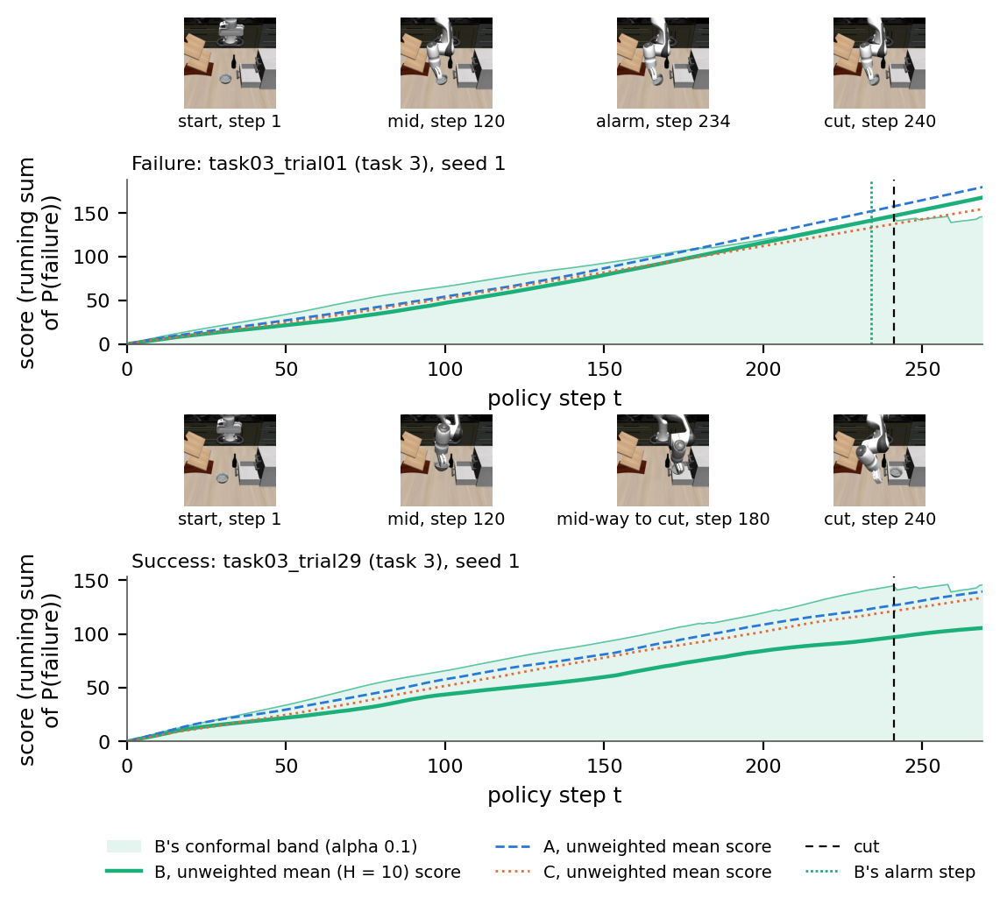

**F2.** Balanced accuracy against mean normalised detection time over the 15 α levels, mean of 3 seeds: (a) unseen tasks, original rollouts; (b) unseen tasks incl. LIBERO-PRO.

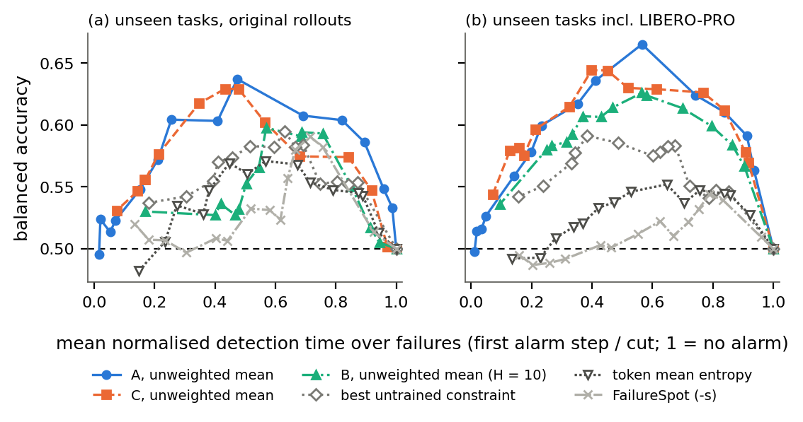

**F3.** (a) Kept rollouts per class against t (original rollouts; training split mean of 3 seeds); (b) action-repeat rate before vs from the first success, successful rollouts, per source.

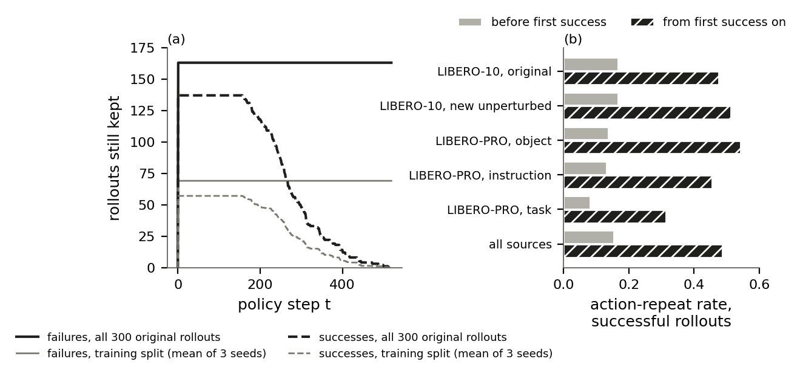

**F4.** Length check: mean score against t on unseen failures (solid) and unseen successes (dashed), unseen tasks, original rollouts; ± 1 std over seeds; drawn while ≥ 5 rollouts of the class are kept.

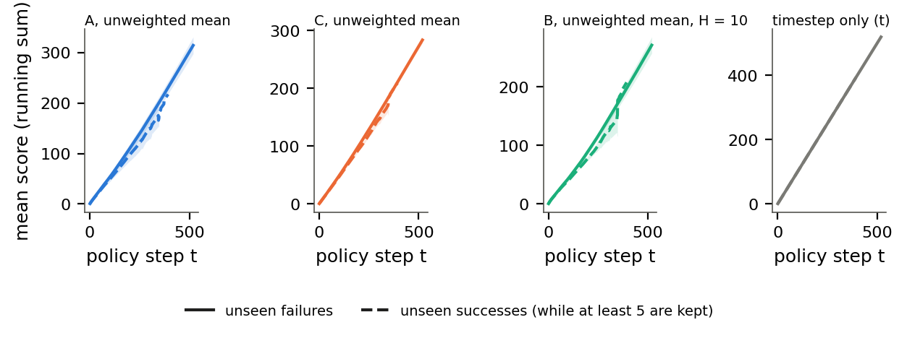

**F5.** Untrained per-task AUROC (running maximum; unseen tasks, original rollouts; mean of 3 seeds) per layer for emb_temp, xl_adj, xl_final, and the action constraints; hatched = sign-unstable.

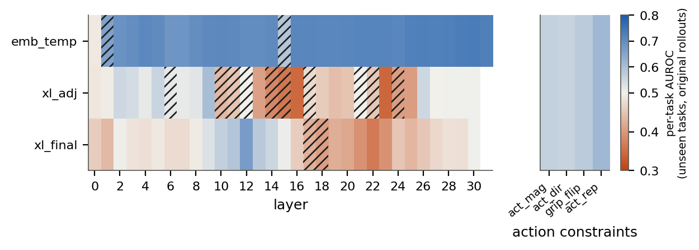

**F6.** Detector A: per-task AUROC against outcome of each of the 34 probes (running sum), unseen (solid, ± 1 std) and eval-seen (faded); the action-token probe to the right; shuffled-label control; A's unweighted mean (dash-dot).

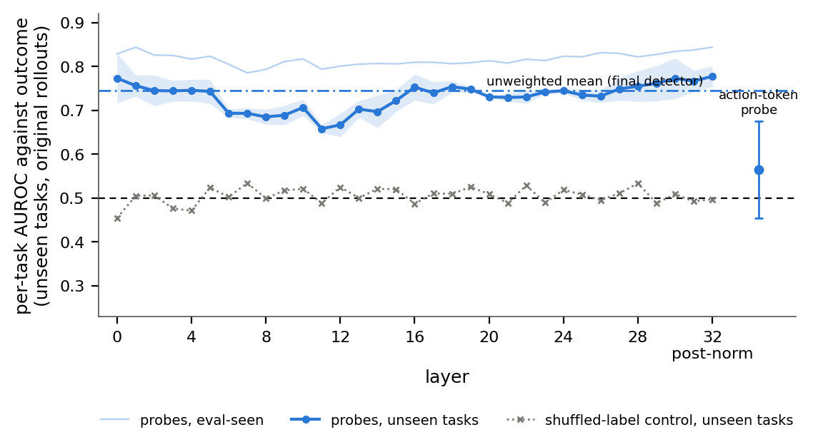

**F7.** Detector C: the same for its 33 probes; dotted: the layer's untrained constraints scored by their running sum (best of three, chosen on eval-seen).

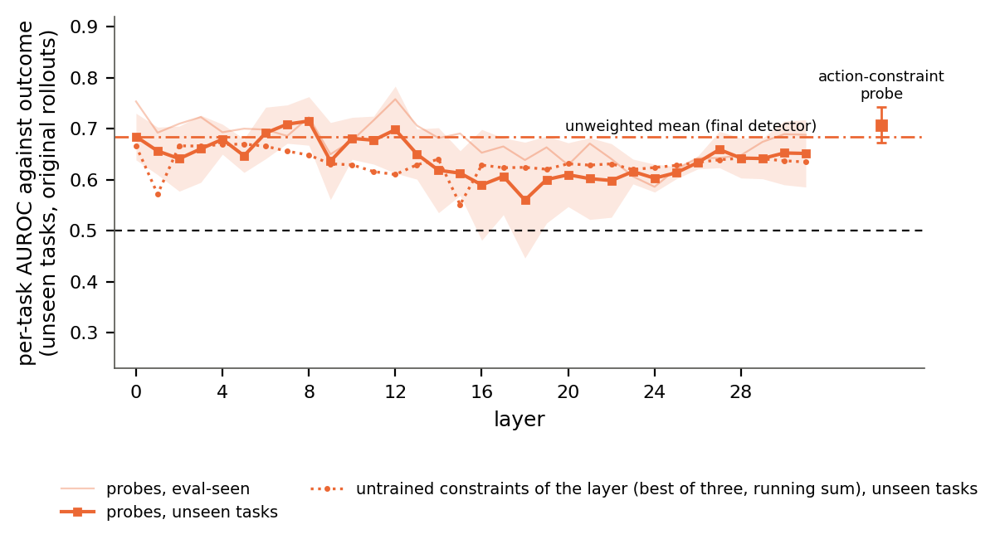

**F8.** Detector B: the same for its grid probes at H = 10 (124 on the original training set, 116 on the full one), one line per target; gaps are sign-unstable targets (no probe).

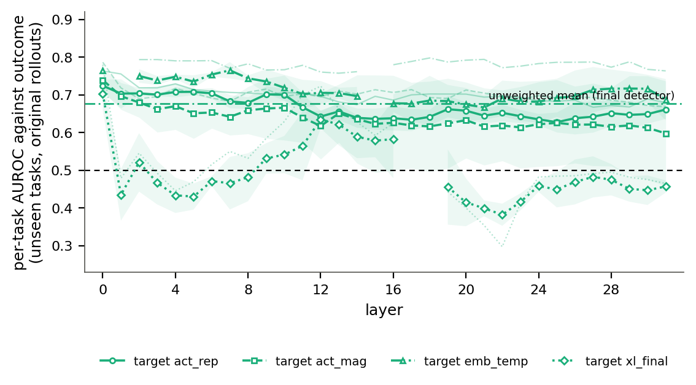

**F9.** B's probes: row-level AUROC against each probe's own constraint target, H = 10, unseen tasks (original rollouts), mean of 3 seeds.

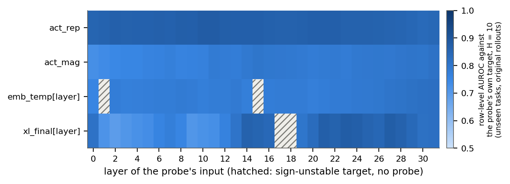

**F10.** Overlay: A per layer, C per layer, B per-layer mean of its probes (H = 10), unseen tasks, original rollouts.

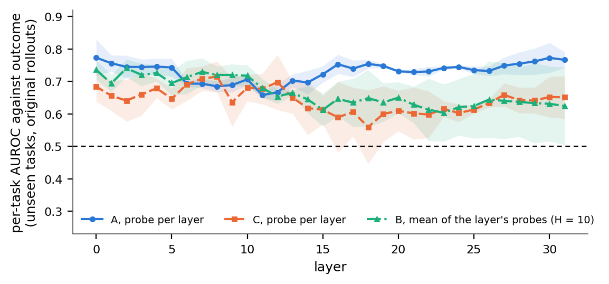

**F11.** Capacity: per-task AUROC against depth (linear, 2, 6, 12 hidden layers, residual MLP), A and C; train, eval-seen (optimistic) and unseen tasks; original (solid) and full (dashed) training set.

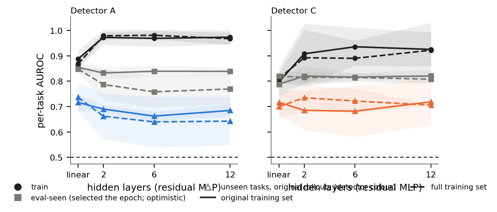

## Deviations, decisions and findings (from RUNLOG.md)

- **2026-10-30T13:31Z** — Decision (shuffled-label control per layer, §4.3): only the selected A probe has one (5 permutations). Computing it per probe as new work: 5 permutations of the train-rollout labels per (probe, seed), rng `default_rng(12345 + 1000*seed + probe index)`, fitted at c = 1e-5 like the real probe.
- **2026-10-30T13:50Z** — Decisions on baseline definitions (§4.2). (1) "Token max-probability" = `token_prob_mean`: per step, the top-bin probability averaged over the 7 action tokens. "Token mean entropy" = `token_entropy_mean`. Each takes the smoothing β with the best eval-seen per-task AUROC (entropy 0.96, max-probability 0.83), is prepared like every constraint, and is scored by its running maximum. Both are sign-unstable across seeds. (2) FailureSpot: both orientations reported. F2 plots −s, the orientation with the higher eval-seen per-task AUROC (0.568 vs 0.492). (3) Timestep-only alarm: the score is identical for every rollout at a given step, so the band's spread is zero and the band is undefined (NaN). It never alarms: balanced accuracy 0.5, nothing caught.
- **2026-10-30T13:50Z** — Palette: the dataviz skill's validator needs node, which is not installed (not installing it). Used the skill's documented, pre-validated categorical slots 1–3 (A #2a78d6, C #eb6834, B #1baf7a). Every series also differs by marker or line style.
- **2026-10-30T14:15Z** — Reproduction mismatch investigated, harmless: A's action-token probe, eval-seen, seeds 1 and 2, differs from `results/abc2/a_probes.csv` by 0.0053 (tolerance 0.005). Cause: refitted probe outputs are stored as fp16, as setup_a stored them, while abc2's per-probe table scored float32. Refitting and scoring in float32 gives 0.6824 / 0.5758, equal to the source. Detector rows are unaffected (they match exactly). All other 601 per-probe checks pass (max 0.0041 from the same rounding).
- **2026-10-30T14:15Z** — Deviation (§4.8, example rollout): seed 0 has no unseen failure that B's unweighted mean (H = 10) alarms on before the cut at α = 0.1 (share caught 0.000 in seed 0), so no seed-0 pair exists. Used the first seed that has one: seed 1, task 3. Failure task03_trial01 is alarmed at step 234, cut 241, with the longest run of repeated actions before the alarm (54 steps) among the candidates. Success task03_trial29 has the latest first success and is not alarmed. Question for James: keep seed 1, or prefer another α or seed. Recorded in `figures/data/example_rollouts.json`.
- **2026-10-30T14:19Z** — Finding (§4.4): B's linear probes vs the persistence baseline (the target's current prepared value, which the probes do not see). Persistence is 1 at H = 0 by construction. At H = 10 / 25 it scores 0.93–0.99 for the smoothed targets (act_rep, act_mag, xl_final) and beats every probe. For the unsmoothed emb_temp targets at H = 10, 69 % of probe-seed pairs beat it (headline set). `tables/table4_b_linear_vs_persistence.csv`.
- **2026-10-30T14:19Z** — Checkpoint 2 → `CHECKPOINT_2.md` and `REPORT.md` (3,134 reproduction checks, 2 failed and explained as harmless fp16 rounding). Questions logged for James: example-rollout seed, persistence framing, token max-probability definition.
- **2026-10-30T14:19Z** — Decision (§6): started the background run because every reproduction mismatch is explained and harmless. Launched (tmux `tr-full`): `bash analysis/thesis_results/run_full.sh > results/thesis_results_full/logs/full_run.log 2>&1`. It writes only to `results/thesis_results_full/` and `/data/tmp/thesis_results_work/full/`. Markers `results/thesis_results_full/logs/full_run.{done,error}`. The full training set's selections (β per family, c for C's probes / C's 132-input logistic regression / A, A's best probe, the earlier emb_temp layer) are the ones the more-data run made on that set's eval-seen (`results/abc2/selections.csv`, D2); everything new (combiners, best probes, B's grid c at all three H, MLP weight decay, the per-task emb_temp layer) is selected here on its eval-seen.
- **2026-10-30T15:04Z** — Background run finished (`results/thesis_results_full/logs/full_run.done`). A's GPU-vs-scikit-learn check on the full set: max diff 0.0017, PASSED. B's grid pass 1 chose c = 1e-4 over all three H (eval-seen own-target AUROC 0.875). 116 probes per H (11 sign-unstable targets skipped). 120 existing-row checks against results/abc2 D2 tables pass exactly.
- **2026-10-30T15:07Z** — Reproduction mismatch investigated, harmless (full training set): A's action-token probe, eval-seen, seed 2, 0.0118 off `results/abc2/a_probes.csv`. Cause: fp16 storage, with probabilities spanning only 0.484–0.515 at c = 1e-6. A float32 refit gives 0.4823, equal to the source.

## Proposed commit message

```
Thesis results, main run (original training set): tables, figures, report

Collect the thesis Results chapter's numbers on the original training set:
A, C and B as single best probe, unweighted mean of probe outputs (primary),
trained combiner (out-of-fold) and 2-layer MLP, with baselines, per-task and
pooled AUROC and conformal alarms on unseen tasks (original and incl.
LIBERO-PRO) and the stress set; per-probe outcome profiles; B's constraint
prediction vs persistence; paired bootstraps; ablations; corpus and confounds.
Every existing row reproduces its source file (292 detector checks, max
diff 0.0001).

New:
- analysis/thesis_results/: probe refits (A and B on GPU, C on CPU),
  detectors, evaluation, checks, profiles, paired bootstrap, corpus,
  example rollout, tables, figures, report; run_gpu_probes.sh,
  run_main.sh, run_full.sh (background run), status.sh
- results/thesis_results/: REPORT.md, CHECKPOINT_0_audit.md,
  CHECKPOINT_1.md, CHECKPOINT_2.md, RUNLOG.md, STATE.md, tables/,
  figures/ (PDF + PNG + data CSVs), scores/

Co-Authored-By: Claude Opus 5.5 <noreply@anthropic.com>
```
