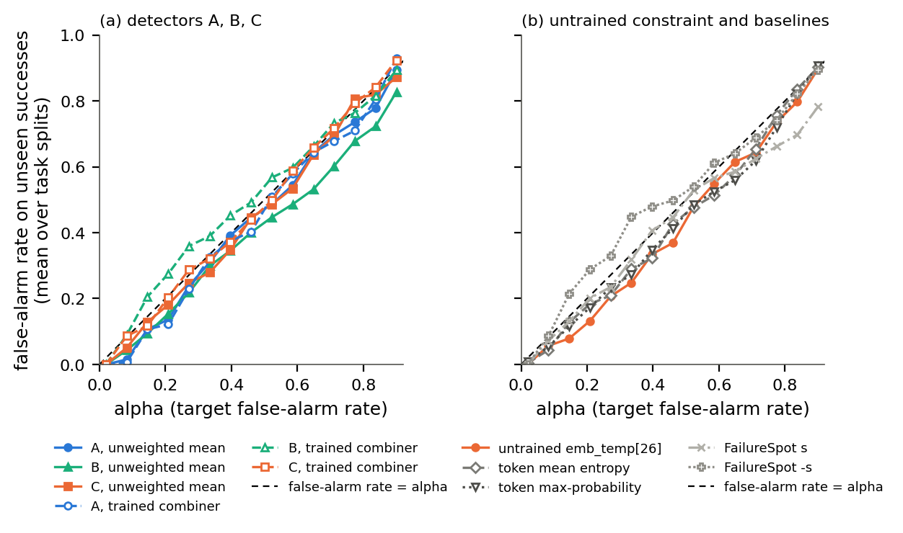
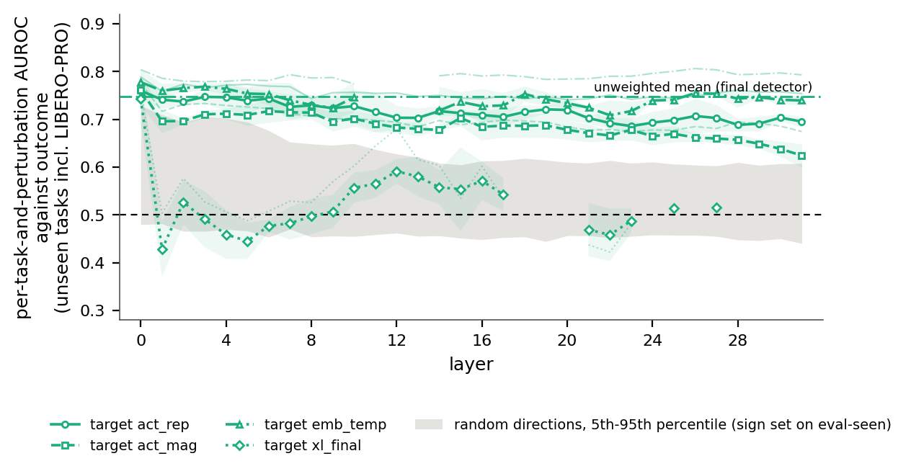

# Task resampling: ranges that redraw the unseen tasks, false alarms, failure types, random directions

*task_resampling_handoff.md (version 4), §7. Generated by `analysis/thesis_results/task_resampling/report.py` from `results/thesis_results_final/task_resampling/`; the headline, decisions and commit message are in `report_notes.md`. A **task split** is what the repo calls a seed: it sets which 3 tasks are held out and how the rest divide into train and eval-seen. Headline setup throughout: full training set, tested on the unseen tasks incl. LIBERO-PRO. No refits: every detector score, split and conformal threshold is the saved one.*

## Headline

1. **Ranges that exclude zero.** With the unseen tasks redrawn, no per-task AUROC gap between A's, B's and C's means excludes zero. On balanced accuracy at α = 0.1, C's mean is above A's (A − C −0.035 [−0.060, −0.007]), B's (B − C −0.053 [−0.080, −0.027]) and B's embedding-temporal mean at every H. A few other ranges also exclude zero: A's mean over A's 2-layer MLP (+0.070 [+0.003, +0.174]); C's balanced-accuracy gain from the full training set (+0.036 [+0.012, +0.053]); C's AUROC loss when emb_temp is smoothed (−0.029 at β = 0.83, −0.059 at β = 0.96 everywhere); and dropping B's layer-0 probes (−0.009 [−0.015, −0.001]). Every other range includes zero, among them B against the untrained constraint, every perturbation type, the training-data change for A and B, and the setting closest to SAFE's.
2. **How far B could trail A.** On the headline setup the range allows B's mean to trail A's mean by up to 0.085 per-task AUROC ([−0.085, +0.020]) and B's embedding-temporal mean (H = 10) by up to 0.073. In the setting closest to SAFE's (original training set, original rollouts) the range allows up to 0.182 per-task and 0.144 pooled.
3. **False alarms against α.** On the unseen tasks, averaged over the three task splits, the false-alarm rate stays at or below α at all 15 levels for A's mean, B's mean and the untrained emb_temp constraint. C's mean exceeds α at one level (by 0.03). The trained combiners do not hold it: B's combiner is above α at 11 levels (by up to 0.09), C's at 8 (by up to 0.02), as is FailureSpot −s at 9 (by up to 0.11). Single task splits exceed α in 12–27 of 45 split-and-level pairs; for example, C's mean has a false-alarm rate of 0.19 at α = 0.1 in task split 2.
4. **Which failures are caught.** Of the 141 failed original rollouts (counted once per task split), 31 froze, 110 moved and grasped but still failed, and none never closed the gripper. At α = 0.1 the detectors catch mainly the frozen ones: C's mean 45%, B's 26%, A's 10% and the untrained constraint 6%. They almost never catch the others (C 6%, B 1%, A 0%, untrained 1%), which are wrong placements and unfinished steps. C's and B's alarms on frozen rollouts mostly come after the freeze starts (median 11 and 20 steps after), while A's 3 catches all come before it.
5. **B's probes against random directions.** At layer 0, random directions (sign set on eval-seen) reach a median of 0.615 (5th–95th percentile 0.48–0.73), and each of B's layer-0 probes (0.74–0.78) beats 99–100% of them. So a random reading of the layer-0 hidden state does not explain them, even though they rank rollouts almost exactly as A's layer-0 probe does (Spearman 0.91–0.95 within groups). From layer 1 on the random median is 0.51–0.61. B's act_rep, act_mag and emb_temp probes beat 91–100% of random directions at every layer, while its xl_final probes sit inside the random band (beating 0–83%).

## §3. Ranges that also redraw the unseen tasks

File: `ranges.csv` (extra columns in `logs/ranges_full.csv`). Difference = x − y on the saved sample (mean over the three task splits); 95% range = 2.5th–97.5th percentile over 2,000 rounds (seed 20261101), each round redrawing 3 of each split's 3 unseen tasks with replacement and then the rollouts within each task-and-perturbation group. Both sides of a comparison use the same draws. B at H = 10 unless stated; headline test set (unseen tasks incl. LIBERO-PRO) unless stated. **Bold** = the range excludes zero.

**Self-check (step 1 switched off), passed.** With bootstrap2's own rollout draws, the engine reproduces every range in `tables/paired_comparisons.csv` to the CSV's 4 decimals (max |change| 4.9e-05). With this run's draws (2,000 rounds), the largest change in a difference or range end is 0.0042 (limit 0.005). Per-row values: `logs/self_check.csv`.

**1. headline**

| comparison (x − y) | metric | difference | 95% range | rounds used |
|---|---|---|---|---|
| B mean - A mean | per-task AUROC | -0.032 | [-0.085, +0.020] | 2000 |
| B mean - A mean | balanced accuracy at alpha 0.1 | -0.018 | [-0.047, +0.006] | 2000 |
| B mean - C mean | per-task AUROC | -0.001 | [-0.041, +0.041] | 2000 |
| B mean - C mean | balanced accuracy at alpha 0.1 | -0.053 | **[-0.080, -0.027]** | 2000 |
| A mean - C mean | per-task AUROC | +0.031 | [-0.018, +0.084] | 2000 |
| A mean - C mean | balanced accuracy at alpha 0.1 | -0.035 | **[-0.060, -0.007]** | 2000 |

**2. within each detector**

| comparison (x − y) | metric | difference | 95% range | rounds used |
|---|---|---|---|---|
| A mean - A single best probe | per-task AUROC | +0.011 | [-0.011, +0.037] | 2000 |
| A mean - A trained combiner | per-task AUROC | +0.009 | [-0.008, +0.021] | 2000 |
| A mean - A 2-layer MLP | per-task AUROC | +0.070 | **[+0.003, +0.174]** | 2000 |
| B mean - B single best probe | per-task AUROC | -0.002 | [-0.032, +0.035] | 2000 |
| B mean - B trained combiner | per-task AUROC | +0.020 | [-0.034, +0.066] | 2000 |
| B mean - B 2-layer MLP | per-task AUROC | +0.009 | [-0.025, +0.069] | 2000 |
| C mean - C single best probe | per-task AUROC | -0.018 | [-0.052, +0.009] | 2000 |
| C mean - C trained combiner | per-task AUROC | -0.001 | [-0.050, +0.040] | 2000 |
| C mean - C 2-layer MLP | per-task AUROC | -0.016 | [-0.051, +0.020] | 2000 |

**3. B embedding-temporal mean**

| comparison (x − y) | metric | difference | 95% range | rounds used |
|---|---|---|---|---|
| B embedding-temporal mean (H = 0) - A mean | per-task AUROC | -0.024 | [-0.063, +0.015] | 2000 |
| B embedding-temporal mean (H = 0) - A mean | balanced accuracy at alpha 0.1 | -0.026 | [-0.067, +0.003] | 2000 |
| B embedding-temporal mean (H = 0) - C mean | per-task AUROC | +0.007 | [-0.032, +0.046] | 2000 |
| B embedding-temporal mean (H = 0) - C mean | balanced accuracy at alpha 0.1 | -0.061 | **[-0.098, -0.031]** | 2000 |
| B embedding-temporal mean (H = 0) - untrained emb_temp[26] | per-task AUROC | +0.016 | [-0.033, +0.059] | 2000 |
| B embedding-temporal mean (H = 0) - untrained emb_temp[26] | balanced accuracy at alpha 0.1 | +0.016 | [-0.023, +0.068] | 2000 |
| B embedding-temporal mean (H = 10) - A mean | per-task AUROC | -0.026 | [-0.073, +0.027] | 2000 |
| B embedding-temporal mean (H = 10) - A mean | balanced accuracy at alpha 0.1 | -0.019 | [-0.044, +0.004] | 2000 |
| B embedding-temporal mean (H = 10) - C mean | per-task AUROC | +0.005 | [-0.028, +0.044] | 2000 |
| B embedding-temporal mean (H = 10) - C mean | balanced accuracy at alpha 0.1 | -0.054 | **[-0.077, -0.030]** | 2000 |
| B embedding-temporal mean (H = 10) - untrained emb_temp[26] | per-task AUROC | +0.013 | [-0.037, +0.068] | 2000 |
| B embedding-temporal mean (H = 10) - untrained emb_temp[26] | balanced accuracy at alpha 0.1 | +0.024 | [-0.004, +0.077] | 2000 |
| B embedding-temporal mean (H = 25) - A mean | per-task AUROC | -0.027 | [-0.069, +0.026] | 2000 |
| B embedding-temporal mean (H = 25) - A mean | balanced accuracy at alpha 0.1 | -0.015 | [-0.037, +0.003] | 2000 |
| B embedding-temporal mean (H = 25) - C mean | per-task AUROC | +0.004 | [-0.033, +0.053] | 2000 |
| B embedding-temporal mean (H = 25) - C mean | balanced accuracy at alpha 0.1 | -0.050 | **[-0.073, -0.025]** | 2000 |
| B embedding-temporal mean (H = 25) - untrained emb_temp[26] | per-task AUROC | +0.013 | [-0.037, +0.069] | 2000 |
| B embedding-temporal mean (H = 25) - untrained emb_temp[26] | balanced accuracy at alpha 0.1 | +0.028 | [-0.001, +0.071] | 2000 |

**4. per perturbation type**

| comparison (x − y) | metric | difference | 95% range | rounds used |
|---|---|---|---|---|
| B mean - A mean, unperturbed groups | per-task AUROC | -0.031 | [-0.075, +0.012] | 2000 |
| B mean - A mean, unperturbed groups | balanced accuracy at alpha 0.1 | +0.010 | [-0.013, +0.033] | 2000 |
| B mean - A mean, object perturbation groups | per-task AUROC | -0.081 | [-0.200, +0.013] | 1708 (skipped 292) |
| B mean - A mean, object perturbation groups | balanced accuracy at alpha 0.1 | -0.058 | [-0.118, +0.052] | 1821 (skipped 179) |
| B mean - A mean, instruction paraphrase groups | per-task AUROC | +0.010 | [-0.097, +0.097] | 1969 (skipped 31) |
| B mean - A mean, instruction paraphrase groups | balanced accuracy at alpha 0.1 | -0.031 | [-0.096, +0.037] | 1997 (skipped 3) |

**5. training data (full - original)**

| comparison (x − y) | metric | difference | 95% range | rounds used |
|---|---|---|---|---|
| A mean: full - original training set | per-task AUROC | +0.025 | [-0.008, +0.072] | 2000 |
| A mean: full - original training set | balanced accuracy at alpha 0.1 | +0.005 | [-0.030, +0.045] | 2000 |
| C mean: full - original training set | per-task AUROC | -0.011 | [-0.028, +0.017] | 2000 |
| C mean: full - original training set | balanced accuracy at alpha 0.1 | +0.036 | **[+0.012, +0.053]** | 2000 |
| B mean on the 113 shared probes: full - original training set | per-task AUROC | -0.014 | [-0.039, +0.011] | 2000 |
| B mean on the 113 shared probes: full - original training set | balanced accuracy at alpha 0.1 | -0.011 | [-0.052, +0.028] | 2000 |

**6. smoothing (setting - selected)**

| comparison (x − y) | metric | difference | 95% range | rounds used |
|---|---|---|---|---|
| C mean: no smoothing - selected | per-task AUROC | -0.004 | [-0.026, +0.011] | 2000 |
| C mean: no smoothing - selected | balanced accuracy at alpha 0.1 | -0.015 | [-0.034, +0.009] | 2000 |
| B mean: no smoothing - selected | per-task AUROC | -0.006 | [-0.058, +0.029] | 2000 |
| B mean: no smoothing - selected | balanced accuracy at alpha 0.1 | +0.008 | [-0.008, +0.029] | 2000 |
| C mean: beta = 0.83 everywhere - selected | per-task AUROC | -0.029 | **[-0.054, -0.005]** | 2000 |
| C mean: beta = 0.83 everywhere - selected | balanced accuracy at alpha 0.1 | -0.013 | [-0.050, +0.028] | 2000 |
| B mean: beta = 0.83 everywhere - selected | per-task AUROC | -0.008 | [-0.019, +0.006] | 2000 |
| B mean: beta = 0.83 everywhere - selected | balanced accuracy at alpha 0.1 | +0.002 | [-0.009, +0.014] | 2000 |
| C mean: beta = 0.96 everywhere - selected | per-task AUROC | -0.059 | **[-0.093, -0.026]** | 2000 |
| C mean: beta = 0.96 everywhere - selected | balanced accuracy at alpha 0.1 | -0.031 | **[-0.058, -0.001]** | 2000 |
| B mean: beta = 0.96 everywhere - selected | per-task AUROC | -0.022 | [-0.059, +0.013] | 2000 |
| B mean: beta = 0.96 everywhere - selected | balanced accuracy at alpha 0.1 | -0.005 | [-0.022, +0.011] | 2000 |

**7. setting closest to SAFE's**

| comparison (x − y) | metric | difference | 95% range | rounds used |
|---|---|---|---|---|
| B mean - A mean, original training set, unseen tasks' original rollouts | per-task AUROC | -0.068 | [-0.182, +0.035] | 2000 |
| B mean - A mean, original training set, unseen tasks' original rollouts | pooled AUROC | -0.030 | [-0.144, +0.041] | 2000 |

**8. B against the untrained constraint**

| comparison (x − y) | metric | difference | 95% range | rounds used |
|---|---|---|---|---|
| B mean - untrained emb_temp[26] | per-task AUROC | +0.008 | [-0.048, +0.059] | 2000 |
| B mean - untrained emb_temp[26] | balanced accuracy at alpha 0.1 | +0.025 | [-0.003, +0.069] | 2000 |
| B mean, unseen tasks' original rollouts: original - full training set | per-task AUROC | -0.041 | [-0.105, +0.017] | 2000 |
| B mean, unseen tasks' original rollouts: original - full training set | balanced accuracy at alpha 0.1 | -0.007 | [-0.045, +0.037] | 2000 |

**Rounds skipped and groups dropped.** A round is skipped when a task split has no group with at least 2 failures and 2 successes, or no success or no failure for balanced accuracy, so that every recorded value averages three splits. On the headline test set no round is skipped. In 1981 of 2,000 rounds at least one drawn group lacks 2 of each class and is left out of the per-task AUROC: on average 3.3 of 27 drawn groups per round, mostly object-perturbation groups with few successes. The same groups fail the rule on the saved sample (8, 7 and 9 of 9 groups qualify). Within the object-perturbation groups alone, 292 rounds are skipped for AUROC (179 for balanced accuracy), because a split's drawn tasks then often have no qualifying group.

## §4. False alarms against the target rate

File: `false_alarms_vs_alpha.csv` (mean ± std over splits, per split, eval-seen reference); figure `F12_false_alarms_vs_alpha.{pdf,png}`. Source: the full training set's saved alarm results (`results/thesis_results_full/tables/data/detector_alarm_per_seed.csv`), headline test set, cut variant, the 15 α levels of the grid. Values: false-alarm rate on unseen successes, mean over the three task splits; **bold** = above α. At α = 0.02 the band is infinite (too few calibration rollouts for that level), so no detector alarms.

| detector | 0.02 | 0.08 | 0.15 | 0.21 | 0.27 | 0.33 | 0.40 | 0.46 | 0.52 | 0.59 | 0.65 | 0.71 | 0.77 | 0.84 | 0.90 | α levels with mean above α |
|---|---|---|---|---|---|---|---|---|---|---|---|---|---|---|---|---|
| A, unweighted mean | 0.00 | 0.02 | 0.11 | 0.14 | 0.24 | 0.31 | 0.39 | 0.45 | 0.49 | 0.54 | 0.64 | 0.70 | 0.74 | 0.78 | 0.89 | 0 |
| B, unweighted mean (H = 10) | 0.00 | 0.04 | 0.09 | 0.15 | 0.22 | 0.30 | 0.35 | 0.40 | 0.45 | 0.49 | 0.53 | 0.60 | 0.68 | 0.72 | 0.83 | 0 |
| C, unweighted mean | 0.00 | 0.05 | 0.13 | 0.18 | 0.25 | 0.28 | 0.35 | 0.45 | 0.49 | 0.53 | 0.64 | 0.69 | **0.81** | 0.82 | 0.87 | 1 |
| A, trained combiner | 0.00 | 0.01 | 0.11 | 0.12 | 0.23 | 0.32 | 0.37 | 0.40 | 0.51 | 0.58 | 0.64 | 0.68 | 0.71 | 0.81 | **0.93** | 1 |
| B, trained combiner (H = 10) | 0.00 | **0.09** | **0.21** | **0.28** | **0.36** | **0.39** | **0.45** | **0.49** | **0.57** | **0.60** | **0.66** | **0.73** | 0.76 | 0.82 | 0.89 | 11 |
| C, trained combiner | 0.00 | **0.09** | 0.12 | 0.20 | **0.29** | 0.32 | 0.37 | 0.44 | 0.50 | **0.59** | **0.66** | **0.72** | **0.79** | **0.84** | **0.92** | 8 |
| untrained emb_temp[26] | 0.00 | 0.06 | 0.08 | 0.13 | 0.21 | 0.25 | 0.33 | 0.37 | 0.48 | 0.55 | 0.61 | 0.64 | 0.74 | 0.80 | 0.90 | 0 |
| token mean entropy | 0.00 | 0.04 | 0.13 | 0.18 | 0.21 | 0.29 | 0.32 | 0.43 | 0.48 | 0.51 | 0.57 | 0.65 | 0.76 | 0.84 | **0.90** | 1 |
| token max-probability | 0.01 | 0.05 | 0.12 | 0.17 | 0.23 | 0.27 | 0.35 | 0.41 | 0.48 | 0.53 | 0.56 | 0.62 | 0.72 | 0.82 | **0.91** | 1 |
| FailureSpot s | 0.00 | 0.07 | 0.13 | 0.20 | 0.23 | 0.32 | **0.41** | 0.45 | **0.53** | 0.57 | 0.59 | 0.62 | 0.66 | 0.70 | 0.78 | 2 |
| FailureSpot -s | 0.00 | **0.09** | **0.21** | **0.29** | **0.33** | **0.45** | **0.48** | **0.50** | **0.54** | **0.61** | 0.64 | 0.69 | 0.74 | 0.82 | 0.89 | 9 |



## §5. Which failures are caught

Files: `failure_types.csv` (one row per rollout and task split), `failure_types_summary.csv`, `failure_descriptions.md` (the 20 checked by eye), frame strips in `failure_frames/`. Rollouts: every failed original LIBERO-10 rollout of each split's unseen tasks, headline setup (full training set; cut = shortest kept length in the rollout's task-and-perturbation group of the headline test set), counted once per split. Caught = the α = 0.1 alarm fires before the cut.

| failure type | rollouts (rollout × split) | distinct rollouts | A mean: share caught (count) | B mean (H = 10): share caught (count) | C mean: share caught (count) | untrained emb_temp[26]: share caught (count) |
|---|---|---|---|---|---|---|
| froze | 31 | 31 | 0.097 (3) | 0.258 (8) | 0.452 (14) | 0.065 (2) |
| never grasped | 0 | 0 |  |  |  |  |
| other | 110 | 93 | 0.000 (0) | 0.009 (1) | 0.064 (7) | 0.009 (1) |
| all failures | 141 | 124 | 0.021 (3) | 0.064 (9) | 0.149 (21) | 0.021 (3) |

"Froze" only (alarm step minus freeze start: negative = the alarm comes before the freeze):

| detector | caught | share of caught with the alarm before the freeze starts | median alarm step − freeze start |
|---|---|---|---|
| A mean | 3 | 1 | -12 |
| B mean (H = 10) | 8 | 0.375 | 19.5 |
| C mean | 14 | 0.429 | 11 |
| untrained emb_temp[26] | 2 | 1 | -46.5 |

**Check by eye:** the action-based type matches 19 of the 20 sampled rollouts (froze 9 of 10, other 10 of 10); the threshold stays at 20 steps. No rollout is "never grasped": every failure that did not freeze closes the gripper at some point (the one rollout that never closes it, task02_trial02, froze first).

## §6. Random-direction control for B

**How B's probe inputs are prepared (read from the code: `probes_b.run_layer` → `setup_b.fit_grid_block` / `predict_block`; `common.load_layer` → `stage4_a.load_probe_input`).** The input at layer L is the cached hidden state `layer<L>.npy`: per policy step, the mean over the 7 decision states (the action-token positions; `abc2/build_cache2.py`), fp16. It is standardised per dimension with the mean and the biased standard deviation over the kept rows of that task split's training rollouts (sd = 0 → 1). For eval-seen and unseen rollouts the refit on all training rows sets this standardisation. A probe's per-step output is sigmoid(w·x + b), and its rollout score is the running sum over kept rows read at its maximum before the cut, which equals the sum to the cut because the outputs are positive.

**Random directions.** 200 unit directions (standard normal, scaled to length 1, seed 20261102), the same for every layer and split. Per-step score = standardised x · d; rollout score = sum over kept rows before the cut. The projection can be negative, so I use the sum to the cut, as the handoff asks, not the running sum's maximum. Per-task AUROC as for B's probes. Sign: a direction is flipped in a split if its eval-seen per-task AUROC is below 0.5 there, which turns its unseen AUROC into exactly 1 − AUROC. **Scorer check:** the same scoring applied to B's saved layer-0 outputs reproduces their per-task AUROC in `figures/data/per_probe_outcome_auroc.csv` (max |diff| 4.5e-05, i.e. the CSV's rounding).

File: `random_directions.csv` (also 5th/95th percentiles unflipped, share flipped, share of unflipped directions beaten, the Spearman columns). Per-task-and-perturbation AUROC on the headline test set, mean over the three task splits; random directions as median [5th, 95th percentile] over the 200; B's probes at H = 10.

| layer | random, sign set on eval-seen | random, unflipped | A's probe | B probes act_rep / act_mag / emb_temp / xl_final | share of signed random directions each B probe beats |
|---|---|---|---|---|---|
| 0 | 0.615 [0.480, 0.728] | 0.511 [0.295, 0.706] | 0.777 | 0.760 / 0.761 / 0.778 / 0.743 | 1 / 1 / 1 / 0.99 |
| 1 | 0.606 [0.481, 0.710] | 0.514 [0.310, 0.702] | 0.783 | 0.741 / 0.696 / 0.760 / 0.428 | 0.995 / 0.91 / 1 / 0 |
| 2 | 0.588 [0.466, 0.694] | 0.513 [0.323, 0.680] | 0.783 | 0.737 / 0.697 / 0.765 / 0.526 | 1 / 0.965 / 1 / 0.215 |
| 3 | 0.591 [0.466, 0.705] | 0.516 [0.314, 0.674] | 0.788 | 0.747 / 0.711 / 0.768 / 0.491 | 1 / 0.965 / 1 / 0.115 |
| 4 | 0.587 [0.470, 0.702] | 0.520 [0.322, 0.678] | 0.787 | 0.746 / 0.712 / 0.764 / 0.459 | 1 / 0.955 / 1 / 0.025 |
| 5 | 0.594 [0.466, 0.694] | 0.510 [0.329, 0.668] | 0.786 | 0.739 / 0.709 / 0.754 / 0.445 | 1 / 0.975 / 1 / 0.015 |
| 6 | 0.578 [0.453, 0.677] | 0.509 [0.349, 0.648] | 0.769 | 0.744 / 0.717 / 0.753 / 0.477 | 0.995 / 0.995 / 1 / 0.12 |
| 7 | 0.560 [0.470, 0.652] | 0.502 [0.354, 0.635] | 0.756 | 0.726 / 0.715 / 0.740 / 0.483 | 1 / 1 / 1 / 0.115 |
| 8 | 0.553 [0.454, 0.648] | 0.499 [0.374, 0.643] | 0.749 | 0.729 / 0.714 / 0.730 / 0.497 | 1 / 1 / 1 / 0.235 |
| 9 | 0.548 [0.456, 0.646] | 0.513 [0.381, 0.632] | 0.745 | 0.723 / 0.695 / 0.724 / 0.507 | 1 / 0.99 / 1 / 0.28 |
| 10 | 0.550 [0.455, 0.649] | 0.500 [0.381, 0.630] | 0.768 | 0.728 / 0.702 / 0.746 / 0.557 | 1 / 0.995 / 1 / 0.535 |
| 11 | 0.548 [0.459, 0.637] | 0.502 [0.389, 0.629] | 0.753 | 0.715 / 0.691 / – / 0.565 | 1 / 1 / – / 0.6 |
| 12 | 0.542 [0.462, 0.627] | 0.508 [0.388, 0.603] | 0.743 | 0.703 / 0.683 / – / 0.591 | 1 / 1 / – / 0.825 |
| 13 | 0.532 [0.455, 0.621] | 0.509 [0.402, 0.604] | 0.749 | 0.703 / 0.680 / – / 0.580 | 1 / 1 / – / 0.8 |
| 14 | 0.535 [0.456, 0.609] | 0.509 [0.412, 0.602] | 0.758 | 0.717 / 0.678 / 0.718 / 0.558 | 1 / 0.995 / 1 / 0.675 |
| 15 | 0.531 [0.451, 0.605] | 0.503 [0.412, 0.595] | 0.758 | 0.713 / 0.703 / 0.737 / 0.554 | 1 / 1 / 1 / 0.66 |
| 16 | 0.529 [0.448, 0.613] | 0.503 [0.400, 0.597] | 0.756 | 0.709 / 0.684 / 0.727 / 0.571 | 1 / 1 / 1 / 0.795 |
| 17 | 0.528 [0.453, 0.614] | 0.506 [0.391, 0.600] | 0.748 | 0.705 / 0.687 / 0.729 / 0.543 | 1 / 1 / 1 / 0.61 |
| 18 | 0.529 [0.454, 0.618] | 0.510 [0.391, 0.592] | 0.754 | 0.716 / 0.686 / 0.753 / – | 1 / 1 / 1 / – |
| 19 | 0.529 [0.444, 0.615] | 0.505 [0.401, 0.591] | 0.758 | 0.721 / 0.687 / 0.742 / – | 1 / 1 / 1 / – |
| 20 | 0.530 [0.456, 0.610] | 0.505 [0.400, 0.591] | 0.754 | 0.720 / 0.678 / 0.734 / – | 1 / 0.995 / 1 / – |
| 21 | 0.528 [0.456, 0.609] | 0.503 [0.399, 0.595] | 0.756 | 0.703 / 0.671 / 0.724 / 0.469 | 1 / 0.995 / 1 / 0.105 |
| 22 | 0.525 [0.452, 0.614] | 0.503 [0.411, 0.593] | 0.762 | 0.692 / 0.666 / 0.709 / 0.458 | 1 / 0.995 / 1 / 0.07 |
| 23 | 0.524 [0.455, 0.608] | 0.502 [0.404, 0.597] | 0.765 | 0.686 / 0.678 / 0.717 / 0.488 | 1 / 1 / 1 / 0.285 |
| 24 | 0.515 [0.458, 0.611] | 0.501 [0.406, 0.597] | 0.768 | 0.693 / 0.665 / 0.739 / – | 1 / 1 / 1 / – |
| 25 | 0.521 [0.457, 0.606] | 0.494 [0.412, 0.592] | 0.766 | 0.698 / 0.670 / 0.741 / 0.513 | 1 / 0.995 / 1 / 0.465 |
| 26 | 0.517 [0.457, 0.604] | 0.496 [0.413, 0.590] | 0.765 | 0.707 / 0.662 / 0.755 / – | 1 / 1 / 1 / – |
| 27 | 0.513 [0.455, 0.603] | 0.499 [0.409, 0.589] | 0.767 | 0.703 / 0.660 / 0.754 / 0.516 | 1 / 1 / 1 / 0.52 |
| 28 | 0.516 [0.448, 0.610] | 0.499 [0.407, 0.587] | 0.767 | 0.688 / 0.657 / 0.743 / – | 1 / 1 / 1 / – |
| 29 | 0.520 [0.446, 0.604] | 0.491 [0.407, 0.593] | 0.764 | 0.691 / 0.649 / 0.746 / – | 1 / 1 / 1 / – |
| 30 | 0.520 [0.450, 0.607] | 0.491 [0.399, 0.591] | 0.771 | 0.704 / 0.638 / 0.741 / – | 1 / 0.99 / 1 / – |
| 31 | 0.521 [0.440, 0.608] | 0.495 [0.407, 0.597] | 0.762 | 0.695 / 0.624 / 0.740 / – | 1 / 0.98 / 1 / – |

### B and A without layer 0

File: `b_without_layer0.csv`. Range from §1 (2,000 rounds, tasks redrawn).

| row | per-task AUROC | full mean | difference | 95% range |
|---|---|---|---|---|
| B mean without layer 0 | 0.739 | 0.748 | -0.009 | **[-0.015, -0.001]** |
| A mean without layer 0 | 0.776 | 0.780 | -0.004 | [-0.009, +0.002] |

### Agreement with A's probe at the same layer

File: `agreement_with_a.csv`. Spearman correlation between the rollout scores of B's probe and A's probe at the same layer, within each task-and-perturbation group of the headline test set (groups of at least 3 rollouts), averaged over groups, then over the three task splits.

| B probe target | layer 0 | layer 1 | layer 10 | layer 26 |
|---|---|---|---|---|
| act_rep | 0.937 | 0.806 | 0.724 | 0.687 |
| act_mag | 0.934 | 0.697 | 0.591 | 0.544 |
| emb_temp | 0.954 | 0.818 | 0.683 | 0.714 |
| xl_final | 0.906 | -0.308 | 0.088 | – |

### F8 with the random-direction band

`../figures/F8_per_probe_detector_b.{pdf,png}` now has the random-direction band (5th–95th percentile, sign set on eval-seen) in light grey behind B's probe lines; band data `../figures/data/F8_random_direction_band.csv`. The earlier version is kept as `../figures/F8_per_probe_detector_b_noband.{pdf,png}`.



## Decisions and notes

1. **Each drawn copy of a task gets its own rollout draw.** The handoff says a task drawn twice counts twice and that rollouts are redrawn within each group. I read this as: each copy of a task gets an independent within-group draw, so the second copy is not a clone of the first, and each copy's cut is recomputed from its own drawn rollouts, as bootstrap2 does. With task resampling switched off, this is exactly the earlier bootstrap: with bootstrap2's own draws it reproduces `tables/paired_comparisons.csv` to the CSV's 4 decimals.
2. **Skipped rounds.** A round is skipped if any task split's value is undefined, so that every recorded value averages three splits. bootstrap2 instead averaged the splits that were defined. On the headline test set no round is skipped; only the perturbation-type subsets skip rounds (object perturbation: 292 of 2,000 for AUROC, 179 for balanced accuracy; instruction paraphrase: 31 and 3). A drawn group with fewer than 2 failures or 2 successes is left out of the per-task AUROC, as the handoff says. Pooled AUROC (§2.7) scores each rollout under its own group's cut, as data.m1 does.
3. **Metrics where §2 does not name one.** §2.3–2.6 and the second comparison of §2.8 report both per-task AUROC and balanced accuracy at α = 0.1, as the follow-up's checks did. §2.2 reports per-task AUROC only, and §2.7 per-task and pooled AUROC, as the handoff says. B's mean on the 113 shared probes (§2.5) is at H = 10 only ("B at H = 10 unless stated").
4. **Which saved files.** Headline comparisons use the full training set's saved scores (`/data/tmp/thesis_results_work/full/npz/`). The original training set (§2.5, §2.7, §2.8) uses that run's own scores and conformal bands (`.../original/npz/`); the 113 shared probes use the follow-up's Check 2 files, and smoothing its Check 4 files. "Untrained emb_temp at layer 26" is the saved best untrained constraint (`emb_best`), whose layer is 26 in every task split.
5. **§4 figure location and α = 0.02.** The figure is new, so it is saved in `task_resampling/` as `F12_false_alarms_vs_alpha`, drawn with the thesis figure style module. Both token baselines and both FailureSpot orientations are included. At α = 0.02 the band is infinite (too few calibration rollouts for that level), so the false-alarm rate is 0 there by construction. α = 0.1 itself is not on the 15-level grid; its values are in the earlier T1.
6. **§5 cut and frames.** The cut is the headline test set's: the shortest kept length in the rollout's group, which mixes the original and new unperturbed rollouts. "At the start" is policy step 0. No rollout is "never grasped". The one failure whose gripper never closes (task02_trial02) also froze, and froze comes first in the order. The by-eye check (19 of 20 match) left the 20-step threshold unchanged. It also showed that the rule can date a freeze too late (task02_trial02 is still from step 0, but its run of exactly repeated actions starts at step 128), and that most "froze" rollouts stall only at the end of a failed grasp or placement. So "alarm before the freeze starts" partly measures how late the stall begins.
7. **§6 scoring of random directions.** B's probe scores are positive, so their running sum at its maximum before the cut equals the sum to the cut. A random projection can be negative, so I used the sum to the cut, as the handoff states. That makes the eval-seen sign flip exact (1 − AUROC per group). The sign is set per task split and per layer; 45–55% of direction-split pairs are flipped (see `random_directions.csv`). B's probe AUROCs are the saved per-probe values from `figures/data/per_probe_outcome_auroc.csv`, and the scorer check on B's saved layer-0 outputs reproduces them.
8. **Agreement with A.** I read "repeat at layers 1, 10 and 26" as: B's probes at layer L against A's probe at the same layer L. At layer 26 B has no xl_final probe (sign-unstable target).
9. **B and A without layer 0.** These are unweighted means of the saved probe outputs: 112 of B's 116 probes and 33 of A's 34. As a check, the mean over all probes reproduces the saved full means exactly (max |diff| 0). Their conformal bands are fitted as for every detector, but only AUROC is reported, as asked.
10. **F8.** The old figure is kept as `figures/F8_per_probe_detector_b_noband.{pdf,png}`. The y-range is still the one shared with F6 and F7, and the band falls inside it at every layer.
11. **Handoff file.** The repo had no copy of this handoff; I saved it as `task_resampling_handoff.md` (version 4).
12. **Work files:** `/data/tmp/thesis_results_work/task_resampling/` (79 MB: the without-layer-0 detectors, their npz files and the random-direction AUROCs). Rerunning rebuilds them.

## Proposed commit message

```
task resampling: ranges that redraw the unseen tasks, false alarms vs alpha, failure types, random-direction control for B
```
