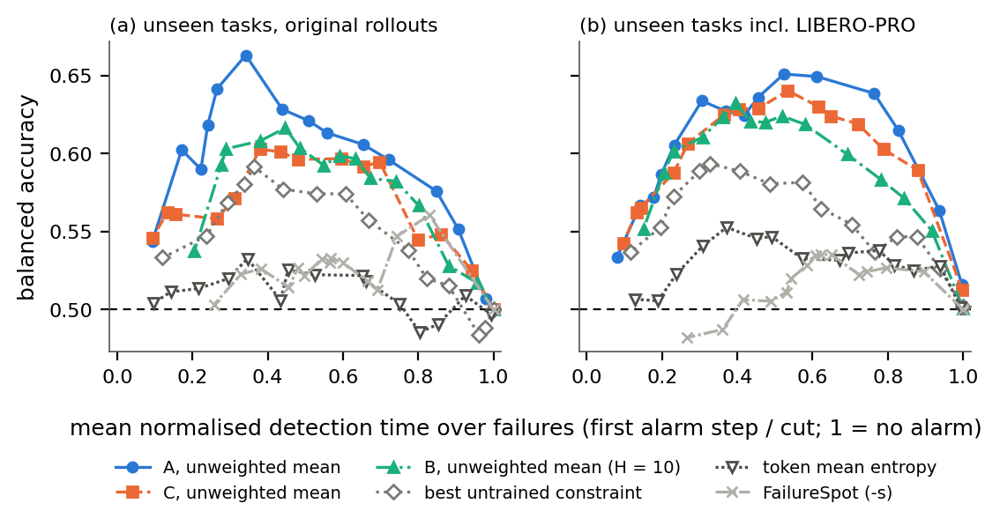
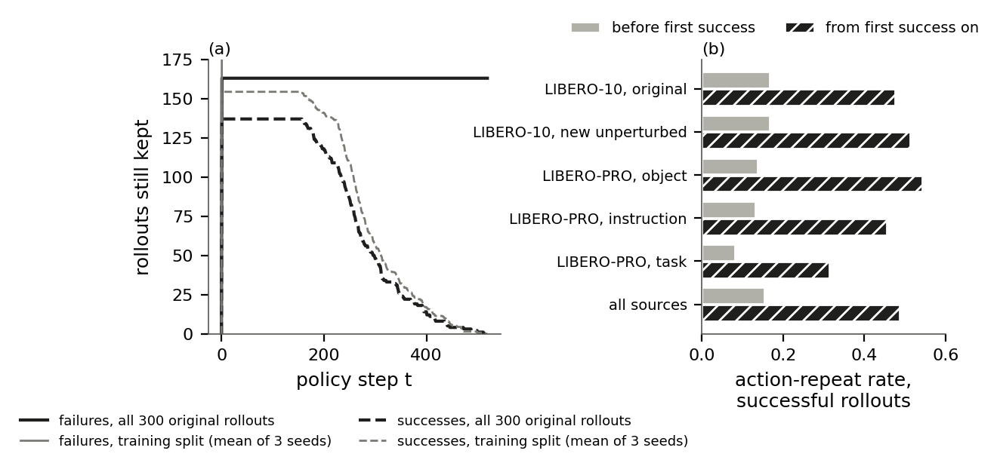
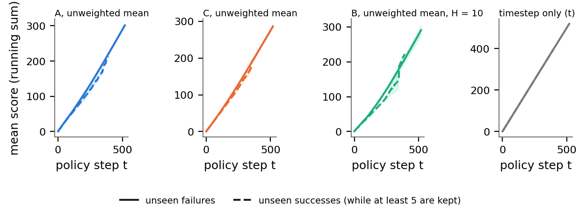
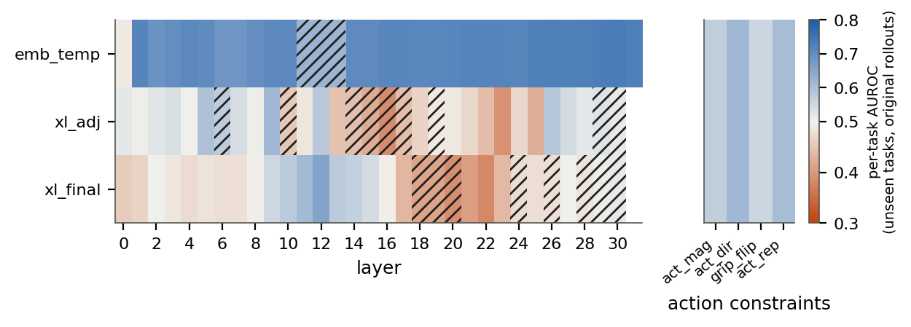
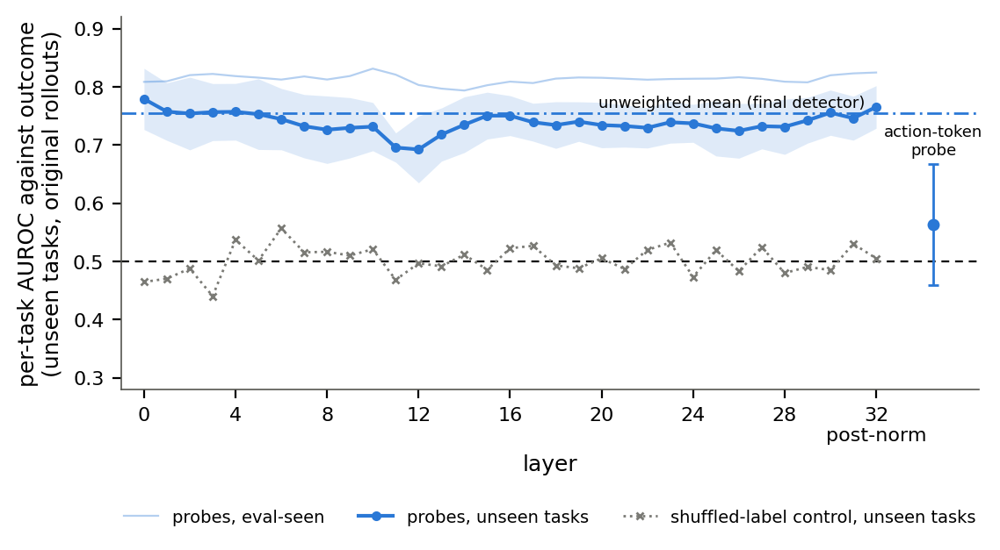
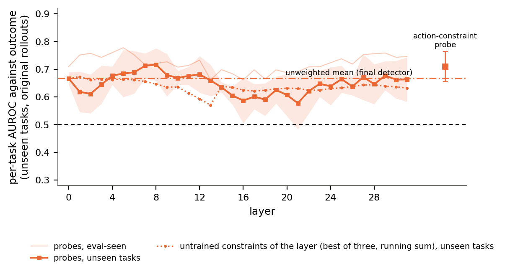
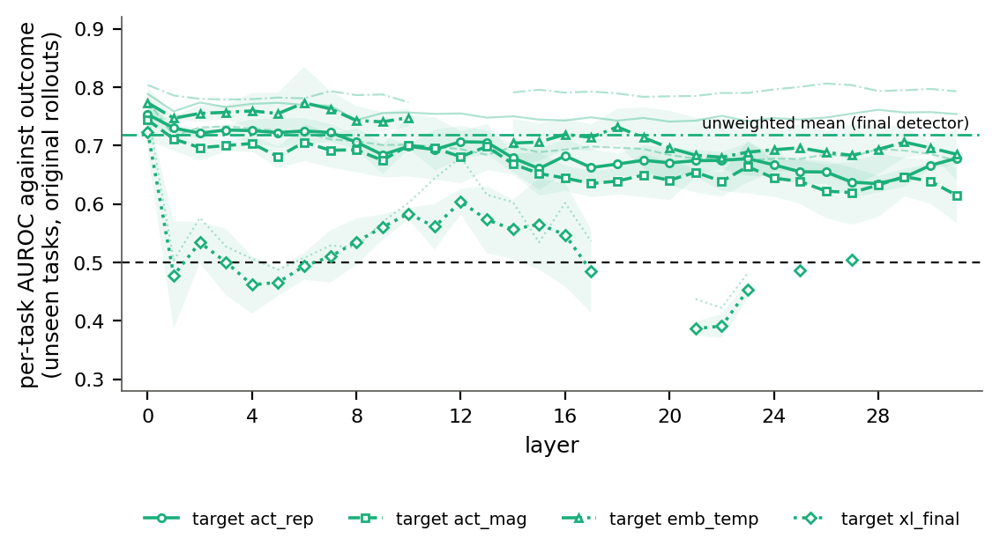
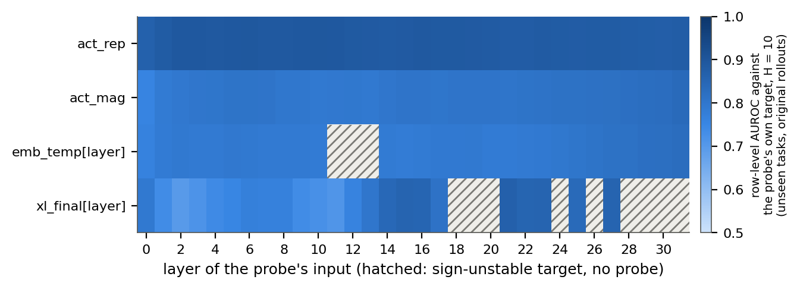
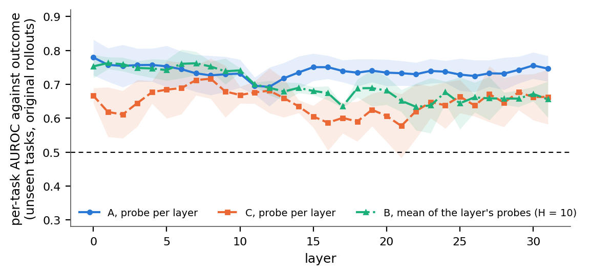
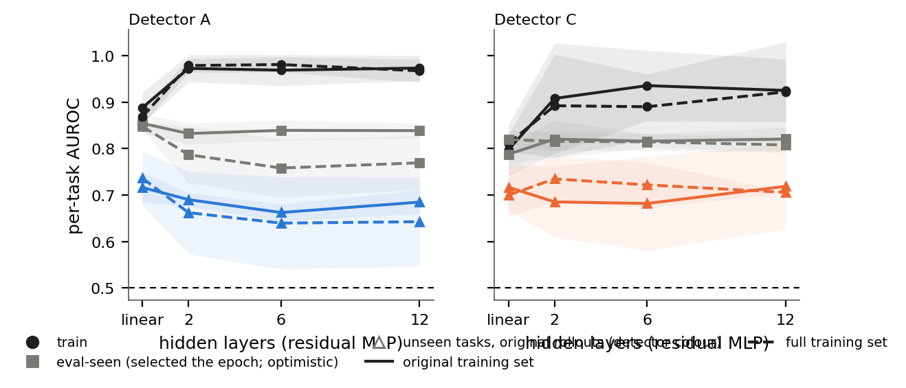

# Thesis results: full training set

*results_collection_handoff.md (version 4), §5. Generated by `analysis/thesis_results/report.py` from `results/thesis_results/`. Numbers to 3 d.p.; ± is the std over the 3 seeds (ddof 1); per-seed values are in the CSVs. Plain names throughout (handoff §0).*

## Headline

Training on the full training set (1,000 rollouts, including LIBERO-PRO object and instruction perturbations) instead of the original 300 doesn't change ranking on unseen tasks (original rollouts) for any primary detector. The paired differences, full minus original, in per-task AUROC are: A's mean +0.009 [−0.037, +0.052], C's mean −0.017 [−0.045, +0.012], and B's mean at H = 10 +0.041 [−0.001, +0.077]. On unseen tasks incl. LIBERO-PRO, A's mean improves slightly (+0.026 [+0.001, +0.060]) while C's and B's are unchanged. The alarm at α = 0.1 moves in both directions: C's mean improves (+0.049 balanced accuracy on the headline set), while A's mean (−0.035) and the untrained constraint (−0.072, whose scores don't depend on training at all) get worse, which shows these alarm verdicts mostly follow the recalibrated band.

## Reading notes

- **This is the training-data ablation** (handoff §6): `tables/training_set_comparison.csv`, merged into the main run's T6 (`results/thesis_results/tables/table6_training_data*.csv`). It uses the same paired bootstrap as the main run: 1,000 resamples within task (or task and perturbation cell) within seed, with each seed's conformal band held fixed. The alarm intervals therefore understate the uncertainty.
- **Untrained rows are a check on the alarm verdicts.** The untrained constraint and FailureSpot have identical scores in both training sets: their per-task AUROC difference is exactly 0. Their alarm changes come only from the band, which the full set calibrates on its own 92 eval-seen successes. A significant alarm change for a trained detector should be read against that.
- **Selections changed on the full set** (`selections_report.md`). β changed for the action family (0.96 → 0.83) and the cross-layer family (0.91 → 0.96). Every c changed except B's grid c (1e-4). 20 constraints are sign-unstable instead of 14, so B has 116 probes per H instead of 124 (29 embedding-temporal). The best untrained constraint is emb_temp[26] under the per-task rule on both training sets.
- **Full-set core table** (`tables/table1_core_detectors.csv`), unseen tasks, original rollouts, per-task AUROC:
  - A's mean 0.754, A's combiner 0.751, A's MLP 0.642;
  - C's mean 0.667, C's 132-input MLP 0.732;
  - B's mean at H = 10 0.719, B's embedding-temporal mean 0.741, B's combiner 0.706.
- **Reproduction checks.** 120 existing full-set rows (`results/abc2` D2 tables) reproduce exactly. One per-probe value misses: A's action-token probe, eval-seen, seed 2, 0.0118. Same cause as the main run: fp16 storage, with probabilities spanning only 0.484–0.515 at c = 1e-6. A float32 refit reproduces the source value 0.4823 exactly. B's grid has no earlier full-set reference at H = 0 and 25. Its H = 10 trained combiner row is the more-data run's, which this run's refit is listed beside.
- **F1 (example rollout) is a main-run figure only**, so the full-set figures folder has no F1.


## Reproduction checks

730 checks against the earlier runs' files (120 detector rows, 603 per-probe values, 0 B grid values, 7 corpus counts); **1 failed**; largest difference 0.0118 (tolerance 0.005 AUROC, 0.01 balanced accuracy). Files: `tables/data/reproduction_checks*.csv`.

## T1. Core table (unseen tasks, original rollouts)

File: `tables/table1_core_detectors.csv` (all three test sets: `table1_core_detectors_all_test_sets.csv`; stress subsets: `table1_stress_set.csv`). Floor = pooled AUROC of the timestep-only score; per-task AUROC of the timestep score is 0.5 by construction. Alarm columns: cut-variant conformal alarm at α = 0.1.

| Detector | Variant | H | per-task AUROC | pooled AUROC | floor | bal. acc. α 0.1 | failures caught | false alarms | detection time | stress set alarmed |
|---|---|---|---|---|---|---|---|---|---|---|
| A | single best probe (of 34) |  | 0.736 ± 0.058 | 0.749 ± 0.043 | 0.5466 | 0.507 ± 0.006 | 0.026 ± 0.027 | 0.013 ± 0.022 | 0.985 ± 0.025 | 0.193 ± 0.147 |
| A | unweighted mean of 34 probe outputs (primary) |  | 0.754 ± 0.041 | 0.735 ± 0.049 | 0.5466 | 0.500 ± 0.011 | 0.026 ± 0.027 | 0.025 ± 0.044 | 0.978 ± 0.025 | 0.273 ± 0.176 |
| A | trained combiner over 34 probe outputs (out-of-fold) |  | 0.751 ± 0.044 | 0.759 ± 0.035 | 0.5466 | 0.546 ± 0.081 | 0.147 ± 0.210 | 0.055 ± 0.054 | 0.916 ± 0.106 | 0.387 ± 0.131 |
| A | 2-layer MLP on the best probe's hidden state |  | 0.642 ± 0.090 | 0.721 ± 0.069 | 0.5466 | 0.546 ± 0.034 | 0.160 ± 0.102 | 0.067 ± 0.066 | 0.901 ± 0.067 | 0.223 ± 0.170 |
| C | single best probe (of 33) |  | 0.700 ± 0.068 | 0.702 ± 0.046 | 0.5466 | 0.534 ± 0.029 | 0.150 ± 0.198 | 0.082 ± 0.142 | 0.893 ± 0.152 | 0.263 ± 0.153 |
| C | unweighted mean of 33 probe outputs (primary) |  | 0.667 ± 0.058 | 0.686 ± 0.052 | 0.5466 | 0.551 ± 0.024 | 0.172 ± 0.140 | 0.070 ± 0.103 | 0.894 ± 0.123 | 0.300 ± 0.130 |
| C | trained combiner over 33 probe outputs (out-of-fold) |  | 0.685 ± 0.068 | 0.727 ± 0.041 | 0.5466 | 0.551 ± 0.095 | 0.189 ± 0.166 | 0.088 ± 0.104 | 0.902 ± 0.078 | 0.327 ± 0.145 |
| C | 2-layer MLP on the best probe's inputs |  | 0.706 ± 0.094 | 0.716 ± 0.049 | 0.5466 | 0.544 ± 0.028 | 0.164 ± 0.186 | 0.075 ± 0.131 | 0.882 ± 0.157 | 0.253 ± 0.118 |
| C (exploratory) | logistic regression on all 132 constraints |  | 0.700 ± 0.047 | 0.752 ± 0.014 | 0.5466 | 0.550 ± 0.076 | 0.181 ± 0.130 | 0.081 ± 0.111 | 0.910 ± 0.063 | 0.313 ± 0.155 |
| C (exploratory) | 2-layer MLP on all 132 constraints |  | 0.732 ± 0.045 | 0.779 ± 0.031 | 0.5466 | 0.575 ± 0.058 | 0.220 ± 0.117 | 0.070 ± 0.007 | 0.903 ± 0.039 | 0.343 ± 0.047 |
| B | single best probe (of 116), chosen on eval-seen per-task AUROC against outcome | 0 | 0.731 ± 0.030 | 0.736 ± 0.023 | 0.5466 | 0.516 ± 0.015 | 0.057 ± 0.029 | 0.025 ± 0.044 | 0.962 ± 0.023 | 0.250 ± 0.069 |
| B | unweighted mean of 116 probe outputs (primary) | 0 | 0.700 ± 0.011 | 0.724 ± 0.036 | 0.5466 | 0.511 ± 0.004 | 0.066 ± 0.042 | 0.043 ± 0.048 | 0.945 ± 0.037 | 0.290 ± 0.072 |
| B | unweighted mean of the 29 embedding-temporal probe outputs | 0 | 0.695 ± 0.033 | 0.719 ± 0.043 | 0.5466 | 0.503 ± 0.008 | 0.044 ± 0.057 | 0.038 ± 0.065 | 0.964 ± 0.047 | 0.220 ± 0.118 |
| B | trained combiner over 116 probe outputs (out-of-fold) | 0 | 0.675 ± 0.042 | 0.715 ± 0.050 | 0.5466 | 0.538 ± 0.033 | 0.150 ± 0.011 | 0.074 ± 0.075 | 0.912 ± 0.033 | 0.337 ± 0.081 |
| B | single best probe (of 116), chosen on eval-seen per-task AUROC against outcome | 10 | 0.725 ± 0.027 | 0.706 ± 0.054 | 0.5466 | 0.505 ± 0.006 | 0.035 ± 0.042 | 0.025 ± 0.044 | 0.973 ± 0.031 | 0.157 ± 0.110 |
| B | unweighted mean of 116 probe outputs (primary) | 10 | 0.719 ± 0.026 | 0.737 ± 0.032 | 0.5466 | 0.517 ± 0.013 | 0.066 ± 0.042 | 0.031 ± 0.054 | 0.952 ± 0.037 | 0.270 ± 0.114 |
| B | unweighted mean of the 29 embedding-temporal probe outputs | 10 | 0.741 ± 0.024 | 0.739 ± 0.027 | 0.5466 | 0.518 ± 0.022 | 0.080 ± 0.119 | 0.044 ± 0.076 | 0.931 ± 0.104 | 0.237 ± 0.172 |
| B | trained combiner over 116 probe outputs (out-of-fold) | 10 | 0.706 ± 0.018 | 0.729 ± 0.040 | 0.5466 | 0.525 ± 0.033 | 0.149 ± 0.058 | 0.099 ± 0.116 | 0.880 ± 0.047 | 0.313 ± 0.122 |
| B | single best probe (of 116), chosen on eval-seen per-task AUROC against outcome | 25 | 0.729 ± 0.044 | 0.727 ± 0.061 | 0.5466 | 0.516 ± 0.018 | 0.044 ± 0.057 | 0.013 ± 0.022 | 0.975 ± 0.032 | 0.213 ± 0.116 |
| B | unweighted mean of 116 probe outputs (primary) | 25 | 0.709 ± 0.013 | 0.729 ± 0.036 | 0.5466 | 0.515 ± 0.016 | 0.074 ± 0.056 | 0.045 ± 0.060 | 0.945 ± 0.046 | 0.280 ± 0.115 |
| B | unweighted mean of the 29 embedding-temporal probe outputs | 25 | 0.738 ± 0.033 | 0.700 ± 0.064 | 0.5466 | 0.506 ± 0.006 | 0.044 ± 0.057 | 0.031 ± 0.054 | 0.965 ± 0.044 | 0.240 ± 0.145 |
| B | trained combiner over 116 probe outputs (out-of-fold) | 25 | 0.699 ± 0.029 | 0.735 ± 0.038 | 0.5466 | 0.520 ± 0.034 | 0.090 ± 0.156 | 0.050 ± 0.087 | 0.915 ± 0.146 | 0.237 ± 0.136 |
| B | 2-layer MLP on the best probe's layer, trained on that probe's constraint target | 10 | 0.719 ± 0.063 | 0.721 ± 0.016 | 0.5466 | 0.506 ± 0.006 | 0.044 ± 0.057 | 0.031 ± 0.054 | 0.966 ± 0.044 | 0.197 ± 0.151 |
| Baseline | timestep only |  | 0.500 ± 0.000 | 0.547 ± 0.090 | 0.5466 | 0.500 ± 0.000 | 0.000 ± 0.000 | 0.000 ± 0.000 | 1.000 ± 0.000 | 0.000 ± 0.000 |
| Baseline | best single untrained constraint (layer chosen on eval-seen per-task AUROC), running maximum |  | 0.725 ± 0.061 | 0.715 ± 0.039 | 0.5466 | 0.481 ± 0.018 | 0.027 ± 0.047 | 0.064 ± 0.078 | 0.977 ± 0.040 | 0.217 ± 0.135 |
| Baseline | untrained constraint at the earlier layer choice (eval-seen pooled AUROC), running maximum |  | 0.731 ± 0.050 | 0.723 ± 0.030 | 0.5466 | 0.481 ± 0.018 | 0.027 ± 0.047 | 0.064 ± 0.078 | 0.977 ± 0.039 | 0.217 ± 0.125 |
| Baseline | token mean entropy, running maximum |  | 0.514 ± 0.045 | 0.506 ± 0.032 | 0.5466 | 0.492 ± 0.023 | 0.126 ± 0.085 | 0.142 ± 0.108 | 0.884 ± 0.073 | 0.113 ± 0.047 |
| Baseline | token max-probability, running maximum |  | 0.535 ± 0.055 | 0.530 ± 0.030 | 0.5466 | 0.486 ± 0.023 | 0.120 ± 0.087 | 0.149 ± 0.096 | 0.892 ± 0.068 | 0.157 ± 0.068 |
| Baseline | FailureSpot signal s, running maximum |  | 0.477 ± 0.061 | 0.491 ± 0.125 | 0.5466 | 0.516 ± 0.029 | 0.154 ± 0.144 | 0.122 ± 0.106 | 0.899 ± 0.092 | 0.117 ± 0.092 |
| Baseline | FailureSpot signal, opposite orientation (-s), running maximum |  | 0.542 ± 0.052 | 0.574 ± 0.053 | 0.5466 | 0.562 ± 0.045 | 0.238 ± 0.100 | 0.115 ± 0.015 | 0.811 ± 0.080 | 0.033 ± 0.025 |

### T1, unseen tasks incl. LIBERO-PRO (per-task-and-perturbation AUROC)

| Detector | Variant | H | per-task-and-perturbation AUROC | pooled AUROC | floor | bal. acc. α 0.1 | failures caught | false alarms | detection time | stress set alarmed |
|---|---|---|---|---|---|---|---|---|---|---|
| A | single best probe (of 34) |  | 0.769 ± 0.018 | 0.780 ± 0.028 | 0.6169 | 0.571 ± 0.049 | 0.151 ± 0.087 | 0.009 ± 0.016 | 0.946 ± 0.024 | 0.193 ± 0.147 |
| A | unweighted mean of 34 probe outputs (primary) |  | 0.780 ± 0.028 | 0.780 ± 0.031 | 0.6169 | 0.573 ± 0.052 | 0.182 ± 0.101 | 0.037 ± 0.038 | 0.910 ± 0.053 | 0.273 ± 0.176 |
| A | trained combiner over 34 probe outputs (out-of-fold) |  | 0.770 ± 0.028 | 0.792 ± 0.035 | 0.6169 | 0.602 ± 0.075 | 0.273 ± 0.182 | 0.070 ± 0.052 | 0.870 ± 0.070 | 0.387 ± 0.131 |
| A | 2-layer MLP on the best probe's hidden state |  | 0.709 ± 0.034 | 0.782 ± 0.048 | 0.6169 | 0.584 ± 0.058 | 0.243 ± 0.135 | 0.075 ± 0.083 | 0.857 ± 0.071 | 0.223 ± 0.170 |
| C | single best probe (of 33) |  | 0.766 ± 0.022 | 0.755 ± 0.057 | 0.6169 | 0.585 ± 0.010 | 0.260 ± 0.155 | 0.089 ± 0.140 | 0.846 ± 0.162 | 0.263 ± 0.153 |
| C | unweighted mean of 33 probe outputs (primary) |  | 0.749 ± 0.026 | 0.743 ± 0.052 | 0.6169 | 0.607 ± 0.045 | 0.296 ± 0.133 | 0.081 ± 0.093 | 0.830 ± 0.132 | 0.300 ± 0.130 |
| C | trained combiner over 33 probe outputs (out-of-fold) |  | 0.750 ± 0.052 | 0.778 ± 0.040 | 0.6169 | 0.610 ± 0.046 | 0.332 ± 0.077 | 0.111 ± 0.055 | 0.827 ± 0.027 | 0.327 ± 0.145 |
| C | 2-layer MLP on the best probe's inputs |  | 0.764 ± 0.038 | 0.755 ± 0.062 | 0.6169 | 0.583 ± 0.010 | 0.237 ± 0.101 | 0.071 ± 0.108 | 0.863 ± 0.116 | 0.253 ± 0.118 |
| C (exploratory) | logistic regression on all 132 constraints |  | 0.767 ± 0.043 | 0.788 ± 0.042 | 0.6169 | 0.615 ± 0.032 | 0.324 ± 0.025 | 0.095 ± 0.067 | 0.836 ± 0.067 | 0.313 ± 0.155 |
| C (exploratory) | 2-layer MLP on all 132 constraints |  | 0.784 ± 0.036 | 0.800 ± 0.033 | 0.6169 | 0.624 ± 0.046 | 0.353 ± 0.086 | 0.105 ± 0.009 | 0.824 ± 0.025 | 0.343 ± 0.047 |
| B | single best probe (of 116), chosen on eval-seen per-task AUROC against outcome | 0 | 0.740 ± 0.020 | 0.766 ± 0.037 | 0.6169 | 0.571 ± 0.028 | 0.181 ± 0.038 | 0.040 ± 0.025 | 0.907 ± 0.032 | 0.250 ± 0.069 |
| B | unweighted mean of 116 probe outputs (primary) | 0 | 0.734 ± 0.018 | 0.775 ± 0.047 | 0.6169 | 0.547 ± 0.028 | 0.150 ± 0.042 | 0.057 ± 0.044 | 0.906 ± 0.047 | 0.290 ± 0.072 |
| B | unweighted mean of the 29 embedding-temporal probe outputs | 0 | 0.756 ± 0.004 | 0.773 ± 0.045 | 0.6169 | 0.546 ± 0.026 | 0.130 ± 0.071 | 0.038 ± 0.052 | 0.925 ± 0.068 | 0.220 ± 0.118 |
| B | trained combiner over 116 probe outputs (out-of-fold) | 0 | 0.707 ± 0.029 | 0.755 ± 0.039 | 0.6169 | 0.591 ± 0.077 | 0.280 ± 0.148 | 0.099 ± 0.072 | 0.840 ± 0.098 | 0.337 ± 0.081 |
| B | single best probe (of 116), chosen on eval-seen per-task AUROC against outcome | 10 | 0.750 ± 0.011 | 0.761 ± 0.042 | 0.6169 | 0.553 ± 0.021 | 0.132 ± 0.034 | 0.027 ± 0.032 | 0.940 ± 0.030 | 0.157 ± 0.110 |
| B | unweighted mean of 116 probe outputs (primary) | 10 | 0.748 ± 0.017 | 0.777 ± 0.046 | 0.6169 | 0.555 ± 0.025 | 0.157 ± 0.036 | 0.048 ± 0.050 | 0.904 ± 0.058 | 0.270 ± 0.114 |
| B | unweighted mean of the 29 embedding-temporal probe outputs | 10 | 0.753 ± 0.017 | 0.774 ± 0.042 | 0.6169 | 0.554 ± 0.021 | 0.156 ± 0.052 | 0.048 ± 0.062 | 0.906 ± 0.076 | 0.237 ± 0.172 |
| B | trained combiner over 116 probe outputs (out-of-fold) | 10 | 0.728 ± 0.024 | 0.763 ± 0.038 | 0.6169 | 0.572 ± 0.041 | 0.270 ± 0.110 | 0.125 ± 0.097 | 0.832 ± 0.105 | 0.313 ± 0.122 |
| B | single best probe (of 116), chosen on eval-seen per-task AUROC against outcome | 25 | 0.764 ± 0.061 | 0.747 ± 0.082 | 0.6169 | 0.563 ± 0.028 | 0.140 ± 0.058 | 0.015 ± 0.014 | 0.939 ± 0.033 | 0.213 ± 0.116 |
| B | unweighted mean of 116 probe outputs (primary) | 25 | 0.742 ± 0.009 | 0.769 ± 0.050 | 0.6169 | 0.567 ± 0.028 | 0.185 ± 0.043 | 0.051 ± 0.043 | 0.893 ± 0.056 | 0.280 ± 0.115 |
| B | unweighted mean of the 29 embedding-temporal probe outputs | 25 | 0.752 ± 0.023 | 0.750 ± 0.051 | 0.6169 | 0.557 ± 0.044 | 0.155 ± 0.084 | 0.040 ± 0.038 | 0.916 ± 0.053 | 0.240 ± 0.145 |
| B | trained combiner over 116 probe outputs (out-of-fold) | 25 | 0.727 ± 0.031 | 0.763 ± 0.059 | 0.6169 | 0.553 ± 0.034 | 0.171 ± 0.056 | 0.064 ± 0.090 | 0.897 ± 0.084 | 0.237 ± 0.136 |
| B | 2-layer MLP on the best probe's layer, trained on that probe's constraint target | 10 | 0.739 ± 0.045 | 0.759 ± 0.037 | 0.6169 | 0.562 ± 0.014 | 0.165 ± 0.058 | 0.041 ± 0.050 | 0.909 ± 0.070 | 0.197 ± 0.151 |
| Baseline | timestep only |  | 0.500 ± 0.000 | 0.617 ± 0.099 | 0.6169 | 0.500 ± 0.000 | 0.000 ± 0.000 | 0.000 ± 0.000 | 1.000 ± 0.000 | 0.000 ± 0.000 |
| Baseline | best single untrained constraint (layer chosen on eval-seen per-task AUROC), running maximum |  | 0.740 ± 0.019 | 0.740 ± 0.049 | 0.6169 | 0.530 ± 0.023 | 0.124 ± 0.052 | 0.065 ± 0.063 | 0.919 ± 0.062 | 0.217 ± 0.135 |
| Baseline | untrained constraint at the earlier layer choice (eval-seen pooled AUROC), running maximum |  | 0.736 ± 0.028 | 0.742 ± 0.051 | 0.6169 | 0.529 ± 0.022 | 0.122 ± 0.053 | 0.065 ± 0.063 | 0.917 ± 0.060 | 0.217 ± 0.125 |
| Baseline | token mean entropy, running maximum |  | 0.585 ± 0.014 | 0.565 ± 0.006 | 0.6169 | 0.525 ± 0.034 | 0.140 ± 0.029 | 0.090 ± 0.060 | 0.901 ± 0.034 | 0.113 ± 0.047 |
| Baseline | token max-probability, running maximum |  | 0.600 ± 0.012 | 0.584 ± 0.011 | 0.6169 | 0.521 ± 0.031 | 0.141 ± 0.035 | 0.100 ± 0.052 | 0.906 ± 0.039 | 0.157 ± 0.068 |
| Baseline | FailureSpot signal s, running maximum |  | 0.437 ± 0.032 | 0.484 ± 0.096 | 0.6169 | 0.537 ± 0.040 | 0.172 ± 0.129 | 0.098 ± 0.092 | 0.887 ± 0.082 | 0.117 ± 0.092 |
| Baseline | FailureSpot signal, opposite orientation (-s), running maximum |  | 0.536 ± 0.014 | 0.582 ± 0.025 | 0.6169 | 0.522 ± 0.017 | 0.156 ± 0.037 | 0.112 ± 0.066 | 0.880 ± 0.029 | 0.033 ± 0.025 |

## T2. Corpus composition

File: `tables/table2_corpus_composition.csv`.

| source | role | rollouts | successes | failures | success rate | task 0 successes / rollouts | task 1 successes / rollouts | task 2 successes / rollouts | task 3 successes / rollouts | task 4 successes / rollouts | task 5 successes / rollouts | task 6 successes / rollouts | task 7 successes / rollouts | task 8 successes / rollouts | task 9 successes / rollouts |
|---|---|---|---|---|---|---|---|---|---|---|---|---|---|---|---|
| LIBERO-10, original | training role | 300 | 137 | 163 | 0.457 | 11/30 | 24/30 | 16/30 | 5/30 | 8/30 | 22/30 | 13/30 | 15/30 | 10/30 | 13/30 |
| LIBERO-10, new unperturbed | training role | 200 | 91 | 109 | 0.455 | 13/20 | 13/20 | 9/20 | 3/20 | 3/20 | 13/20 | 13/20 | 11/20 | 5/20 | 8/20 |
| LIBERO-PRO object perturbation | training role | 200 | 47 | 153 | 0.235 | 0/20 | 14/20 | 9/20 | 8/20 | 6/20 | 0/20 | 4/20 | 0/20 | 4/20 | 2/20 |
| LIBERO-PRO instruction perturbation | training role | 200 | 85 | 115 | 0.425 | 7/20 | 13/20 | 11/20 | 7/20 | 1/20 | 13/20 | 5/20 | 15/20 | 4/20 | 9/20 |
| LIBERO-PRO position swap | stress set only | 50 | 0 | 50 | 0 | 0/5 | 0/5 | 0/5 | 0/5 | 0/5 | 0/5 | 0/5 | 0/5 | 0/5 | 0/5 |
| LIBERO-PRO task perturbation | stress set only | 50 | 4 | 46 | 0.08 | 3/5 | 0/5 | 0/5 | 0/5 | 0/5 | 0/5 | 0/5 | 0/5 | 1/5 | 0/5 |
| all |  | 1000 | 364 | 636 | 0.364 | 34/100 | 64/100 | 45/100 | 23/100 | 18/100 | 48/100 | 35/100 | 41/100 | 24/100 | 32/100 |

## T3. Constraints: best per family and baselines

File: `tables/table3_constraints.csv`.

| kind | signal | smoothing beta | sign per seed (+: higher means failure) | sign-unstable | per-task AUROC, eval-seen, | per-task AUROC, unseen tasks, original rollouts, | per-task-and-perturbation AUROC, unseen tasks incl. LIBERO-PRO, | pooled AUROC, unseen tasks, original rollouts, mean | timestep-only floor, unseen tasks, original rollouts | note | source |
|---|---|---|---|---|---|---|---|---|---|---|---|
| untrained constraint | emb_temp[26] | none | --- | False | 0.769 ± 0.014 | 0.725 ± 0.061 | 0.740 ± 0.019 | 0.7146 | 0.5466 | layer chosen on eval-seen per-task AUROC | results/abc2/constraint_m1_summary.csv |
| untrained constraint | xl_adj[2] | 0.96 | --- | False | 0.620 ± 0.037 | 0.521 ± 0.055 | 0.570 ± 0.011 | 0.57 | 0.5466 | layer chosen on eval-seen per-task AUROC | results/abc2/constraint_m1_summary.csv |
| untrained constraint | xl_final[12] | 0.96 | --- | False | 0.630 ± 0.041 | 0.655 ± 0.040 | 0.635 ± 0.051 | 0.5994 | 0.5466 | layer chosen on eval-seen per-task AUROC | results/abc2/constraint_m1_summary.csv |
| untrained constraint | act_rep | 0.83 | +++ | False | 0.617 ± 0.029 | 0.605 ± 0.023 | 0.626 ± 0.041 | 0.6277 | 0.5466 |  | results/abc2/constraint_m1_summary.csv |
| untrained constraint | act_dir | 0.83 | +++ | False | 0.667 ± 0.034 | 0.615 ± 0.038 | 0.636 ± 0.029 | 0.6231 | 0.5466 |  | results/abc2/constraint_m1_summary.csv |
| untrained constraint | act_mag | 0.83 | --- | False | 0.607 ± 0.009 | 0.569 ± 0.035 | 0.603 ± 0.048 | 0.6008 | 0.5466 |  | results/abc2/constraint_m1_summary.csv |
| untrained constraint | grip_flip | 0.83 | +++ | False | 0.454 ± 0.018 | 0.552 ± 0.074 | 0.530 ± 0.056 | 0.5675 | 0.5466 |  | results/abc2/constraint_m1_summary.csv |
| untrained constraint | xl_spread | 0.96 | --- | False | 0.532 ± 0.020 | 0.573 ± 0.052 | 0.545 ± 0.066 | 0.525 | 0.5466 |  | results/abc2/constraint_m1_summary.csv |
| baseline | token mean entropy | 0.83 | --- | False | 0.572 ± 0.005 | 0.514 ± 0.045 | 0.585 ± 0.014 | 0.5056 | 0.5466 | beta chosen on eval-seen per-task AUROC | results/abc2/constraint_m1_summary.csv |
| baseline | token max-probability | 0.83 | +++ | False | 0.574 ± 0.022 | 0.535 ± 0.055 | 0.600 ± 0.012 | 0.5302 | 0.5466 | beta chosen on eval-seen per-task AUROC | results/abc2/constraint_m1_summary.csv |
| baseline | FailureSpot signal s | 0.8 | +++ | False | 0.508 ± 0.127 | 0.477 ± 0.061 | 0.437 ± 0.032 | 0.4915 | 0.5466 | fixed orientation | results/abc2/constraint_m1_summary.csv |
| baseline | FailureSpot signal -s | 0.8 | --- | False | 0.524 ± 0.054 | 0.542 ± 0.052 | 0.536 ± 0.014 | 0.574 | 0.5466 | fixed orientation | results/abc2/constraint_m1_summary.csv |
| baseline | timestep only | none | +++ | False | 0.500 ± 0.000 | 0.500 ± 0.000 | 0.500 ± 0.000 | 0.5466 | 0.5466 | 0.5 per task by construction | results/abc2/constraint_m1_summary.csv |

## T4. B per look-ahead H

File: `tables/table4_b_by_lookahead.csv`.

| look-ahead H | row | test set | per-task AUROC | balanced accuracy at alpha 0.1 | choice per seed | per-task-and-perturbation AUROC |
|---|---|---|---|---|---|---|
| 0 | single best probe | unseen tasks, original rollouts | 0.731 ± 0.030 | 0.516 ± 0.015 | L29:emb_temp:H0 | L00:emb_temp:H0 | L00:act_rep:H0 |  |
| 0 | single best probe | unseen tasks incl. LIBERO-PRO |  | 0.571 ± 0.028 | L29:emb_temp:H0 | L00:emb_temp:H0 | L00:act_rep:H0 | 0.740 ± 0.020 |
| 0 | unweighted mean of all grid probes (primary) | unseen tasks, original rollouts | 0.700 ± 0.011 | 0.511 ± 0.004 | 116 probes | 116 probes | 116 probes |  |
| 0 | unweighted mean of all grid probes (primary) | unseen tasks incl. LIBERO-PRO |  | 0.547 ± 0.028 | 116 probes | 116 probes | 116 probes | 0.734 ± 0.018 |
| 0 | unweighted mean of the embedding-temporal probes | unseen tasks, original rollouts | 0.695 ± 0.033 | 0.503 ± 0.008 | 29 embedding-temporal probes | 29 embedding-temporal probes | 29 embedding-temporal probes |  |
| 0 | unweighted mean of the embedding-temporal probes | unseen tasks incl. LIBERO-PRO |  | 0.546 ± 0.026 | 29 embedding-temporal probes | 29 embedding-temporal probes | 29 embedding-temporal probes | 0.756 ± 0.004 |
| 0 | trained combiner over all grid probes | unseen tasks, original rollouts | 0.675 ± 0.042 | 0.538 ± 0.033 | grid c=1e-4 final c=1 | grid c=1e-4 final c=1 | grid c=1e-4 final c=1 |  |
| 0 | trained combiner over all grid probes | unseen tasks incl. LIBERO-PRO |  | 0.591 ± 0.077 | grid c=1e-4 final c=1 | grid c=1e-4 final c=1 | grid c=1e-4 final c=1 | 0.707 ± 0.029 |
| 0 | paired difference, unweighted mean minus trained combiner | unseen tasks, original rollouts | 0.025 ± 0.052 |  |  |  |
| 0 | paired difference, unweighted mean minus trained combiner | unseen tasks incl. LIBERO-PRO |  |  |  | 0.026 ± 0.016 |
| 10 | single best probe | unseen tasks, original rollouts | 0.725 ± 0.027 | 0.505 ± 0.006 | L30:emb_temp:H10 | L15:emb_temp:H10 | L00:emb_temp:H10 |  |
| 10 | single best probe | unseen tasks incl. LIBERO-PRO |  | 0.553 ± 0.021 | L30:emb_temp:H10 | L15:emb_temp:H10 | L00:emb_temp:H10 | 0.750 ± 0.011 |
| 10 | unweighted mean of all grid probes (primary) | unseen tasks, original rollouts | 0.719 ± 0.026 | 0.517 ± 0.013 | 116 probes | 116 probes | 116 probes |  |
| 10 | unweighted mean of all grid probes (primary) | unseen tasks incl. LIBERO-PRO |  | 0.555 ± 0.025 | 116 probes | 116 probes | 116 probes | 0.748 ± 0.017 |
| 10 | unweighted mean of the embedding-temporal probes | unseen tasks, original rollouts | 0.741 ± 0.024 | 0.518 ± 0.022 | 29 embedding-temporal probes | 29 embedding-temporal probes | 29 embedding-temporal probes |  |
| 10 | unweighted mean of the embedding-temporal probes | unseen tasks incl. LIBERO-PRO |  | 0.554 ± 0.021 | 29 embedding-temporal probes | 29 embedding-temporal probes | 29 embedding-temporal probes | 0.753 ± 0.017 |
| 10 | trained combiner over all grid probes | unseen tasks, original rollouts | 0.706 ± 0.018 | 0.525 ± 0.033 | grid c=0.0001 final c=0.01 | grid c=0.0001 final c=0.01 | grid c=0.0001 final c=0.01 |  |
| 10 | trained combiner over all grid probes | unseen tasks incl. LIBERO-PRO |  | 0.572 ± 0.041 | grid c=0.0001 final c=0.01 | grid c=0.0001 final c=0.01 | grid c=0.0001 final c=0.01 | 0.728 ± 0.024 |
| 10 | paired difference, unweighted mean minus trained combiner | unseen tasks, original rollouts | 0.013 ± 0.044 |  |  |  |
| 10 | paired difference, unweighted mean minus trained combiner | unseen tasks incl. LIBERO-PRO |  |  |  | 0.020 ± 0.031 |
| 25 | single best probe | unseen tasks, original rollouts | 0.729 ± 0.044 | 0.516 ± 0.018 | L00:emb_temp:H25 | L17:emb_temp:H25 | L18:emb_temp:H25 |  |
| 25 | single best probe | unseen tasks incl. LIBERO-PRO |  | 0.563 ± 0.028 | L00:emb_temp:H25 | L17:emb_temp:H25 | L18:emb_temp:H25 | 0.764 ± 0.061 |
| 25 | unweighted mean of all grid probes (primary) | unseen tasks, original rollouts | 0.709 ± 0.013 | 0.515 ± 0.016 | 116 probes | 116 probes | 116 probes |  |
| 25 | unweighted mean of all grid probes (primary) | unseen tasks incl. LIBERO-PRO |  | 0.567 ± 0.028 | 116 probes | 116 probes | 116 probes | 0.742 ± 0.009 |
| 25 | unweighted mean of the embedding-temporal probes | unseen tasks, original rollouts | 0.738 ± 0.033 | 0.506 ± 0.006 | 29 embedding-temporal probes | 29 embedding-temporal probes | 29 embedding-temporal probes |  |
| 25 | unweighted mean of the embedding-temporal probes | unseen tasks incl. LIBERO-PRO |  | 0.557 ± 0.044 | 29 embedding-temporal probes | 29 embedding-temporal probes | 29 embedding-temporal probes | 0.752 ± 0.023 |
| 25 | trained combiner over all grid probes | unseen tasks, original rollouts | 0.699 ± 0.029 | 0.520 ± 0.034 | grid c=1e-4 final c=0.0001 | grid c=1e-4 final c=0.0001 | grid c=1e-4 final c=0.0001 |  |
| 25 | trained combiner over all grid probes | unseen tasks incl. LIBERO-PRO |  | 0.553 ± 0.034 | grid c=1e-4 final c=0.0001 | grid c=1e-4 final c=0.0001 | grid c=1e-4 final c=0.0001 | 0.727 ± 0.031 |
| 25 | paired difference, unweighted mean minus trained combiner | unseen tasks, original rollouts | 0.009 ± 0.019 |  |  |  |
| 25 | paired difference, unweighted mean minus trained combiner | unseen tasks incl. LIBERO-PRO |  |  |  | 0.015 ± 0.037 |

## T4 (continued). B's 2-layer MLP vs its linear probe vs persistence

File: `tables/table4_b_mlp_vs_linear_vs_persistence.csv`.

| comparison | model | test set | AUROC | target per seed | balanced accuracy at alpha 0.1 |
|---|---|---|---|---|---|
| row-level AUROC against the probe's own target (H = 10) | 2-layer MLP | eval-seen | 0.838 ± 0.058 | emb_temp[30] | emb_temp[15] | emb_temp[0] |  |
| row-level AUROC against the probe's own target (H = 10) | linear probe | eval-seen | 0.833 ± 0.057 | emb_temp[30] | emb_temp[15] | emb_temp[0] |  |
| row-level AUROC against the probe's own target (H = 10) | persistence (current value) | eval-seen | 0.781 ± 0.013 | emb_temp[30] | emb_temp[15] | emb_temp[0] |  |
| row-level AUROC against the probe's own target (H = 10) | 2-layer MLP | unseen tasks, original rollouts | 0.788 ± 0.020 | emb_temp[30] | emb_temp[15] | emb_temp[0] |  |
| row-level AUROC against the probe's own target (H = 10) | linear probe | unseen tasks, original rollouts | 0.781 ± 0.015 | emb_temp[30] | emb_temp[15] | emb_temp[0] |  |
| row-level AUROC against the probe's own target (H = 10) | persistence (current value) | unseen tasks, original rollouts | 0.769 ± 0.021 | emb_temp[30] | emb_temp[15] | emb_temp[0] |  |
| row-level AUROC against the probe's own target (H = 10) | 2-layer MLP | unseen tasks incl. LIBERO-PRO | 0.807 ± 0.016 | emb_temp[30] | emb_temp[15] | emb_temp[0] |  |
| row-level AUROC against the probe's own target (H = 10) | linear probe | unseen tasks incl. LIBERO-PRO | 0.799 ± 0.015 | emb_temp[30] | emb_temp[15] | emb_temp[0] |  |
| row-level AUROC against the probe's own target (H = 10) | persistence (current value) | unseen tasks incl. LIBERO-PRO | 0.783 ± 0.013 | emb_temp[30] | emb_temp[15] | emb_temp[0] |  |
| per-task AUROC against outcome (running sum), and alarm | 2-layer MLP | unseen tasks, original rollouts | 0.719 ± 0.063 |  | 0.506 ± 0.006 |
| per-task AUROC against outcome (running sum), and alarm | linear probe | unseen tasks, original rollouts | 0.725 ± 0.027 |  | 0.505 ± 0.006 |
| per-task AUROC against outcome (running sum), and alarm | 2-layer MLP | unseen tasks incl. LIBERO-PRO | 0.739 ± 0.045 |  | 0.562 ± 0.014 |
| per-task AUROC against outcome (running sum), and alarm | linear probe | unseen tasks incl. LIBERO-PRO | 0.750 ± 0.011 |  | 0.553 ± 0.021 |

## T4 (continued). B's linear probes vs persistence, every target and H

File: `tables/table4_b_linear_vs_persistence.csv`.

| target kind | H | test set | probe-seed pairs | linear probes, mean row-level AUROC | persistence, mean row-level AUROC | timestep only, mean row-level AUROC | share of probes above persistence |
|---|---|---|---|---|---|---|---|
| act_mag | 0 | eval-seen | 96 | 0.872 | 1 | 0.4806 | 0 |
| act_mag | 0 | unseen tasks incl. LIBERO-PRO | 96 | 0.8145 | 1 | 0.5153 | 0 |
| act_mag | 0 | unseen tasks, original rollouts | 96 | 0.797 | 1 | 0.5026 | 0 |
| act_mag | 10 | eval-seen | 96 | 0.882 | 0.959 | 0.4875 | 0 |
| act_mag | 10 | unseen tasks incl. LIBERO-PRO | 96 | 0.8259 | 0.9574 | 0.5277 | 0 |
| act_mag | 10 | unseen tasks, original rollouts | 96 | 0.8045 | 0.9558 | 0.5157 | 0 |
| act_mag | 25 | eval-seen | 96 | 0.8659 | 0.9137 | 0.4833 | 0 |
| act_mag | 25 | unseen tasks incl. LIBERO-PRO | 96 | 0.8016 | 0.9109 | 0.5249 | 0 |
| act_mag | 25 | unseen tasks, original rollouts | 96 | 0.7812 | 0.9086 | 0.5082 | 0 |
| act_rep | 0 | eval-seen | 96 | 0.918 | 1 | 0.7061 | 0 |
| act_rep | 0 | unseen tasks incl. LIBERO-PRO | 96 | 0.8923 | 1 | 0.7376 | 0 |
| act_rep | 0 | unseen tasks, original rollouts | 96 | 0.8829 | 1 | 0.7417 | 0 |
| act_rep | 10 | eval-seen | 96 | 0.9176 | 0.9587 | 0.7011 | 0 |
| act_rep | 10 | unseen tasks incl. LIBERO-PRO | 96 | 0.8935 | 0.9606 | 0.7372 | 0 |
| act_rep | 10 | unseen tasks, original rollouts | 96 | 0.8848 | 0.9546 | 0.7445 | 0 |
| act_rep | 25 | eval-seen | 96 | 0.8999 | 0.9107 | 0.6941 | 0 |
| act_rep | 25 | unseen tasks incl. LIBERO-PRO | 96 | 0.8717 | 0.9165 | 0.7318 | 0 |
| act_rep | 25 | unseen tasks, original rollouts | 96 | 0.8638 | 0.9092 | 0.7424 | 0 |
| emb_temp | 0 | eval-seen | 87 | 0.8151 | 1 | 0.621 | 0 |
| emb_temp | 0 | unseen tasks incl. LIBERO-PRO | 87 | 0.7997 | 1 | 0.6544 | 0 |
| emb_temp | 0 | unseen tasks, original rollouts | 87 | 0.7789 | 1 | 0.6489 | 0 |
| emb_temp | 10 | eval-seen | 87 | 0.8424 | 0.7787 | 0.6183 | 0.966 |
| emb_temp | 10 | unseen tasks incl. LIBERO-PRO | 87 | 0.8145 | 0.7873 | 0.6716 | 0.851 |
| emb_temp | 10 | unseen tasks, original rollouts | 87 | 0.7941 | 0.7752 | 0.6588 | 0.793 |
| emb_temp | 25 | eval-seen | 87 | 0.8479 | 0.7482 | 0.5858 | 1 |
| emb_temp | 25 | unseen tasks incl. LIBERO-PRO | 87 | 0.7721 | 0.7568 | 0.6458 | 0.644 |
| emb_temp | 25 | unseen tasks, original rollouts | 87 | 0.7482 | 0.7439 | 0.6269 | 0.586 |
| xl_final | 0 | eval-seen | 69 | 0.8725 | 1 | 0.5769 | 0 |
| xl_final | 0 | unseen tasks incl. LIBERO-PRO | 69 | 0.7691 | 1 | 0.5702 | 0 |
| xl_final | 0 | unseen tasks, original rollouts | 69 | 0.7746 | 1 | 0.5672 | 0 |
| xl_final | 10 | eval-seen | 69 | 0.8807 | 0.992 | 0.5629 | 0 |
| xl_final | 10 | unseen tasks incl. LIBERO-PRO | 69 | 0.7826 | 0.9922 | 0.5555 | 0 |
| xl_final | 10 | unseen tasks, original rollouts | 69 | 0.7872 | 0.9912 | 0.5513 | 0 |
| xl_final | 25 | eval-seen | 69 | 0.882 | 0.9685 | 0.5444 | 0 |
| xl_final | 25 | unseen tasks incl. LIBERO-PRO | 69 | 0.7845 | 0.9694 | 0.5356 | 0 |
| xl_final | 25 | unseen tasks, original rollouts | 69 | 0.7851 | 0.9659 | 0.5286 | 0 |

## T5. Ablations: constraint families and look-ahead

File: `tables/table5_ablations_families_and_lookahead.csv`.

| ablation | detector | variant | look-ahead H | test set | source | per-task AUROC | balanced accuracy at alpha 0.1 | per-task-and-perturbation AUROC |
|---|---|---|---|---|---|---|---|---|
| constraint families | C | unweighted mean of C's probes without the action family |  | unseen tasks, original rollouts | this run | 0.665 ± 0.055 | 0.545 ± 0.028 |  |
| constraint families | C | unweighted mean of C's probes without the action family |  | unseen tasks incl. LIBERO-PRO | this run |  | 0.600 ± 0.049 | 0.745 ± 0.027 |
| constraint families | C | unweighted mean of C's probes without the emb_temp family |  | unseen tasks, original rollouts | this run | 0.681 ± 0.034 | 0.509 ± 0.007 |  |
| constraint families | C | unweighted mean of C's probes without the emb_temp family |  | unseen tasks incl. LIBERO-PRO | this run |  | 0.591 ± 0.042 | 0.718 ± 0.021 |
| constraint families | C | unweighted mean of C's probes without the cross-layer family |  | unseen tasks, original rollouts | this run | 0.652 ± 0.080 | 0.546 ± 0.037 |  |
| constraint families | C | unweighted mean of C's probes without the cross-layer family |  | unseen tasks incl. LIBERO-PRO | this run |  | 0.598 ± 0.009 | 0.719 ± 0.016 |
| constraint families | B | unweighted mean of the act_rep probes only | 0 | unseen tasks, original rollouts | this run | 0.693 ± 0.003 | 0.502 ± 0.009 |  |
| constraint families | B | unweighted mean of the act_rep probes only | 0 | unseen tasks incl. LIBERO-PRO | this run |  | 0.550 ± 0.038 | 0.731 ± 0.023 |
| constraint families | B | unweighted mean of the act_mag probes only | 0 | unseen tasks, original rollouts | this run | 0.654 ± 0.013 | 0.539 ± 0.026 |  |
| constraint families | B | unweighted mean of the act_mag probes only | 0 | unseen tasks incl. LIBERO-PRO | this run |  | 0.559 ± 0.034 | 0.683 ± 0.021 |
| constraint families | B | unweighted mean of the emb_temp probes only | 0 | unseen tasks, original rollouts | this run | 0.695 ± 0.033 | 0.503 ± 0.008 |  |
| constraint families | B | unweighted mean of the emb_temp probes only | 0 | unseen tasks incl. LIBERO-PRO | this run |  | 0.546 ± 0.026 | 0.756 ± 0.004 |
| constraint families | B | unweighted mean of the xl_final probes only | 0 | unseen tasks, original rollouts | this run | 0.542 ± 0.047 | 0.495 ± 0.009 |  |
| constraint families | B | unweighted mean of the xl_final probes only | 0 | unseen tasks incl. LIBERO-PRO | this run |  | 0.511 ± 0.014 | 0.549 ± 0.014 |
| constraint families | B | trained combiner of the act_rep probes only | 0 | unseen tasks, original rollouts | this run | 0.649 ± 0.043 | 0.541 ± 0.041 |  |
| constraint families | B | trained combiner of the act_rep probes only | 0 | unseen tasks incl. LIBERO-PRO | this run |  | 0.571 ± 0.041 | 0.673 ± 0.011 |
| constraint families | B | trained combiner of the act_mag probes only | 0 | unseen tasks, original rollouts | this run | 0.704 ± 0.034 | 0.535 ± 0.025 |  |
| constraint families | B | trained combiner of the act_mag probes only | 0 | unseen tasks incl. LIBERO-PRO | this run |  | 0.574 ± 0.036 | 0.758 ± 0.037 |
| constraint families | B | trained combiner of the emb_temp probes only | 0 | unseen tasks, original rollouts | this run | 0.717 ± 0.056 | 0.540 ± 0.061 |  |
| constraint families | B | trained combiner of the emb_temp probes only | 0 | unseen tasks incl. LIBERO-PRO | this run |  | 0.571 ± 0.020 | 0.751 ± 0.008 |
| constraint families | B | trained combiner of the xl_final probes only | 0 | unseen tasks, original rollouts | this run | 0.704 ± 0.018 | 0.497 ± 0.007 |  |
| constraint families | B | trained combiner of the xl_final probes only | 0 | unseen tasks incl. LIBERO-PRO | this run |  | 0.576 ± 0.031 | 0.716 ± 0.017 |
| constraint families | B | unweighted mean of the act_rep probes only | 10 | unseen tasks, original rollouts | this run | 0.690 ± 0.008 | 0.502 ± 0.009 |  |
| constraint families | B | unweighted mean of the act_rep probes only | 10 | unseen tasks incl. LIBERO-PRO | this run |  | 0.545 ± 0.030 | 0.727 ± 0.017 |
| constraint families | B | unweighted mean of the act_mag probes only | 10 | unseen tasks, original rollouts | this run | 0.674 ± 0.009 | 0.540 ± 0.027 |  |
| constraint families | B | unweighted mean of the act_mag probes only | 10 | unseen tasks incl. LIBERO-PRO | this run |  | 0.547 ± 0.020 | 0.703 ± 0.019 |
| constraint families | B | unweighted mean of the emb_temp probes only | 10 | unseen tasks, original rollouts | this run | 0.741 ± 0.024 | 0.518 ± 0.022 |  |
| constraint families | B | unweighted mean of the emb_temp probes only | 10 | unseen tasks incl. LIBERO-PRO | this run |  | 0.554 ± 0.021 | 0.753 ± 0.017 |
| constraint families | B | unweighted mean of the xl_final probes only | 10 | unseen tasks, original rollouts | this run | 0.536 ± 0.049 | 0.499 ± 0.002 |  |
| constraint families | B | unweighted mean of the xl_final probes only | 10 | unseen tasks incl. LIBERO-PRO | this run |  | 0.511 ± 0.014 | 0.540 ± 0.012 |
| constraint families | B | trained combiner of the act_rep probes only | 10 | unseen tasks, original rollouts | this run | 0.678 ± 0.067 | 0.503 ± 0.008 |  |
| constraint families | B | trained combiner of the act_rep probes only | 10 | unseen tasks incl. LIBERO-PRO | this run |  | 0.557 ± 0.034 | 0.711 ± 0.012 |
| constraint families | B | trained combiner of the act_mag probes only | 10 | unseen tasks, original rollouts | this run | 0.723 ± 0.027 | 0.527 ± 0.013 |  |
| constraint families | B | trained combiner of the act_mag probes only | 10 | unseen tasks incl. LIBERO-PRO | this run |  | 0.572 ± 0.020 | 0.763 ± 0.033 |
| constraint families | B | trained combiner of the emb_temp probes only | 10 | unseen tasks, original rollouts | this run | 0.773 ± 0.006 | 0.521 ± 0.018 |  |
| constraint families | B | trained combiner of the emb_temp probes only | 10 | unseen tasks incl. LIBERO-PRO | this run |  | 0.561 ± 0.021 | 0.772 ± 0.007 |
| constraint families | B | trained combiner of the xl_final probes only | 10 | unseen tasks, original rollouts | this run | 0.686 ± 0.035 | 0.538 ± 0.037 |  |
| constraint families | B | trained combiner of the xl_final probes only | 10 | unseen tasks incl. LIBERO-PRO | this run |  | 0.580 ± 0.041 | 0.706 ± 0.042 |
| constraint families | B | unweighted mean of the act_rep probes only | 25 | unseen tasks, original rollouts | this run | 0.704 ± 0.016 | 0.506 ± 0.006 |  |
| constraint families | B | unweighted mean of the act_rep probes only | 25 | unseen tasks incl. LIBERO-PRO | this run |  | 0.544 ± 0.023 | 0.725 ± 0.007 |
| constraint families | B | unweighted mean of the act_mag probes only | 25 | unseen tasks, original rollouts | this run | 0.666 ± 0.011 | 0.525 ± 0.011 |  |
| constraint families | B | unweighted mean of the act_mag probes only | 25 | unseen tasks incl. LIBERO-PRO | this run |  | 0.548 ± 0.024 | 0.696 ± 0.015 |
| constraint families | B | unweighted mean of the emb_temp probes only | 25 | unseen tasks, original rollouts | this run | 0.738 ± 0.033 | 0.506 ± 0.006 |  |
| constraint families | B | unweighted mean of the emb_temp probes only | 25 | unseen tasks incl. LIBERO-PRO | this run |  | 0.557 ± 0.044 | 0.752 ± 0.023 |
| constraint families | B | unweighted mean of the xl_final probes only | 25 | unseen tasks, original rollouts | this run | 0.525 ± 0.042 | 0.493 ± 0.012 |  |
| constraint families | B | unweighted mean of the xl_final probes only | 25 | unseen tasks incl. LIBERO-PRO | this run |  | 0.506 ± 0.003 | 0.528 ± 0.009 |
| constraint families | B | trained combiner of the act_rep probes only | 25 | unseen tasks, original rollouts | this run | 0.715 ± 0.015 | 0.517 ± 0.013 |  |
| constraint families | B | trained combiner of the act_rep probes only | 25 | unseen tasks incl. LIBERO-PRO | this run |  | 0.558 ± 0.020 | 0.728 ± 0.013 |
| constraint families | B | trained combiner of the act_mag probes only | 25 | unseen tasks, original rollouts | this run | 0.711 ± 0.035 | 0.531 ± 0.018 |  |
| constraint families | B | trained combiner of the act_mag probes only | 25 | unseen tasks incl. LIBERO-PRO | this run |  | 0.574 ± 0.009 | 0.741 ± 0.008 |
| constraint families | B | trained combiner of the emb_temp probes only | 25 | unseen tasks, original rollouts | this run | 0.745 ± 0.035 | 0.514 ± 0.024 |  |
| constraint families | B | trained combiner of the emb_temp probes only | 25 | unseen tasks incl. LIBERO-PRO | this run |  | 0.560 ± 0.027 | 0.763 ± 0.021 |
| constraint families | B | trained combiner of the xl_final probes only | 25 | unseen tasks, original rollouts | this run | 0.739 ± 0.032 | 0.503 ± 0.013 |  |
| constraint families | B | trained combiner of the xl_final probes only | 25 | unseen tasks incl. LIBERO-PRO | this run |  | 0.556 ± 0.027 | 0.713 ± 0.042 |
| constraint families | C | unweighted mean of 33 probe outputs (primary) |  | unseen tasks, original rollouts | this run | 0.667 ± 0.058 | 0.551 ± 0.024 |  |
| constraint families | C | unweighted mean of 33 probe outputs (primary) |  | unseen tasks incl. LIBERO-PRO | this run |  | 0.607 ± 0.045 | 0.749 ± 0.026 |
| look-ahead H | B | unweighted mean of 116 probe outputs (primary) | 0 | unseen tasks, original rollouts | this run | 0.700 ± 0.011 | 0.511 ± 0.004 |  |
| look-ahead H | B | unweighted mean of 116 probe outputs (primary) | 0 | unseen tasks incl. LIBERO-PRO | this run |  | 0.547 ± 0.028 | 0.734 ± 0.018 |
| look-ahead H | B | unweighted mean of 116 probe outputs (primary) | 10 | unseen tasks, original rollouts | this run | 0.719 ± 0.026 | 0.517 ± 0.013 |  |
| look-ahead H | B | unweighted mean of 116 probe outputs (primary) | 10 | unseen tasks incl. LIBERO-PRO | this run |  | 0.555 ± 0.025 | 0.748 ± 0.017 |
| look-ahead H | B | unweighted mean of 116 probe outputs (primary) | 25 | unseen tasks, original rollouts | this run | 0.709 ± 0.013 | 0.515 ± 0.016 |  |
| look-ahead H | B | unweighted mean of 116 probe outputs (primary) | 25 | unseen tasks incl. LIBERO-PRO | this run |  | 0.567 ± 0.028 | 0.742 ± 0.009 |
| look-ahead H | B | trained combiner over 116 probe outputs (out-of-fold) | 0 | unseen tasks, original rollouts | this run | 0.675 ± 0.042 | 0.538 ± 0.033 |  |
| look-ahead H | B | trained combiner over 116 probe outputs (out-of-fold) | 0 | unseen tasks incl. LIBERO-PRO | this run |  | 0.591 ± 0.077 | 0.707 ± 0.029 |
| look-ahead H | B | trained combiner over 116 probe outputs (out-of-fold) | 10 | unseen tasks, original rollouts | this run | 0.706 ± 0.018 | 0.525 ± 0.033 |  |
| look-ahead H | B | trained combiner over 116 probe outputs (out-of-fold) | 10 | unseen tasks incl. LIBERO-PRO | this run |  | 0.572 ± 0.041 | 0.728 ± 0.024 |
| look-ahead H | B | trained combiner over 116 probe outputs (out-of-fold) | 25 | unseen tasks, original rollouts | this run | 0.699 ± 0.029 | 0.520 ± 0.034 |  |
| look-ahead H | B | trained combiner over 116 probe outputs (out-of-fold) | 25 | unseen tasks incl. LIBERO-PRO | this run |  | 0.553 ± 0.034 | 0.727 ± 0.031 |

## T6. Training data

File: `tables/table6_training_data.csv`.

| detector | training set | test set | per-task AUROC | balanced accuracy at alpha 0.1 | source |
|---|---|---|---|---|---|
| best untrained constraint (emb_temp, pooled layer choice) | original training set | unseen tasks, original rollouts | 0.725 ± 0.055 | 0.556 ± 0.106 | results/abc2/report_tables/ranking.csv, alarm.csv |
| best untrained constraint (emb_temp, pooled layer choice) | original training set | unseen tasks, original + new unperturbed rollouts | 0.719 ± 0.010 | 0.555 ± 0.100 | results/abc2/report_tables/ranking.csv, alarm.csv |
| best untrained constraint (emb_temp, pooled layer choice) | original training set | unseen tasks incl. LIBERO-PRO | 0.739 ± 0.026 | 0.548 ± 0.081 | results/abc2/report_tables/ranking.csv, alarm.csv |
| best untrained constraint (emb_temp, pooled layer choice) | 500-rollout training set | unseen tasks, original rollouts | 0.725 ± 0.055 | 0.534 ± 0.033 | results/abc2/report_tables/ranking.csv, alarm.csv |
| best untrained constraint (emb_temp, pooled layer choice) | 500-rollout training set | unseen tasks, original + new unperturbed rollouts | 0.719 ± 0.010 | 0.524 ± 0.023 | results/abc2/report_tables/ranking.csv, alarm.csv |
| best untrained constraint (emb_temp, pooled layer choice) | 500-rollout training set | unseen tasks incl. LIBERO-PRO | 0.739 ± 0.026 | 0.543 ± 0.013 | results/abc2/report_tables/ranking.csv, alarm.csv |
| best untrained constraint (emb_temp, pooled layer choice) | full training set | unseen tasks, original rollouts | 0.731 ± 0.050 | 0.481 ± 0.018 | results/abc2/report_tables/ranking.csv, alarm.csv |
| best untrained constraint (emb_temp, pooled layer choice) | full training set | unseen tasks, original + new unperturbed rollouts | 0.720 ± 0.007 | 0.499 ± 0.009 | results/abc2/report_tables/ranking.csv, alarm.csv |
| best untrained constraint (emb_temp, pooled layer choice) | full training set | unseen tasks incl. LIBERO-PRO | 0.736 ± 0.028 | 0.529 ± 0.022 | results/abc2/report_tables/ranking.csv, alarm.csv |
| A, single best probe | original training set | unseen tasks, original rollouts | 0.716 ± 0.032 | 0.537 ± 0.033 | results/abc2/report_tables/ranking.csv, alarm.csv |
| A, single best probe | original training set | unseen tasks, original + new unperturbed rollouts | 0.701 ± 0.025 | 0.540 ± 0.038 | results/abc2/report_tables/ranking.csv, alarm.csv |
| A, single best probe | original training set | unseen tasks incl. LIBERO-PRO | 0.742 ± 0.036 | 0.573 ± 0.082 | results/abc2/report_tables/ranking.csv, alarm.csv |
| A, single best probe | 500-rollout training set | unseen tasks, original rollouts | 0.757 ± 0.046 | 0.539 ± 0.044 | results/abc2/report_tables/ranking.csv, alarm.csv |
| A, single best probe | 500-rollout training set | unseen tasks, original + new unperturbed rollouts | 0.750 ± 0.020 | 0.546 ± 0.053 | results/abc2/report_tables/ranking.csv, alarm.csv |
| A, single best probe | 500-rollout training set | unseen tasks incl. LIBERO-PRO | 0.775 ± 0.013 | 0.587 ± 0.075 | results/abc2/report_tables/ranking.csv, alarm.csv |
| A, single best probe | full training set | unseen tasks, original rollouts | 0.736 ± 0.058 | 0.507 ± 0.006 | results/abc2/report_tables/ranking.csv, alarm.csv |
| A, single best probe | full training set | unseen tasks, original + new unperturbed rollouts | 0.740 ± 0.040 | 0.520 ± 0.020 | results/abc2/report_tables/ranking.csv, alarm.csv |
| A, single best probe | full training set | unseen tasks incl. LIBERO-PRO | 0.769 ± 0.018 | 0.571 ± 0.049 | results/abc2/report_tables/ranking.csv, alarm.csv |
| C (exploratory), logistic regression on all 132 constraints | original training set | unseen tasks, original rollouts | 0.717 ± 0.049 | 0.501 ± 0.002 | results/abc2/report_tables/ranking.csv, alarm.csv |
| C (exploratory), logistic regression on all 132 constraints | original training set | unseen tasks, original + new unperturbed rollouts | 0.741 ± 0.011 | 0.517 ± 0.015 | results/abc2/report_tables/ranking.csv, alarm.csv |
| C (exploratory), logistic regression on all 132 constraints | original training set | unseen tasks incl. LIBERO-PRO | 0.791 ± 0.030 | 0.564 ± 0.043 | results/abc2/report_tables/ranking.csv, alarm.csv |
| C (exploratory), logistic regression on all 132 constraints | 500-rollout training set | unseen tasks, original rollouts | 0.704 ± 0.041 | 0.529 ± 0.038 | results/abc2/report_tables/ranking.csv, alarm.csv |
| C (exploratory), logistic regression on all 132 constraints | 500-rollout training set | unseen tasks, original + new unperturbed rollouts | 0.734 ± 0.021 | 0.543 ± 0.045 | results/abc2/report_tables/ranking.csv, alarm.csv |
| C (exploratory), logistic regression on all 132 constraints | 500-rollout training set | unseen tasks incl. LIBERO-PRO | 0.778 ± 0.035 | 0.607 ± 0.071 | results/abc2/report_tables/ranking.csv, alarm.csv |
| C (exploratory), logistic regression on all 132 constraints | full training set | unseen tasks, original rollouts | 0.700 ± 0.047 | 0.550 ± 0.076 | results/abc2/report_tables/ranking.csv, alarm.csv |
| C (exploratory), logistic regression on all 132 constraints | full training set | unseen tasks, original + new unperturbed rollouts | 0.729 ± 0.026 | 0.548 ± 0.033 | results/abc2/report_tables/ranking.csv, alarm.csv |
| C (exploratory), logistic regression on all 132 constraints | full training set | unseen tasks incl. LIBERO-PRO | 0.767 ± 0.043 | 0.615 ± 0.032 | results/abc2/report_tables/ranking.csv, alarm.csv |
| A, unweighted mean of 34 probe outputs (primary) | original training set | unseen tasks, original rollouts | 0.745 ± 0.037 | 0.536 ± 0.043 | results/thesis_results/tables/table1_core_detectors_all_test_sets.csv |
| C, unweighted mean of 33 probe outputs (primary) | original training set | unseen tasks, original rollouts | 0.684 ± 0.066 | 0.502 ± 0.003 | results/thesis_results/tables/table1_core_detectors_all_test_sets.csv |
| B, unweighted mean of 124 probe outputs (primary), H = 0 | original training set | unseen tasks, original rollouts | 0.662 ± 0.053 | 0.510 ± 0.017 | results/thesis_results/tables/table1_core_detectors_all_test_sets.csv |
| B, unweighted mean of 124 probe outputs (primary), H = 10 | original training set | unseen tasks, original rollouts | 0.678 ± 0.058 | 0.510 ± 0.045 | results/thesis_results/tables/table1_core_detectors_all_test_sets.csv |
| B, unweighted mean of 124 probe outputs (primary), H = 25 | original training set | unseen tasks, original rollouts | 0.698 ± 0.056 | 0.510 ± 0.030 | results/thesis_results/tables/table1_core_detectors_all_test_sets.csv |
| Baseline, best single untrained constraint (layer chosen on eval-seen per-task AUROC), running maximum | original training set | unseen tasks, original rollouts | 0.725 ± 0.061 | 0.553 ± 0.101 | results/thesis_results/tables/table1_core_detectors_all_test_sets.csv |
| A, unweighted mean of 34 probe outputs (primary) | original training set | unseen tasks incl. LIBERO-PRO |  | 0.567 ± 0.086 | results/thesis_results/tables/table1_core_detectors_all_test_sets.csv |
| C, unweighted mean of 33 probe outputs (primary) | original training set | unseen tasks incl. LIBERO-PRO |  | 0.571 ± 0.027 | results/thesis_results/tables/table1_core_detectors_all_test_sets.csv |
| B, unweighted mean of 124 probe outputs (primary), H = 0 | original training set | unseen tasks incl. LIBERO-PRO |  | 0.554 ± 0.057 | results/thesis_results/tables/table1_core_detectors_all_test_sets.csv |
| B, unweighted mean of 124 probe outputs (primary), H = 10 | original training set | unseen tasks incl. LIBERO-PRO |  | 0.576 ± 0.051 | results/thesis_results/tables/table1_core_detectors_all_test_sets.csv |
| B, unweighted mean of 124 probe outputs (primary), H = 25 | original training set | unseen tasks incl. LIBERO-PRO |  | 0.567 ± 0.046 | results/thesis_results/tables/table1_core_detectors_all_test_sets.csv |
| Baseline, best single untrained constraint (layer chosen on eval-seen per-task AUROC), running maximum | original training set | unseen tasks incl. LIBERO-PRO |  | 0.547 ± 0.078 | results/thesis_results/tables/table1_core_detectors_all_test_sets.csv |
| A, unweighted mean of 34 probe outputs (primary) | full training set | unseen tasks, original rollouts | 0.754 ± 0.041 | 0.500 ± 0.011 | results/thesis_results_full/tables/table1_core_detectors_all_test_sets.csv |
| C, unweighted mean of 33 probe outputs (primary) | full training set | unseen tasks, original rollouts | 0.667 ± 0.058 | 0.551 ± 0.024 | results/thesis_results_full/tables/table1_core_detectors_all_test_sets.csv |
| B, unweighted mean of 116 probe outputs (primary), H = 0 | full training set | unseen tasks, original rollouts | 0.700 ± 0.011 | 0.511 ± 0.004 | results/thesis_results_full/tables/table1_core_detectors_all_test_sets.csv |
| B, unweighted mean of 116 probe outputs (primary), H = 10 | full training set | unseen tasks, original rollouts | 0.719 ± 0.026 | 0.517 ± 0.013 | results/thesis_results_full/tables/table1_core_detectors_all_test_sets.csv |
| B, unweighted mean of 116 probe outputs (primary), H = 25 | full training set | unseen tasks, original rollouts | 0.709 ± 0.013 | 0.515 ± 0.016 | results/thesis_results_full/tables/table1_core_detectors_all_test_sets.csv |
| Baseline, best single untrained constraint (layer chosen on eval-seen per-task AUROC), running maximum | full training set | unseen tasks, original rollouts | 0.725 ± 0.061 | 0.481 ± 0.018 | results/thesis_results_full/tables/table1_core_detectors_all_test_sets.csv |
| A, unweighted mean of 34 probe outputs (primary) | full training set | unseen tasks incl. LIBERO-PRO |  | 0.573 ± 0.052 | results/thesis_results_full/tables/table1_core_detectors_all_test_sets.csv |
| C, unweighted mean of 33 probe outputs (primary) | full training set | unseen tasks incl. LIBERO-PRO |  | 0.607 ± 0.045 | results/thesis_results_full/tables/table1_core_detectors_all_test_sets.csv |
| B, unweighted mean of 116 probe outputs (primary), H = 0 | full training set | unseen tasks incl. LIBERO-PRO |  | 0.547 ± 0.028 | results/thesis_results_full/tables/table1_core_detectors_all_test_sets.csv |
| B, unweighted mean of 116 probe outputs (primary), H = 10 | full training set | unseen tasks incl. LIBERO-PRO |  | 0.555 ± 0.025 | results/thesis_results_full/tables/table1_core_detectors_all_test_sets.csv |
| B, unweighted mean of 116 probe outputs (primary), H = 25 | full training set | unseen tasks incl. LIBERO-PRO |  | 0.567 ± 0.028 | results/thesis_results_full/tables/table1_core_detectors_all_test_sets.csv |
| Baseline, best single untrained constraint (layer chosen on eval-seen per-task AUROC), running maximum | full training set | unseen tasks incl. LIBERO-PRO |  | 0.530 ± 0.023 | results/thesis_results_full/tables/table1_core_detectors_all_test_sets.csv |

## T6 (continued). Original vs full training set, paired bootstrap (full minus original)

File: `tables/table6_training_data_paired.csv`.

| detector | test set | metric | original training set | full training set | difference (full minus original) | 95% interval low | 95% interval high | verdict |
|---|---|---|---|---|---|---|---|---|
| A, unweighted mean of 34 probe outputs | unseen tasks, original rollouts | per-task AUROC | 0.7453 | 0.7542 | 0.0089 | -0.0366 | 0.0522 | interval includes zero |
| A, unweighted mean of 34 probe outputs | unseen tasks, original rollouts | balanced accuracy at alpha 0.1 | 0.5358 | 0.5004 | -0.0354 | -0.0667 | -0.0087 | full lower (interval below zero) |
| C, unweighted mean of 33 probe outputs | unseen tasks, original rollouts | per-task AUROC | 0.6843 | 0.6671 | -0.0172 | -0.0445 | 0.0115 | interval includes zero |
| C, unweighted mean of 33 probe outputs | unseen tasks, original rollouts | balanced accuracy at alpha 0.1 | 0.5019 | 0.551 | 0.0491 | 0.0176 | 0.0776 | full higher (interval above zero) |
| B, unweighted mean of all grid probe outputs (124 original / 116 full), H = 0 | unseen tasks, original rollouts | per-task AUROC | 0.662 | 0.6996 | 0.0376 | -0.0005 | 0.0774 | interval includes zero |
| B, unweighted mean of all grid probe outputs (124 original / 116 full), H = 0 | unseen tasks, original rollouts | balanced accuracy at alpha 0.1 | 0.5096 | 0.5111 | 0.0015 | -0.0342 | 0.0247 | interval includes zero |
| B, unweighted mean of all grid probe outputs (124 original / 116 full), H = 10 | unseen tasks, original rollouts | per-task AUROC | 0.6776 | 0.719 | 0.0414 | -0.0013 | 0.0773 | interval includes zero |
| B, unweighted mean of all grid probe outputs (124 original / 116 full), H = 10 | unseen tasks, original rollouts | balanced accuracy at alpha 0.1 | 0.5099 | 0.517 | 0.0071 | -0.0286 | 0.0312 | interval includes zero |
| B, unweighted mean of all grid probe outputs (124 original / 116 full), H = 25 | unseen tasks, original rollouts | per-task AUROC | 0.6979 | 0.7088 | 0.0109 | -0.0344 | 0.0548 | interval includes zero |
| B, unweighted mean of all grid probe outputs (124 original / 116 full), H = 25 | unseen tasks, original rollouts | balanced accuracy at alpha 0.1 | 0.5097 | 0.5149 | 0.0052 | -0.0258 | 0.0274 | interval includes zero |
| best single untrained constraint (running maximum) | unseen tasks, original rollouts | per-task AUROC | 0.725 | 0.725 | 0 | 0 | 0 | interval includes zero |
| best single untrained constraint (running maximum) | unseen tasks, original rollouts | balanced accuracy at alpha 0.1 | 0.5532 | 0.4814 | -0.0718 | -0.1113 | -0.031 | full lower (interval below zero) |
| token mean entropy | unseen tasks, original rollouts | per-task AUROC | 0.539 | 0.5137 | -0.0253 | -0.1395 | 0.0879 | interval includes zero |
| token mean entropy | unseen tasks, original rollouts | balanced accuracy at alpha 0.1 | 0.5235 | 0.4918 | -0.0317 | -0.091 | 0.0201 | interval includes zero |
| token max-probability | unseen tasks, original rollouts | per-task AUROC | 0.4755 | 0.535 | 0.0595 | -0.0218 | 0.1325 | interval includes zero |
| token max-probability | unseen tasks, original rollouts | balanced accuracy at alpha 0.1 | 0.4905 | 0.4857 | -0.0048 | -0.052 | 0.04 | interval includes zero |
| FailureSpot signal s | unseen tasks, original rollouts | per-task AUROC | 0.4766 | 0.4766 | 0 | 0 | 0 | interval includes zero |
| FailureSpot signal s | unseen tasks, original rollouts | balanced accuracy at alpha 0.1 | 0.5182 | 0.5162 | -0.0021 | -0.0247 | 0.0253 | interval includes zero |
| FailureSpot signal -s | unseen tasks, original rollouts | per-task AUROC | 0.5416 | 0.5416 | 0 | 0 | 0 | interval includes zero |
| FailureSpot signal -s | unseen tasks, original rollouts | balanced accuracy at alpha 0.1 | 0.5283 | 0.562 | 0.0336 | -0.0074 | 0.0828 | interval includes zero |
| A, unweighted mean of 34 probe outputs | unseen tasks incl. LIBERO-PRO | per-task-and-perturbation AUROC | 0.7541 | 0.7796 | 0.0255 | 0.001 | 0.0604 | full higher (interval above zero) |
| A, unweighted mean of 34 probe outputs | unseen tasks incl. LIBERO-PRO | balanced accuracy at alpha 0.1 | 0.5672 | 0.5725 | 0.0053 | -0.0146 | 0.0231 | interval includes zero |
| C, unweighted mean of 33 probe outputs | unseen tasks incl. LIBERO-PRO | per-task-and-perturbation AUROC | 0.7602 | 0.7488 | -0.0114 | -0.0255 | 0.0136 | interval includes zero |
| C, unweighted mean of 33 probe outputs | unseen tasks incl. LIBERO-PRO | balanced accuracy at alpha 0.1 | 0.5713 | 0.6074 | 0.0361 | 0.0134 | 0.0515 | full higher (interval above zero) |
| B, unweighted mean of all grid probe outputs (124 original / 116 full), H = 0 | unseen tasks incl. LIBERO-PRO | per-task-and-perturbation AUROC | 0.7404 | 0.7336 | -0.0068 | -0.0238 | 0.0176 | interval includes zero |
| B, unweighted mean of all grid probe outputs (124 original / 116 full), H = 0 | unseen tasks incl. LIBERO-PRO | balanced accuracy at alpha 0.1 | 0.5541 | 0.5466 | -0.0075 | -0.0287 | 0.0074 | interval includes zero |
| B, unweighted mean of all grid probe outputs (124 original / 116 full), H = 10 | unseen tasks incl. LIBERO-PRO | per-task-and-perturbation AUROC | 0.7579 | 0.7481 | -0.0099 | -0.0269 | 0.0117 | interval includes zero |
| B, unweighted mean of all grid probe outputs (124 original / 116 full), H = 10 | unseen tasks incl. LIBERO-PRO | balanced accuracy at alpha 0.1 | 0.5758 | 0.5547 | -0.0211 | -0.0428 | -0.0017 | full lower (interval below zero) |
| B, unweighted mean of all grid probe outputs (124 original / 116 full), H = 25 | unseen tasks incl. LIBERO-PRO | per-task-and-perturbation AUROC | 0.7649 | 0.7421 | -0.0227 | -0.0381 | 0.0058 | interval includes zero |
| B, unweighted mean of all grid probe outputs (124 original / 116 full), H = 25 | unseen tasks incl. LIBERO-PRO | balanced accuracy at alpha 0.1 | 0.5665 | 0.5672 | 0.0006 | -0.0219 | 0.0128 | interval includes zero |
| best single untrained constraint (running maximum) | unseen tasks incl. LIBERO-PRO | per-task-and-perturbation AUROC | 0.74 | 0.74 | 0 | 0 | 0 | interval includes zero |
| best single untrained constraint (running maximum) | unseen tasks incl. LIBERO-PRO | balanced accuracy at alpha 0.1 | 0.5475 | 0.5297 | -0.0178 | -0.0424 | 0.014 | interval includes zero |
| token mean entropy | unseen tasks incl. LIBERO-PRO | per-task-and-perturbation AUROC | 0.4945 | 0.5845 | 0.09 | 0.0018 | 0.1553 | full higher (interval above zero) |
| token mean entropy | unseen tasks incl. LIBERO-PRO | balanced accuracy at alpha 0.1 | 0.5338 | 0.5251 | -0.0087 | -0.0409 | 0.0239 | interval includes zero |
| token max-probability | unseen tasks incl. LIBERO-PRO | per-task-and-perturbation AUROC | 0.5567 | 0.6004 | 0.0437 | -0.0002 | 0.0959 | interval includes zero |
| token max-probability | unseen tasks incl. LIBERO-PRO | balanced accuracy at alpha 0.1 | 0.5118 | 0.5206 | 0.0088 | -0.0157 | 0.0324 | interval includes zero |
| FailureSpot signal s | unseen tasks incl. LIBERO-PRO | per-task-and-perturbation AUROC | 0.4372 | 0.4372 | 0 | 0 | 0 | interval includes zero |
| FailureSpot signal s | unseen tasks incl. LIBERO-PRO | balanced accuracy at alpha 0.1 | 0.5235 | 0.537 | 0.0135 | 0.0027 | 0.0362 | full higher (interval above zero) |
| FailureSpot signal -s | unseen tasks incl. LIBERO-PRO | per-task-and-perturbation AUROC | 0.5359 | 0.5359 | 0 | 0 | 0 | interval includes zero |
| FailureSpot signal -s | unseen tasks incl. LIBERO-PRO | balanced accuracy at alpha 0.1 | 0.5231 | 0.5219 | -0.0011 | -0.0202 | 0.0246 | interval includes zero |
| A, unweighted mean of 34 probe outputs | stress set | share alarmed before the cut at alpha 0.1 | 0.2067 | 0.2733 | 0.0667 |  |  | no bootstrap (nearly every stress rollout fails) |
| C, unweighted mean of 33 probe outputs | stress set | share alarmed before the cut at alpha 0.1 | 0.1833 | 0.3 | 0.1167 |  |  | no bootstrap (nearly every stress rollout fails) |
| B, unweighted mean of all grid probe outputs (124 original / 116 full), H = 0 | stress set | share alarmed before the cut at alpha 0.1 | 0.2267 | 0.29 | 0.0633 |  |  | no bootstrap (nearly every stress rollout fails) |
| B, unweighted mean of all grid probe outputs (124 original / 116 full), H = 10 | stress set | share alarmed before the cut at alpha 0.1 | 0.3133 | 0.27 | -0.0433 |  |  | no bootstrap (nearly every stress rollout fails) |
| B, unweighted mean of all grid probe outputs (124 original / 116 full), H = 25 | stress set | share alarmed before the cut at alpha 0.1 | 0.3233 | 0.28 | -0.0433 |  |  | no bootstrap (nearly every stress rollout fails) |
| best single untrained constraint (running maximum) | stress set | share alarmed before the cut at alpha 0.1 | 0.29 | 0.2167 | -0.0733 |  |  | no bootstrap (nearly every stress rollout fails) |
| token mean entropy | stress set | share alarmed before the cut at alpha 0.1 | 0.1633 | 0.1133 | -0.05 |  |  | no bootstrap (nearly every stress rollout fails) |
| token max-probability | stress set | share alarmed before the cut at alpha 0.1 | 0.11 | 0.1567 | 0.0467 |  |  | no bootstrap (nearly every stress rollout fails) |
| FailureSpot signal s | stress set | share alarmed before the cut at alpha 0.1 | 0.0933 | 0.1167 | 0.0233 |  |  | no bootstrap (nearly every stress rollout fails) |
| FailureSpot signal -s | stress set | share alarmed before the cut at alpha 0.1 | 0.0133 | 0.0333 | 0.02 |  |  | no bootstrap (nearly every stress rollout fails) |

## Paired comparisons (unseen tasks, original rollouts)

File: `tables/paired_comparisons.csv`.

| comparison (x - y) | metric | x value | y value | difference | 95% interval low | 95% interval high | verdict |
|---|---|---|---|---|---|---|---|
| B mean vs A mean | per-task AUROC | 0.719 | 0.7542 | -0.0353 | -0.0892 | 0.0141 | interval includes zero |
| B mean vs A mean | balanced accuracy at alpha 0.1 | 0.517 | 0.5004 | 0.0166 | -0.007 | 0.0376 | interval includes zero |
| B mean vs A mean | share of failures caught at alpha 0.1 | 0.0655 | 0.026 | 0.0395 | -0.0071 | 0.0791 | interval includes zero |
| B mean vs C mean | per-task AUROC | 0.719 | 0.6671 | 0.0519 | -0.0081 | 0.1038 | interval includes zero |
| B mean vs C mean | balanced accuracy at alpha 0.1 | 0.517 | 0.551 | -0.034 | -0.0636 | -0.0043 | x lower (interval below zero) |
| B mean vs C mean | share of failures caught at alpha 0.1 | 0.0655 | 0.1719 | -0.1064 | -0.1562 | -0.053 | x lower (interval below zero) |
| A mean vs C mean | per-task AUROC | 0.7542 | 0.6671 | 0.0871 | 0.0249 | 0.1494 | x higher (interval above zero) |
| A mean vs C mean | balanced accuracy at alpha 0.1 | 0.5004 | 0.551 | -0.0506 | -0.0851 | -0.0139 | x lower (interval below zero) |
| A mean vs C mean | share of failures caught at alpha 0.1 | 0.026 | 0.1719 | -0.1459 | -0.2034 | -0.0831 | x lower (interval below zero) |
| A mean vs A trained combiner | per-task AUROC | 0.7542 | 0.7507 | 0.0035 | -0.0137 | 0.0243 | interval includes zero |
| A mean vs A trained combiner | balanced accuracy at alpha 0.1 | 0.5004 | 0.5462 | -0.0458 | -0.0759 | -0.01 | x lower (interval below zero) |
| A mean vs A trained combiner | share of failures caught at alpha 0.1 | 0.026 | 0.1471 | -0.1211 | -0.1591 | -0.0694 | x lower (interval below zero) |
| A mean vs A single best probe | per-task AUROC | 0.7542 | 0.7364 | 0.0178 | -0.0185 | 0.0569 | interval includes zero |
| A mean vs A single best probe | balanced accuracy at alpha 0.1 | 0.5004 | 0.5067 | -0.0063 | -0.0223 | 0.0086 | interval includes zero |
| A mean vs A single best probe | share of failures caught at alpha 0.1 | 0.026 | 0.026 | 0 | -0.0238 | 0.0244 | interval includes zero |
| A mean vs A 2-layer MLP | per-task AUROC | 0.7542 | 0.6416 | 0.1126 | 0.0405 | 0.1865 | x higher (interval above zero) |
| A mean vs A 2-layer MLP | balanced accuracy at alpha 0.1 | 0.5004 | 0.5462 | -0.0458 | -0.0847 | -0.0051 | x lower (interval below zero) |
| A mean vs A 2-layer MLP | share of failures caught at alpha 0.1 | 0.026 | 0.1596 | -0.1336 | -0.1957 | -0.0687 | x lower (interval below zero) |
| C mean vs C trained combiner | per-task AUROC | 0.6671 | 0.6848 | -0.0177 | -0.0723 | 0.0361 | interval includes zero |
| C mean vs C trained combiner | balanced accuracy at alpha 0.1 | 0.551 | 0.5506 | 0.0004 | -0.0389 | 0.0379 | interval includes zero |
| C mean vs C trained combiner | share of failures caught at alpha 0.1 | 0.1719 | 0.1893 | -0.0174 | -0.0825 | 0.0478 | interval includes zero |
| C mean vs C single best probe | per-task AUROC | 0.6671 | 0.7 | -0.0329 | -0.0877 | 0.0161 | interval includes zero |
| C mean vs C single best probe | balanced accuracy at alpha 0.1 | 0.551 | 0.5342 | 0.0168 | -0.0076 | 0.0394 | interval includes zero |
| C mean vs C single best probe | share of failures caught at alpha 0.1 | 0.1719 | 0.1502 | 0.0217 | -0.0192 | 0.0606 | interval includes zero |
| C mean vs C 2-layer MLP | per-task AUROC | 0.6671 | 0.7061 | -0.039 | -0.1001 | 0.019 | interval includes zero |
| C mean vs C 2-layer MLP | balanced accuracy at alpha 0.1 | 0.551 | 0.544 | 0.007 | -0.0217 | 0.0374 | interval includes zero |
| C mean vs C 2-layer MLP | share of failures caught at alpha 0.1 | 0.1719 | 0.1635 | 0.0084 | -0.047 | 0.0601 | interval includes zero |
| B mean vs B trained combiner | per-task AUROC | 0.719 | 0.7055 | 0.0134 | -0.039 | 0.0729 | interval includes zero |
| B mean vs B trained combiner | balanced accuracy at alpha 0.1 | 0.517 | 0.5251 | -0.008 | -0.0467 | 0.0277 | interval includes zero |
| B mean vs B trained combiner | share of failures caught at alpha 0.1 | 0.0655 | 0.1494 | -0.0839 | -0.1461 | -0.0359 | x lower (interval below zero) |
| B mean vs B single best probe | per-task AUROC | 0.719 | 0.7246 | -0.0056 | -0.0527 | 0.0432 | interval includes zero |
| B mean vs B single best probe | balanced accuracy at alpha 0.1 | 0.517 | 0.5049 | 0.0121 | -0.0041 | 0.0299 | interval includes zero |
| B mean vs B single best probe | share of failures caught at alpha 0.1 | 0.0655 | 0.035 | 0.0305 | 0.0052 | 0.0655 | x higher (interval above zero) |
| B mean vs B 2-layer MLP | per-task AUROC | 0.719 | 0.7186 | 0.0004 | -0.0442 | 0.0479 | interval includes zero |
| B mean vs B 2-layer MLP | balanced accuracy at alpha 0.1 | 0.517 | 0.5063 | 0.0108 | -0.0076 | 0.0302 | interval includes zero |
| B mean vs B 2-layer MLP | share of failures caught at alpha 0.1 | 0.0655 | 0.044 | 0.0215 | -0.0152 | 0.0604 | interval includes zero |
| B 2-layer MLP vs B single best linear probe | per-task AUROC | 0.7186 | 0.7246 | -0.006 | -0.0434 | 0.0278 | interval includes zero |
| B 2-layer MLP vs B single best linear probe | balanced accuracy at alpha 0.1 | 0.5063 | 0.5049 | 0.0014 | -0.0079 | 0.0132 | interval includes zero |
| B 2-layer MLP vs B single best linear probe | share of failures caught at alpha 0.1 | 0.044 | 0.035 | 0.009 | 0 | 0.0294 | interval includes zero |

## Figures

Each figure: `figures/<name>.pdf` (vector) and `.png`; data in `figures/data/` (`per_probe_outcome_auroc.csv` behind F6–F8 and F10).

**F1.** *not produced* — see deviations.

**F2.** Balanced accuracy against mean normalised detection time over the 15 α levels, mean of 3 seeds: (a) unseen tasks, original rollouts; (b) unseen tasks incl. LIBERO-PRO.



**F3.** (a) Kept rollouts per class against t (original rollouts; training split mean of 3 seeds); (b) action-repeat rate before vs from the first success, successful rollouts, per source.



**F4.** Length check: mean score against t on unseen failures (solid) and unseen successes (dashed), unseen tasks, original rollouts; ± 1 std over seeds; drawn while ≥ 5 rollouts of the class are kept.



**F5.** Untrained per-task AUROC (running maximum; unseen tasks, original rollouts; mean of 3 seeds) per layer for emb_temp, xl_adj, xl_final, and the action constraints; hatched = sign-unstable.



**F6.** Detector A: per-task AUROC against outcome of each of the 34 probes (running sum), unseen (solid, ± 1 std) and eval-seen (faded); the action-token probe to the right; shuffled-label control; A's unweighted mean (dash-dot).



**F7.** Detector C: the same for its 33 probes; dotted: the layer's untrained constraints scored by their running sum (best of three, chosen on eval-seen).



**F8.** Detector B: the same for its grid probes at H = 10 (124 on the original training set, 116 on the full one), one line per target; gaps are sign-unstable targets (no probe).



**F9.** B's probes: row-level AUROC against each probe's own constraint target, H = 10, unseen tasks (original rollouts), mean of 3 seeds.



**F10.** Overlay: A per layer, C per layer, B per-layer mean of its probes (H = 10), unseen tasks, original rollouts.



**F11.** Capacity: per-task AUROC against depth (linear, 2, 6, 12 hidden layers, residual MLP), A and C; train, eval-seen (optimistic) and unseen tasks; original (solid) and full (dashed) training set.



## Deviations, decisions and findings (from RUNLOG.md)

- **2026-10-30T14:19Z** — Decision (§6): started the background run because every reproduction mismatch is explained and harmless. Launched (tmux `tr-full`): `bash analysis/thesis_results/run_full.sh > results/thesis_results_full/logs/full_run.log 2>&1`. It writes only to `results/thesis_results_full/` and `/data/tmp/thesis_results_work/full/`. Markers `results/thesis_results_full/logs/full_run.{done,error}`. The full training set's selections (β per family, c for C's probes / C's 132-input logistic regression / A, A's best probe, the earlier emb_temp layer) are the ones the more-data run made on that set's eval-seen (`results/abc2/selections.csv`, D2); everything new (combiners, best probes, B's grid c at all three H, MLP weight decay, the per-task emb_temp layer) is selected here on its eval-seen.

## Proposed commit message

```
Thesis results, background run: full training set and training-data ablation

Repeat the results collection with the full training set (1,000 rollouts incl.
LIBERO-PRO object and instruction perturbations), every selection re-made on
its eval-seen set; B's grid at H = 0/10/25 (116 probes per H). Add the
original-vs-full comparison with paired bootstraps (training-data ablation)
and the selections report.

New:
- results/thesis_results_full/: REPORT.md, report_notes.md, RUNLOG.md,
  selections_report.md, tables/ (incl. training_set_comparison.csv,
  selections_comparison.csv), figures/, scores/
- results/thesis_results/tables/table6_training_data*.csv: B and the means
  join the training-data table

Co-Authored-By: Claude Opus 5.5 <noreply@anthropic.com>
```
